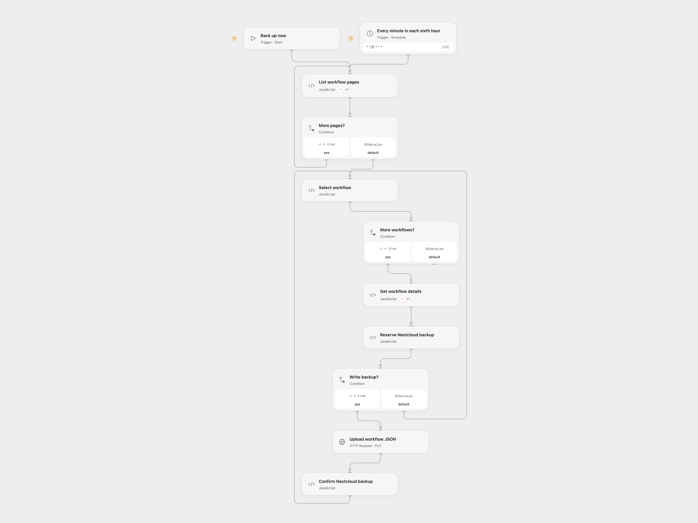

# Archive n8n Workflows to Nextcloud

Back up n8n workflows as JSON files in a Nextcloud folder.

<!-- template-actions:start -->
 
<!-- template-actions:end -->

<picture>
  <source media="(prefers-color-scheme: dark)" srcset="preview-dark.png">
  
</picture>

## Setup

Connect the n8n public API. Set the HTTPS WebDAV URL of an existing Nextcloud folder in **Reserve Nextcloud backup**. Bind secret Variables NEXTCLOUD_USERNAME and NEXTCLOUD_APP_PASSWORD to the upload's Basic Auth inputs; use an account with write access. Enable persistent State and prevent overlapping runs. In n8n connect its API and Nextcloud credentials, set the existing destination path in **NextCloud1**, and choose a Data Table with item_key and status text columns. Activate one format.

## Behavior

The manual trigger or schedule lists all workflows, retrieves each by ID and uploads its JSON. The source cron expression runs every minute during the 00, 06, 12 and 18 UTC hours, 240 times daily. Adjust the schedule to suit your needs. Each upload replaces the file at its path. Filenames include both workflow name and ID to prevent collisions between workflows with the same name; renamed workflows leave the previous filename in place. Workflow JSON can contain private configuration and credential references, so restrict folder and execution history access. Open Flow Code input/output and the accumulated workflow list must each fit 1 MiB.

If an upload result is unknown, inspect the Nextcloud file before retrying. In Open Flow enter the pending key and confirmed or absent in **Reserve Nextcloud backup**, rerun, then clear the fields. In n8n mark the pending Data Table row done only after confirming the file, or delete it only after confirming no upload occurred. Subsequent runs overwrite the file again.

Inspiration &amp; credits

Use the public n8n API, distinguish duplicate names by ID and checkpoint uploads.

Adapted from [Example - Backup n8n to Nextcloud](https://github.com/Zie619/n8n-workflows/blob/ae8cf6dc5b873cbb4f74587aa9180ed3a9f70682/workflows/Functionitem/1067_Functionitem_Manual_Export_Webhook.json) in [Zie619/n8n-workflows](https://github.com/Zie619/n8n-workflows). The source export does not identify a separate template author or license.

The collection’s [MIT notice](https://github.com/Zie619/n8n-workflows/blob/94007c1445d9258a7da116646b79473e7c7c3282/LICENSE) is pinned at a later revision. This is the collection notice at that revision; it does not establish a separate original template author's license. Our changes are listed above; see [repository licensing](../../README.md#licensing).

> MIT License
>
> Copyright (c) 2025 Zie619
>
> Permission is hereby granted, free of charge, to any person obtaining a copy
> of this software and associated documentation files (the "Software"), to deal
> in the Software without restriction, including without limitation the rights
> to use, copy, modify, merge, publish, distribute, sublicense, and/or sell
> copies of the Software, and to permit persons to whom the Software is
> furnished to do so, subject to the following conditions:
>
> The above copyright notice and this permission notice shall be included in all
> copies or substantial portions of the Software.
>
> THE SOFTWARE IS PROVIDED "AS IS", WITHOUT WARRANTY OF ANY KIND, EXPRESS OR
> IMPLIED, INCLUDING BUT NOT LIMITED TO THE WARRANTIES OF MERCHANTABILITY,
> FITNESS FOR A PARTICULAR PURPOSE AND NONINFRINGEMENT. IN NO EVENT SHALL THE
> AUTHORS OR COPYRIGHT HOLDERS BE LIABLE FOR ANY CLAIM, DAMAGES OR OTHER
> LIABILITY, WHETHER IN AN ACTION OF CONTRACT, TORT OR OTHERWISE, ARISING FROM,
> OUT OF OR IN CONNECTION WITH THE SOFTWARE OR THE USE OR OTHER DEALINGS IN THE
> SOFTWARE.

