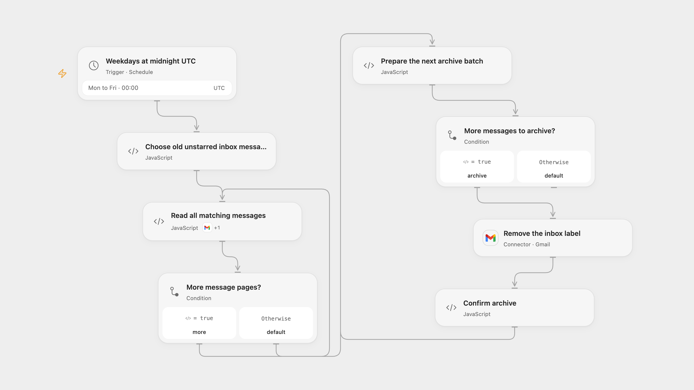

# Archive Old Unstarred Gmail

Archive older unstarred inbox messages on workdays while keeping starred messages in the inbox.

<picture>
  <source media="(prefers-color-scheme: dark)" srcset="preview-dark.png">
  
</picture>

[Open Flow JSON](templates/archive-old-unstarred-gmail.openflow.json) · [n8n JSON](templates/archive-old-unstarred-gmail.n8n.json)

## Setup

Connect Gmail with read and modify permission. Review the selected mailbox and stop concurrent mailbox changes while this workflow runs. Activate one format. The workflow removes the INBOX label; it does not delete messages.

## Behavior

At midnight UTC on weekdays, the workflow finds inbox messages received before 24 hours earlier and archives those without the STARRED label. Open Flow runs at the minute boundary; n8n uses a fixed second within the minute. Open Flow reads every search page before modifying messages and archives in batches of up to 1,000; n8n archives matching messages individually. Empty search results perform no writes.

A message starred or otherwise changed during a run may still be archived because Gmail does not provide an atomic condition on a label update. Prevent overlapping runs and review the mailbox before retrying a failed or uncertain update; earlier changes are not rolled back. Open Flow must fit the selected message IDs and page tokens within the host execution limits.

Inspiration &amp; credits

## Changes to the source

- The source checks the entire serialized thread for the text STARRED, so that text in a message body can also exclude a thread. It then archives the whole selected thread, including any newer messages. Both formats check message labels and archive only individual old unstarred messages, including in mixed threads.
- Both formats use UTC instead of inheriting the n8n instance timezone, retain full pagination before updates, and remove the source Gmail nodes’ automatic retries for reads and archive operations.

Adapted from [Keep starred emails in inbox, archive everything else](https://github.com/Zie619/n8n-workflows/blob/ae8cf6dc5b873cbb4f74587aa9180ed3a9f70682/workflows/Schedule/0443_Schedule_Filter_Automation_Scheduled.json) in [Zie619/n8n-workflows](https://github.com/Zie619/n8n-workflows). The source export does not identify a separate template author or license.

The collection’s [MIT notice](https://github.com/Zie619/n8n-workflows/blob/94007c1445d9258a7da116646b79473e7c7c3282/LICENSE) is pinned at a later revision. This is the collection notice at that revision; it does not establish a separate original template author's license. Our changes are listed above; see [repository licensing](../../README.md#licensing).

> MIT License
>
> Copyright (c) 2025 Zie619
>
> Permission is hereby granted, free of charge, to any person obtaining a copy
> of this software and associated documentation files (the "Software"), to deal
> in the Software without restriction, including without limitation the rights
> to use, copy, modify, merge, publish, distribute, sublicense, and/or sell
> copies of the Software, and to permit persons to whom the Software is
> furnished to do so, subject to the following conditions:
>
> The above copyright notice and this permission notice shall be included in all
> copies or substantial portions of the Software.
>
> THE SOFTWARE IS PROVIDED "AS IS", WITHOUT WARRANTY OF ANY KIND, EXPRESS OR
> IMPLIED, INCLUDING BUT NOT LIMITED TO THE WARRANTIES OF MERCHANTABILITY,
> FITNESS FOR A PARTICULAR PURPOSE AND NONINFRINGEMENT. IN NO EVENT SHALL THE
> AUTHORS OR COPYRIGHT HOLDERS BE LIABLE FOR ANY CLAIM, DAMAGES OR OTHER
> LIABILITY, WHETHER IN AN ACTION OF CONTRACT, TORT OR OTHERWISE, ARISING FROM,
> OUT OF OR IN CONNECTION WITH THE SOFTWARE OR THE USE OR OTHER DEALINGS IN THE
> SOFTWARE.

