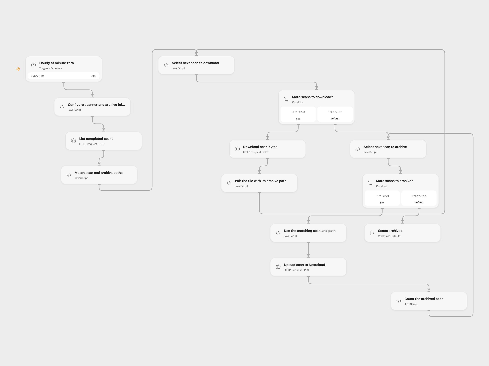

# Archive ScanServJS Scans in Nextcloud

Copy completed scans from ScanServJS to a Nextcloud folder every hour, keeping their original filenames.

<!-- template-actions:start -->
 
<!-- template-actions:end -->

<picture>
  <source media="(prefers-color-scheme: dark)" srcset="preview-dark.png">
  
</picture>

## Setup

1. Connect a scanner to ScanServJS and make its read API reachable from the workflow runtime. For a scanner on a private network, run the workflow in an environment with access to that network.
2. Create a destination folder in Nextcloud. In **Configure scanner and archive folder**, enter the ScanServJS base URL and the full WebDAV URL of the destination folder, such as `https://nextcloud.example.org/remote.php/dav/files/YOUR_USERNAME/Scans`.
3. In **Upload scan to Nextcloud**, bind `NEXTCLOUD_USER` and the secret Variable `NEXTCLOUD_APP_PASSWORD` to the Nextcloud username and app password. If the ScanServJS API requires authentication, configure it in both **List completed scans** and **Download scan bytes**.
4. Deploy the workflow. It runs at minute zero every hour (UTC).

## Behavior

Each run lists completed scans through the ScanServJS API, downloads each file and writes the bytes under the same filename in the Nextcloud folder. A file already at that path is overwritten. Scans stay on the scanner service.

The workflow downloads every listed file before uploading any of them. A download failure stops the run before any upload. An upload failure stops the remaining uploads. Files uploaded earlier in that run stay in Nextcloud. Each file must fit your Open Flow deployment's per-file Artifact limit, and the batch must fit its per-run Artifact limit.

In n8n

Set the ScanServJS base URL in **Configure ScanServJS**. If the scan API requires authentication, bind the same credential in **List completed scans** and **Download scan bytes**. Create the `Scans` folder in Nextcloud and connect **Upload scan to Nextcloud** using a Nextcloud API credential. Use the account's WebDAV root URL without a trailing slash, the username, and a Nextcloud app password. The schedule runs at minute zero in the workflow timezone.

Inspiration &amp; credits

## Changes to the source

- Make server and WebDAV configuration explicit, and encode each original filename when building its download and archive paths.
- Download each file as binary and preserve its path across both phases. Open Flow uses Run Artifacts for the binary transfer to Nextcloud WebDAV.
- [ScanServJS API specification](https://github.com/sbs20/scanservjs/blob/1fe80e03314f4dd52a2bb9aa3d8cd370c6e5b32d/app-server/src/swagger.yml) and [Nextcloud WebDAV documentation](https://docs.nextcloud.com/server/stable/developer_manual/client_apis/WebDAV/basic.html).

Adapted from [Scans von PDF zu Nextcloud](https://github.com/Zie619/n8n-workflows/blob/ae8cf6dc5b873cbb4f74587aa9180ed3a9f70682/workflows/Http/1419_HTTP_Schedule_Automation_Scheduled.json) in [Zie619/n8n-workflows](https://github.com/Zie619/n8n-workflows). Attribution: Zie619 / n8n-workflows.

The collection’s [MIT notice](https://github.com/Zie619/n8n-workflows/blob/94007c1445d9258a7da116646b79473e7c7c3282/LICENSE) is pinned at a later revision. This is the collection notice at that revision; it does not establish a separate original template author's license. Our changes are listed above; see [repository licensing](../../README.md#licensing).

> MIT License
>
> Copyright (c) 2025 Zie619
>
> Permission is hereby granted, free of charge, to any person obtaining a copy
> of this software and associated documentation files (the "Software"), to deal
> in the Software without restriction, including without limitation the rights
> to use, copy, modify, merge, publish, distribute, sublicense, and/or sell
> copies of the Software, and to permit persons to whom the Software is
> furnished to do so, subject to the following conditions:
>
> The above copyright notice and this permission notice shall be included in all
> copies or substantial portions of the Software.
>
> THE SOFTWARE IS PROVIDED "AS IS", WITHOUT WARRANTY OF ANY KIND, EXPRESS OR
> IMPLIED, INCLUDING BUT NOT LIMITED TO THE WARRANTIES OF MERCHANTABILITY,
> FITNESS FOR A PARTICULAR PURPOSE AND NONINFRINGEMENT. IN NO EVENT SHALL THE
> AUTHORS OR COPYRIGHT HOLDERS BE LIABLE FOR ANY CLAIM, DAMAGES OR OTHER
> LIABILITY, WHETHER IN AN ACTION OF CONTRACT, TORT OR OTHERWISE, ARISING FROM,
> OUT OF OR IN CONNECTION WITH THE SOFTWARE OR THE USE OR OTHER DEALINGS IN THE
> SOFTWARE.

