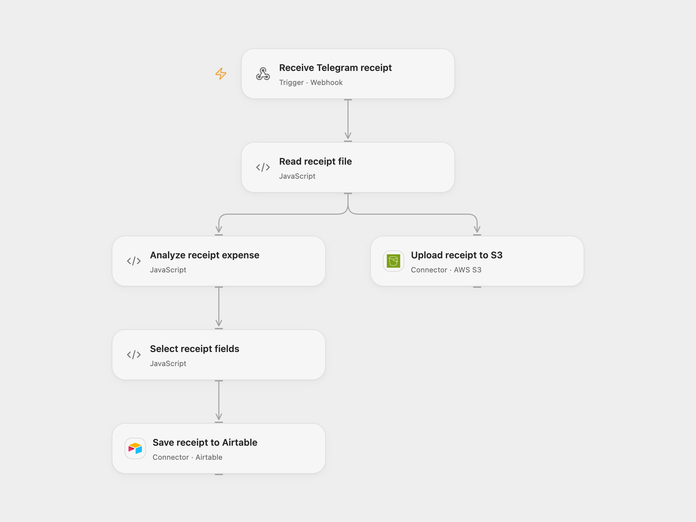

# Archive Telegram Receipts with Textract

Archive Telegram receipt images in S3 and save extracted expense fields in Airtable.

<picture>
  <source media="(prefers-color-scheme: dark)" srcset="preview-dark.png">
  
</picture>

[Open Flow JSON](templates/archive-telegram-receipts-with-textract.openflow.json) · [n8n JSON](templates/archive-telegram-receipts-with-textract.n8n.json)

## Setup

Connect AWS S3 and set the bucket and region in **Upload receipt to S3**. In **Analyze receipt expense**, configure the same AWS region, bind secret Variables for the IAM access key ID and secret access key, and optionally a session token. Update its allowed Textract hostname if changing region. Grant upload and Textract AnalyzeExpense permission. Connect Airtable and set the base ID and table in **Save receipt to Airtable**. Create text columns named for the Textract summary fields to save, such as `TOTAL` and `VENDOR_NAME`; list those exact names separated by commas in **Select receipt fields**.

Import the n8n workflow, connect the Telegram bot and activate it. Set **Choose delivery mode** to `relay` and configure the Open Flow webhook in **Forward receipt**. For n8n-only operation choose `direct`, connect AWS and Airtable, configure the bucket and table, and select the same field names in **Airtable**. Use one mode. The source leaves the Airtable field selection empty; configuring fields is necessary to save extracted values.

## Behavior

Send the bot a receipt image or document it can download. The original file is uploaded under its Telegram filename while Textract analyzes the same bytes; the configured matching summary fields are appended to Airtable. The branches run independently, so one can succeed when the other fails. Reusing a filename can overwrite the S3 object. The webhook acknowledges before the work finishes. Check both destinations before replaying an uncertain write. Receipts and execution data may contain sensitive information. The Open Flow webhook does not authenticate callers; restrict access to trusted callers. Runtime request and file size limits apply.

Inspiration &amp; credits

## Changes to the source

- Replace private destinations with configuration, require an explicit Airtable field selection, and provide an optional n8n receipt relay.

Adapted from [Telegram receipt expense extraction](https://github.com/Zie619/n8n-workflows/blob/ae8cf6dc5b873cbb4f74587aa9180ed3a9f70682/workflows/Awstextract/0148_Awstextract_Telegram_Automate_Triggered.json) in [Zie619/n8n-workflows](https://github.com/Zie619/n8n-workflows). The source export does not identify a separate template author or license.

The collection’s [MIT notice](https://github.com/Zie619/n8n-workflows/blob/94007c1445d9258a7da116646b79473e7c7c3282/LICENSE) is pinned at a later revision. This is the collection notice at that revision; it does not establish a separate original template author's license. Our changes are listed above; see [repository licensing](../../README.md#licensing).

> MIT License
>
> Copyright (c) 2025 Zie619
>
> Permission is hereby granted, free of charge, to any person obtaining a copy
> of this software and associated documentation files (the "Software"), to deal
> in the Software without restriction, including without limitation the rights
> to use, copy, modify, merge, publish, distribute, sublicense, and/or sell
> copies of the Software, and to permit persons to whom the Software is
> furnished to do so, subject to the following conditions:
>
> The above copyright notice and this permission notice shall be included in all
> copies or substantial portions of the Software.
>
> THE SOFTWARE IS PROVIDED "AS IS", WITHOUT WARRANTY OF ANY KIND, EXPRESS OR
> IMPLIED, INCLUDING BUT NOT LIMITED TO THE WARRANTIES OF MERCHANTABILITY,
> FITNESS FOR A PARTICULAR PURPOSE AND NONINFRINGEMENT. IN NO EVENT SHALL THE
> AUTHORS OR COPYRIGHT HOLDERS BE LIABLE FOR ANY CLAIM, DAMAGES OR OTHER
> LIABILITY, WHETHER IN AN ACTION OF CONTRACT, TORT OR OTHERWISE, ARISING FROM,
> OUT OF OR IN CONNECTION WITH THE SOFTWARE OR THE USE OR OTHER DEALINGS IN THE
> SOFTWARE.

