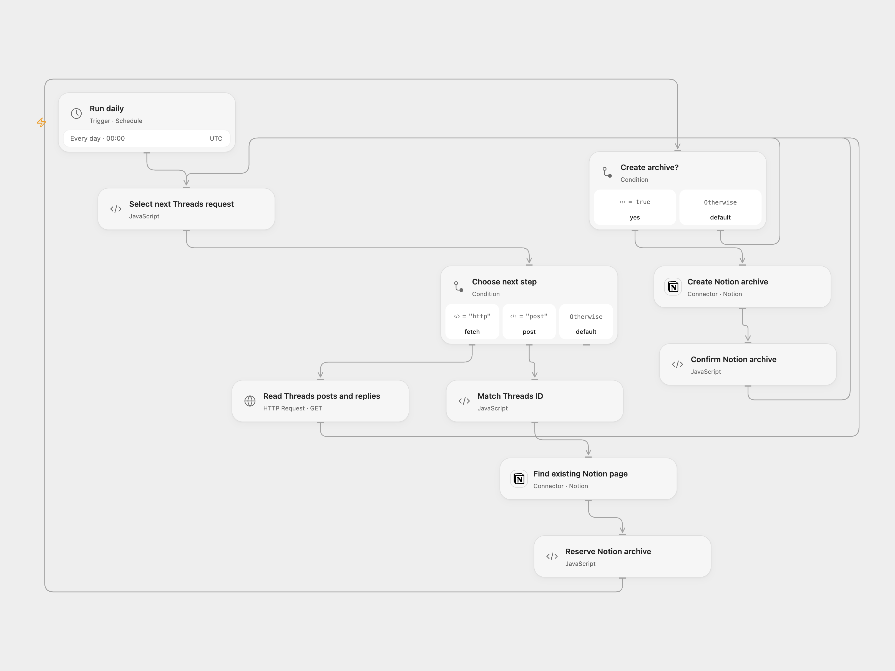

# Archive Threads Posts to Notion

Archive recent Threads posts and your replies as Notion pages.

<!-- template-actions:start -->
 
<!-- template-actions:end -->

<picture>
  <source media="(prefers-color-scheme: dark)" srcset="preview-dark.png">
  
</picture>

## Setup

Configure the Threads user ID and username in **Select next Threads request**. Bind a Threads long-lived user token with posts and replies read permissions as the secret variable THREADS_ACCESS_TOKEN; refresh and replace it before expiration. Connect Notion and set the same data source ID in **Find existing Notion page** and **Reserve Notion archive**. The data source requires Name (title), Threads ID and Username (rich text), Post Date (date), Source (multi-select) and Import Check (checkbox). Enable persistent State and avoid overlapping runs. Connect an HTTP Header Auth credential containing the Threads bearer token to the three Threads HTTP nodes; connect Notion to **Threads ID** and select the database. Set the data source ID in **Prepare Notion page**, and connect a Notion HTTP Header Auth credential to **Create Notion archive**.

## Behavior

Every day the workflow reads recent posts and their conversations, retaining replies from the configured username. It creates one Notion page with text and media embeds for each missing post. Results can contain private information and media URLs may expire. Posts over 100 blocks stop for manual handling.

Before creating a page, a pending marker is saved. If creation has an unknown result, inspect Notion, enter its pending key and confirmed or absent in **Reserve Notion archive**, then rerun and clear those fields. A confirmed page must be visible in Notion.

In n8n

In n8n set the Threads user ID in **Get Post**, **Threads / Comments** and their pagination expressions, and username in **Combine post and replies**. Select a Data Table with item_key and status text columns in all checkpoint nodes. In n8n inspect the pending Data Table row and Notion; mark it done if the page exists or delete it only if creation did not occur, then retry.

Inspiration &amp; credits

Use paginated reads, create post blocks in one request and stop on uncertain writes.

Adapted from [Get your Threads Post automatically](https://github.com/Zie619/n8n-workflows/blob/ae8cf6dc5b873cbb4f74587aa9180ed3a9f70682/workflows/Code/0706_Code_Schedule_Create_Scheduled.json) in [Zie619/n8n-workflows](https://github.com/Zie619/n8n-workflows). The source credits [Geekaz](https://www.threads.net/@geekaz) as creator; no separate original-template license was identified.

The collection’s [MIT notice](https://github.com/Zie619/n8n-workflows/blob/94007c1445d9258a7da116646b79473e7c7c3282/LICENSE) is pinned at a later revision. This is the collection notice at that revision; it does not establish a separate original template author's license. Our changes are listed above; see [repository licensing](../../README.md#licensing).

> MIT License
>
> Copyright (c) 2025 Zie619
>
> Permission is hereby granted, free of charge, to any person obtaining a copy
> of this software and associated documentation files (the "Software"), to deal
> in the Software without restriction, including without limitation the rights
> to use, copy, modify, merge, publish, distribute, sublicense, and/or sell
> copies of the Software, and to permit persons to whom the Software is
> furnished to do so, subject to the following conditions:
>
> The above copyright notice and this permission notice shall be included in all
> copies or substantial portions of the Software.
>
> THE SOFTWARE IS PROVIDED "AS IS", WITHOUT WARRANTY OF ANY KIND, EXPRESS OR
> IMPLIED, INCLUDING BUT NOT LIMITED TO THE WARRANTIES OF MERCHANTABILITY,
> FITNESS FOR A PARTICULAR PURPOSE AND NONINFRINGEMENT. IN NO EVENT SHALL THE
> AUTHORS OR COPYRIGHT HOLDERS BE LIABLE FOR ANY CLAIM, DAMAGES OR OTHER
> LIABILITY, WHETHER IN AN ACTION OF CONTRACT, TORT OR OTHERWISE, ARISING FROM,
> OUT OF OR IN CONNECTION WITH THE SOFTWARE OR THE USE OR OTHER DEALINGS IN THE
> SOFTWARE.

