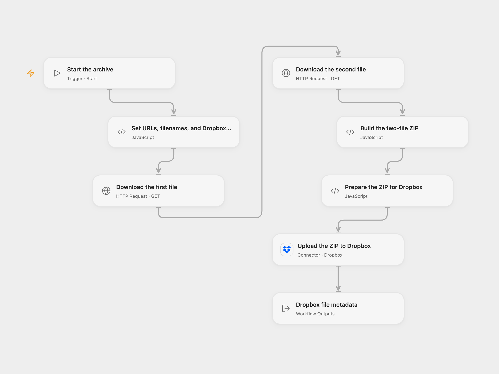

# Archive Two Cloud Files to Dropbox

Download two public files, put them in one ZIP with the names you choose, and save it to Dropbox.

<!-- template-actions:start -->
 
<!-- template-actions:end -->

<picture>
  <source media="(prefers-color-scheme: dark)" srcset="preview-dark.png">
  
</picture>

## Setup

1. In **Set URLs, filenames, and Dropbox path**, enter two direct HTTPS URLs and choose a filename for each ZIP member. Use distinct filenames without directory components. The sample downloads are [RFC 2606](https://www.rfc-editor.org/rfc/rfc2606.txt) and [RFC 5737](https://www.rfc-editor.org/rfc/rfc5737.txt).
2. Set the full Dropbox path for the archive. The default is `/images.zip`. An existing file at the chosen path will be overwritten, and the parent folder must already exist.
3. Select your Dropbox connection in **Upload the ZIP to Dropbox**, then run manually. Open **Dropbox file metadata** for the upload result.

## Behavior

The workflow downloads both files, preserves their bytes in one ZIP, and uploads that archive once. Each source file can be up to 1 MiB and must return HTTP 200 without a redirect. An incomplete or failed download stops the run before upload.

In n8n

Set both URLs, both ZIP member names, and the Dropbox path in **Set URLs, filenames, and Dropbox path**. Select your Dropbox OAuth2 credential in **Upload the ZIP to Dropbox**. Run manually and open that node's result to see the saved file. The same limits on source files apply.

Inspiration &amp; credits

## Changes to the source

- Make both file URLs, the ZIP member names, and the Dropbox destination configurable.
- Check that both complete downloads are available before creating and uploading the ZIP.
- Preserve the original workflow's overwrite behavior. [Original template by Harshil Agrawal](https://n8n.io/workflows/908-compress-binary-files-to-zip-format/).

Adapted from [Compress binary files to zip format](https://github.com/Zie619/n8n-workflows/blob/ae8cf6dc5b873cbb4f74587aa9180ed3a9f70682/workflows/Http/1187_HTTP_Dropbox_Automation_Webhook.json) in [Zie619/n8n-workflows](https://github.com/Zie619/n8n-workflows). Attribution: Harshil Agrawal (original workflow); Zie619 / n8n-workflows (collection).

The collection’s [MIT notice](https://github.com/Zie619/n8n-workflows/blob/94007c1445d9258a7da116646b79473e7c7c3282/LICENSE) is pinned at a later revision. This is the collection notice at that revision; it does not establish a separate original template author's license. Our changes are listed above; see [repository licensing](../../README.md#licensing).

> MIT License
>
> Copyright (c) 2025 Zie619
>
> Permission is hereby granted, free of charge, to any person obtaining a copy
> of this software and associated documentation files (the "Software"), to deal
> in the Software without restriction, including without limitation the rights
> to use, copy, modify, merge, publish, distribute, sublicense, and/or sell
> copies of the Software, and to permit persons to whom the Software is
> furnished to do so, subject to the following conditions:
>
> The above copyright notice and this permission notice shall be included in all
> copies or substantial portions of the Software.
>
> THE SOFTWARE IS PROVIDED "AS IS", WITHOUT WARRANTY OF ANY KIND, EXPRESS OR
> IMPLIED, INCLUDING BUT NOT LIMITED TO THE WARRANTIES OF MERCHANTABILITY,
> FITNESS FOR A PARTICULAR PURPOSE AND NONINFRINGEMENT. IN NO EVENT SHALL THE
> AUTHORS OR COPYRIGHT HOLDERS BE LIABLE FOR ANY CLAIM, DAMAGES OR OTHER
> LIABILITY, WHETHER IN AN ACTION OF CONTRACT, TORT OR OTHERWISE, ARISING FROM,
> OUT OF OR IN CONNECTION WITH THE SOFTWARE OR THE USE OR OTHER DEALINGS IN THE
> SOFTWARE.

