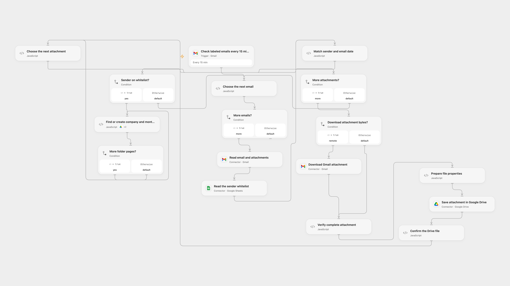

# Archive Whitelisted Email Attachments to Drive

Save labeled email attachments from whitelisted senders in company and month folders.

<picture>
  <source media="(prefers-color-scheme: dark)" srcset="preview-dark.png">
  
</picture>

[Open Flow JSON](templates/archive-whitelisted-email-attachments-to-drive.openflow.json) · [n8n JSON](templates/archive-whitelisted-email-attachments-to-drive.n8n.json)

## Setup

Create a Gmail label for the messages to process. Connect the same Gmail account to the trigger, read and download nodes and set the label ID in **Check labeled emails every 15 minutes**. Prepare a Google Sheet with unique **email** and **company** headers and one row per sender; connect Google Sheets in **Read the sender whitelist** and configure its spreadsheet ID and range. Connect the same Google Drive account in the folder and upload nodes, enable the folder node's Provider Actions and set its parent folder ID. Set the Connector transit hostname in **Verify complete attachment** and enable Gmail file transit.

In n8n, connect Gmail, Google Sheets and Google Drive select the same label, set the spreadsheet ID and range in the URL of **Read whitelist raw values**, connect its Google Sheets OAuth2 credential, and set the same parent folder in **Search Company Folder1** and **Create Company Folder**. Enable one format.

## Behavior

Every 15 minutes labeled emails are matched against the whitelist by sender address. Each attachment is saved under a company folder and a single month folder named YYYY/MM using the email Date header in UTC. Files have a timestamp prefix and retain sender and time_received Drive properties. Unmatched senders produce no files. Restrict access to mailbox content, transit URLs, Drive properties and execution history.

Both formats reject duplicate whitelist headers or sender entries. Open Flow handles up to 50 messages per poll, validates unique folder matches, and stops on ambiguous data. Folder searches are paginated. Its file transit and Code limits apply; large files can fail. A folder or file may already have been created when a write fails or its result is uncertain. Check Drive before retrying; previously uploaded files remain. There is no exactly-once guarantee.

Inspiration &amp; credits

## Changes to the source

- Replace private Gmail label, whitelist sheet and parent folder with configuration. Search company folders within the configured parent and validate duplicates rather than using an unrelated matching folder.
- Preserve each attachment's message association when splitting batches; Open Flow uses Gmail attachment transit for stored bytes.

Adapted from [Organize email attachments into Google Drive folders by company with Gmail & Sheets](https://github.com/Zie619/n8n-workflows/blob/ae8cf6dc5b873cbb4f74587aa9180ed3a9f70682/workflows/Googlesheets/0837_GoogleSheets_Gmail_Create_Triggered.json) in [Zie619/n8n-workflows](https://github.com/Zie619/n8n-workflows). The matching [n8n community listing](https://n8n.io/workflows/3464-organize-email-attachments-into-google-drive-folders-by-company-with-gmail-and-sheets/) credits Ventsislav Minev. The original template does not state a separate license.

The collection’s [MIT notice](https://github.com/Zie619/n8n-workflows/blob/94007c1445d9258a7da116646b79473e7c7c3282/LICENSE) is pinned at a later revision. This is the collection notice at that revision; it does not establish a separate original template author's license. Our changes are listed above; see [repository licensing](../../README.md#licensing).

> MIT License
>
> Copyright (c) 2025 Zie619
>
> Permission is hereby granted, free of charge, to any person obtaining a copy
> of this software and associated documentation files (the "Software"), to deal
> in the Software without restriction, including without limitation the rights
> to use, copy, modify, merge, publish, distribute, sublicense, and/or sell
> copies of the Software, and to permit persons to whom the Software is
> furnished to do so, subject to the following conditions:
>
> The above copyright notice and this permission notice shall be included in all
> copies or substantial portions of the Software.
>
> THE SOFTWARE IS PROVIDED "AS IS", WITHOUT WARRANTY OF ANY KIND, EXPRESS OR
> IMPLIED, INCLUDING BUT NOT LIMITED TO THE WARRANTIES OF MERCHANTABILITY,
> FITNESS FOR A PARTICULAR PURPOSE AND NONINFRINGEMENT. IN NO EVENT SHALL THE
> AUTHORS OR COPYRIGHT HOLDERS BE LIABLE FOR ANY CLAIM, DAMAGES OR OTHER
> LIABILITY, WHETHER IN AN ACTION OF CONTRACT, TORT OR OTHERWISE, ARISING FROM,
> OUT OF OR IN CONNECTION WITH THE SOFTWARE OR THE USE OR OTHER DEALINGS IN THE
> SOFTWARE.

