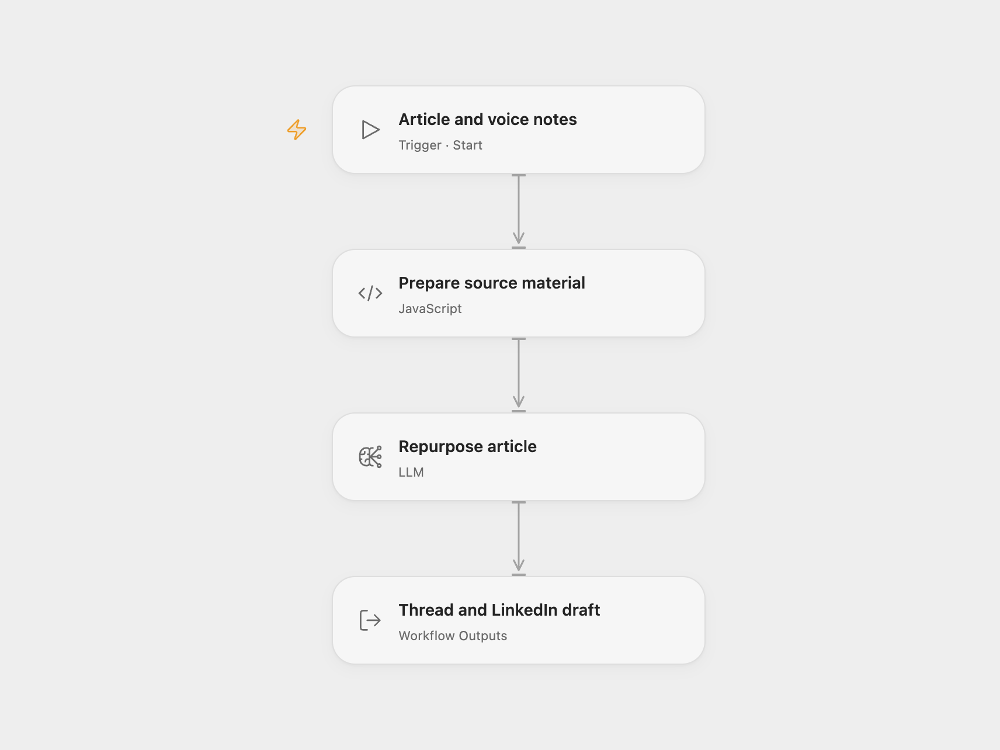

# Article to Social Posts

Repurpose an article or transcript into an X thread and LinkedIn post. The prompt requires claims to come from your source and asks for a human-review response when the material is too short or unreadable.

<picture>
  <source media="(prefers-color-scheme: dark)" srcset="preview-dark.png">
  
</picture>

[Open Flow JSON](templates/article-to-social-posts.openflow.json) · [n8n JSON](templates/article-to-social-posts.n8n.json)

## Use

For Open Flow, import the JSON, select a configured `gpt-4o-mini` model in **Repurpose article**, and use Run. Supply the article as `source` and optional guidance as `voice_notes`. The output is `posts`.

For n8n, connect OpenAI in **Chat Model**, open **Article Form**, and submit the article and optional voice notes. **Show Posts** displays the result. Open Flow uses manual run inputs and outputs in place of the n8n hosted form.

The workflow normalizes whitespace and sends the first 9,000 characters to the model. It requests `===TWITTER THREAD===` and `===LINKEDIN POST===` sections, with 6–9 tweets and a 120–220-word LinkedIn post. For insufficient material, the requested output begins `[NEEDS-HUMAN]` with a reason. These are model instructions; review grounding, length, and wording before publishing. Nothing is posted automatically.

## Changes to the source

- Fix whitespace normalization so it collapses actual whitespace rather than matching a literal backslash.
- Validate that the submitted source contains text before calling the model.
- Replace the source tool-less Agent with a Basic LLM Chain in n8n, keeping its system and user instructions. The single generation request does not need tools or conversation memory.

## Source and license

Adapted from [Grounded Article to Thread and LinkedIn Post](https://github.com/enescingoz/awesome-n8n-templates/blob/827110332c21cbe000ab13f6d292d5adb1f1f8db/Instagram_Twitter_Social_Media/Grounded%20Article%20to%20Thread%20and%20LinkedIn%20Post.json) in [enescingoz/awesome-n8n-templates](https://github.com/enescingoz/awesome-n8n-templates).

Source collection notice: © 2024–2026 Enes Cingoz, [CC BY 4.0](https://github.com/enescingoz/awesome-n8n-templates/blob/827110332c21cbe000ab13f6d292d5adb1f1f8db/LICENSE). The source export does not identify a separate template author or license. See [repository licensing](../../README.md#licensing) for the scope of OOMOL contributions and third-party material.
