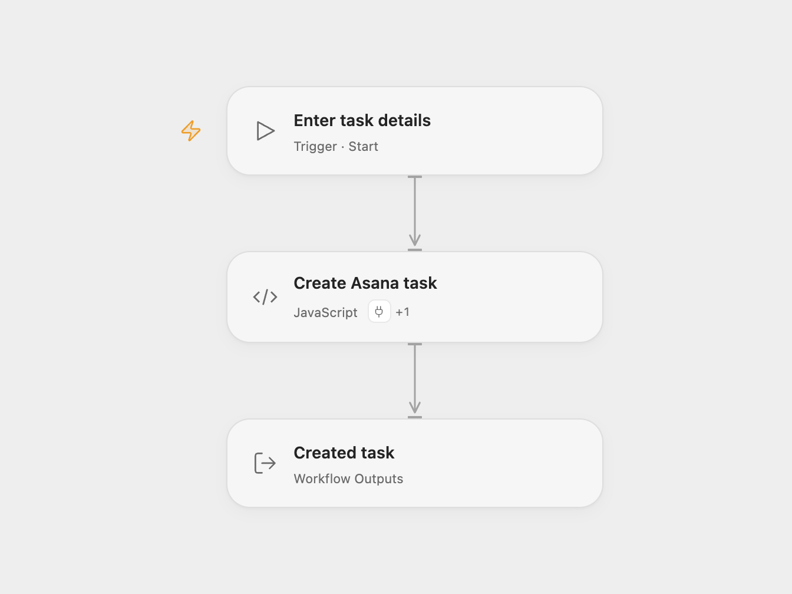

# Asana Task Creator

Create one Asana task with a name in an existing workspace.

<picture>
  <source media="(prefers-color-scheme: dark)" srcset="preview-dark.png">
  
</picture>

[Open Flow JSON](templates/asana-task-creator.openflow.json) · [n8n JSON](templates/asana-task-creator.n8n.json)

## Setup

Select your Asana account through **Actions** in **Create Asana task**. Run with the task **Name** and **Workspace ID**. The account needs permission to create tasks in that workspace. In n8n, select Asana credentials, set the name and choose the workspace in **Asana**.

Each run makes one task creation request with only the name and workspace. It does not assign the task, add it to a project, set dates or change other task properties. Asana applies its defaults. Open Flow returns the task fields supplied by the Action; n8n returns the task from the API response.

There is no lookup, duplicate detection, update or automatic retry. A failed request stops the run. If a write times out, check Asana before running it again. Repeating a successful run can create another task.

## Changes to the source

- Require the name and workspace as Open Flow run inputs.
- Send the source’s two fields through the Asana create-task Action and expose its result.

## Source and license

Adapted from [Create a new task in Asana](https://github.com/Zie619/n8n-workflows/blob/ae8cf6dc5b873cbb4f74587aa9180ed3a9f70682/workflows/Manual/1225_Manual_Asana_Create_Triggered.json) in [Zie619/n8n-workflows](https://github.com/Zie619/n8n-workflows). The source export does not identify a separate template author or license.

The collection’s [MIT notice](https://github.com/Zie619/n8n-workflows/blob/94007c1445d9258a7da116646b79473e7c7c3282/LICENSE) is pinned at a later revision. This is the collection notice at that revision; it does not establish a separate original template author's license. Our changes are listed above; see [repository licensing](../../README.md#licensing).

> MIT License
>
> Copyright (c) 2025 Zie619
>
> Permission is hereby granted, free of charge, to any person obtaining a copy
> of this software and associated documentation files (the "Software"), to deal
> in the Software without restriction, including without limitation the rights
> to use, copy, modify, merge, publish, distribute, sublicense, and/or sell
> copies of the Software, and to permit persons to whom the Software is
> furnished to do so, subject to the following conditions:
>
> The above copyright notice and this permission notice shall be included in all
> copies or substantial portions of the Software.
>
> THE SOFTWARE IS PROVIDED "AS IS", WITHOUT WARRANTY OF ANY KIND, EXPRESS OR
> IMPLIED, INCLUDING BUT NOT LIMITED TO THE WARRANTIES OF MERCHANTABILITY,
> FITNESS FOR A PARTICULAR PURPOSE AND NONINFRINGEMENT. IN NO EVENT SHALL THE
> AUTHORS OR COPYRIGHT HOLDERS BE LIABLE FOR ANY CLAIM, DAMAGES OR OTHER
> LIABILITY, WHETHER IN AN ACTION OF CONTRACT, TORT OR OTHERWISE, ARISING FROM,
> OUT OF OR IN CONNECTION WITH THE SOFTWARE OR THE USE OR OTHER DEALINGS IN THE
> SOFTWARE.
