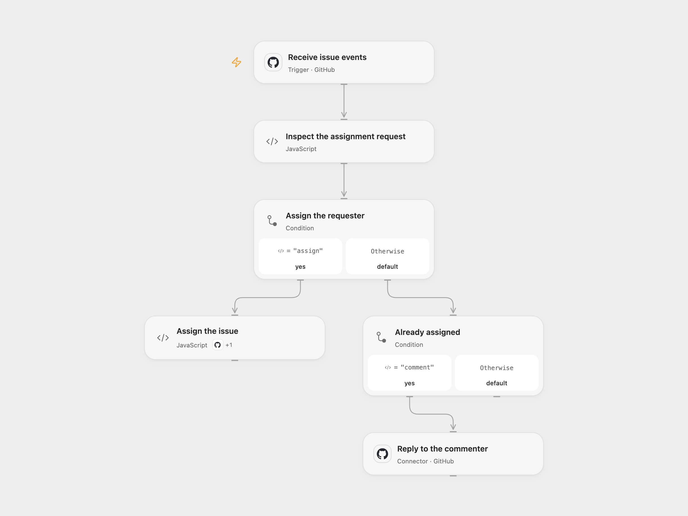

# Assign GitHub Issues on Request

Assign an unassigned GitHub issue to its author or commenter when they request it.

<picture>
  <source media="(prefers-color-scheme: dark)" srcset="preview-dark.png">
  
</picture>

[Open Flow JSON](templates/assign-github-issues-on-request.openflow.json) · [n8n JSON](templates/assign-github-issues-on-request.n8n.json)

## Setup

Connect GitHub in **Receive issue events**, set the repository owner and name, and keep both subscribed events. Connect the GitHub Action in **Assign the issue** and connect GitHub in **Reply to the commenter** using an account allowed to edit issues and create comments. The repository needs an existing label named `assigned`. In n8n configure the same repository and GitHub credentials on the trigger and action nodes. Enable one format only.

## Behavior

On an opened issue or newly created issue comment, the workflow looks for the source pattern matching “assign … me”. If the event says the issue has no assignees, it assigns the author or commenter and sets the labels to only `assigned`, replacing existing labels. If a comment requests an already assigned issue, it replies naming its current assignee. An opened issue that is already assigned, or a message without the pattern, causes no write. GitHub also delivers issue comments on pull requests to this event.

The decision uses the webhook's issue snapshot, not a fresh lookup or an atomic claim. Concurrent requests or later changes can overwrite an assignment or labels. Duplicate deliveries can cause repeated writes or comments; check the issue before retrying after an uncertain result. GitHub may reject assignment when the account lacks access or the requester cannot be assigned.

Inspiration &amp; credits

## Changes to the source

- Remove the original repository and credential identifiers and validate event fields before writing.
- Preserve the source's assignment pattern, label replacement and comment text while using the current event body.

Adapted from [Automate assigning GitHub issues](https://github.com/Zie619/n8n-workflows/blob/ae8cf6dc5b873cbb4f74587aa9180ed3a9f70682/workflows/Noop/0096_Noop_GitHub_Automate_Triggered.json) in [Zie619/n8n-workflows](https://github.com/Zie619/n8n-workflows). The matching [n8n community listing](https://n8n.io/workflows/1442-automate-assigning-github-issues/) credits manohar. The original template does not state a separate license.

The collection’s [MIT notice](https://github.com/Zie619/n8n-workflows/blob/94007c1445d9258a7da116646b79473e7c7c3282/LICENSE) is pinned at a later revision. This is the collection notice at that revision; it does not establish a separate original template author's license. Our changes are listed above; see [repository licensing](../../README.md#licensing).

> MIT License
>
> Copyright (c) 2025 Zie619
>
> Permission is hereby granted, free of charge, to any person obtaining a copy
> of this software and associated documentation files (the "Software"), to deal
> in the Software without restriction, including without limitation the rights
> to use, copy, modify, merge, publish, distribute, sublicense, and/or sell
> copies of the Software, and to permit persons to whom the Software is
> furnished to do so, subject to the following conditions:
>
> The above copyright notice and this permission notice shall be included in all
> copies or substantial portions of the Software.
>
> THE SOFTWARE IS PROVIDED "AS IS", WITHOUT WARRANTY OF ANY KIND, EXPRESS OR
> IMPLIED, INCLUDING BUT NOT LIMITED TO THE WARRANTIES OF MERCHANTABILITY,
> FITNESS FOR A PARTICULAR PURPOSE AND NONINFRINGEMENT. IN NO EVENT SHALL THE
> AUTHORS OR COPYRIGHT HOLDERS BE LIABLE FOR ANY CLAIM, DAMAGES OR OTHER
> LIABILITY, WHETHER IN AN ACTION OF CONTRACT, TORT OR OTHERWISE, ARISING FROM,
> OUT OF OR IN CONNECTION WITH THE SOFTWARE OR THE USE OR OTHER DEALINGS IN THE
> SOFTWARE.

