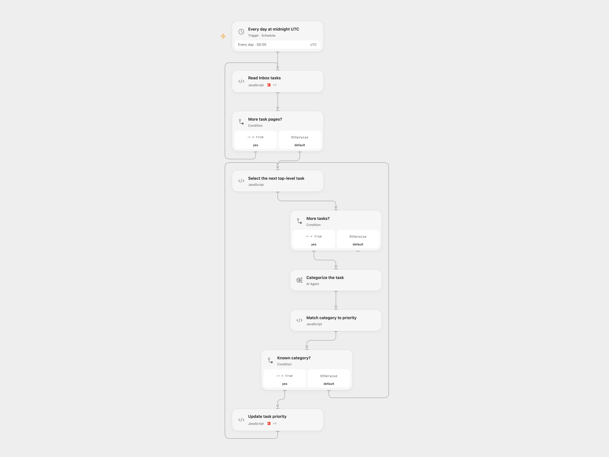

# Assign Inbox Task Priorities with AI

Classify top-level Inbox tasks and set their Todoist priorities from a configurable category map.

<picture>
  <source media="(prefers-color-scheme: dark)" srcset="preview-dark.png">
  
</picture>

[Open Flow JSON](templates/assign-inbox-task-priorities-with-ai.openflow.json) · [n8n JSON](templates/assign-inbox-task-priorities-with-ai.n8n.json)

## Setup

Connect Todoist and configure the Inbox project ID in **Read Inbox tasks**. Configure the category-to-priority object in **Select the next top-level task**. Values are Todoist API priorities from 1 through 4, where 4 is most urgent. Select an AI model. In n8n connect Todoist and OpenAI, select the Inbox project and configure the category map. Enable one format.

## Behavior

Every day at 00:00 UTC, the workflow reads all Inbox task pages, skips subtasks, classifies each top-level task and updates the task priority only for a known category. The example categories are apartment, health and german. An unknown category or other causes no update. Review model-driven changes before relying on them.

Open Flow starts at the minute boundary; n8n uses a fixed second within that minute. Task content is sent to the configured model. A failed or uncertain update stops the run. Each daily run reads the Inbox again and may update the same task, so inspect Todoist before the next run or manual retry. Open Flow uses the formal Todoist Actions through Code for page and per-task coordination. n8n uses its Todoist nodes. Large projects must fit platform execution limits.

Inspiration &amp; credits

## Changes to the source

- Correct the category-map key lookup, use the same category map in both classification and priority matching, and make the Inbox ID configurable.
- Use Todoist node version 2.2 for current paginated API responses. Use UTC instead of the source instance timezone and remove the source automatic Todoist retries to avoid repeating an uncertain write.

Adapted from [Categorize Todoist tasks by priority](https://github.com/Zie619/n8n-workflows/blob/ae8cf6dc5b873cbb4f74587aa9180ed3a9f70682/workflows/Schedule/0563_Schedule_Filter_Update_Scheduled.json) in [Zie619/n8n-workflows](https://github.com/Zie619/n8n-workflows). The source export does not identify a separate template author or license.

The collection’s [MIT notice](https://github.com/Zie619/n8n-workflows/blob/94007c1445d9258a7da116646b79473e7c7c3282/LICENSE) is pinned at a later revision. This is the collection notice at that revision; it does not establish a separate original template author's license. Our changes are listed above; see [repository licensing](../../README.md#licensing).

> MIT License
>
> Copyright (c) 2025 Zie619
>
> Permission is hereby granted, free of charge, to any person obtaining a copy
> of this software and associated documentation files (the "Software"), to deal
> in the Software without restriction, including without limitation the rights
> to use, copy, modify, merge, publish, distribute, sublicense, and/or sell
> copies of the Software, and to permit persons to whom the Software is
> furnished to do so, subject to the following conditions:
>
> The above copyright notice and this permission notice shall be included in all
> copies or substantial portions of the Software.
>
> THE SOFTWARE IS PROVIDED "AS IS", WITHOUT WARRANTY OF ANY KIND, EXPRESS OR
> IMPLIED, INCLUDING BUT NOT LIMITED TO THE WARRANTIES OF MERCHANTABILITY,
> FITNESS FOR A PARTICULAR PURPOSE AND NONINFRINGEMENT. IN NO EVENT SHALL THE
> AUTHORS OR COPYRIGHT HOLDERS BE LIABLE FOR ANY CLAIM, DAMAGES OR OTHER
> LIABILITY, WHETHER IN AN ACTION OF CONTRACT, TORT OR OTHERWISE, ARISING FROM,
> OUT OF OR IN CONNECTION WITH THE SOFTWARE OR THE USE OR OTHER DEALINGS IN THE
> SOFTWARE.

