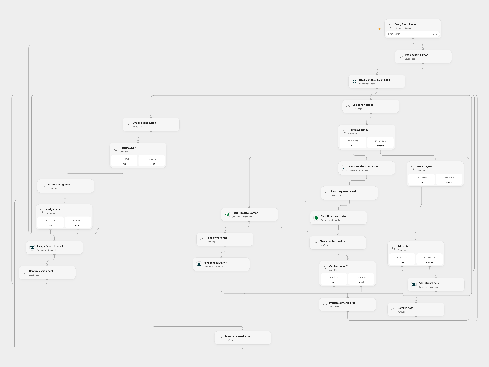

# Assign Zendesk Tickets to Pipedrive Owners

Assign new Zendesk tickets to the requester’s Pipedrive owner when that owner is a Zendesk agent.

<!-- template-actions:start -->
 
<!-- template-actions:end -->

<picture>
  <source media="(prefers-color-scheme: dark)" srcset="preview-dark.png">
  
</picture>

## Setup

Connect Zendesk and Pipedrive with ticket, user and person read access and Zendesk ticket update access. Enable persistent State and prevent overlapping runs. In n8n configure the Zendesk subdomain, Pipedrive domain and initial Unix timestamp in **Configure export**. The timestamp must be at least one minute old. Use HTTP Header Auth credentials for the respective services and select a Data Table with item_key and status text columns. Activate one format.

## Behavior

Every five minutes, read Zendesk incremental ticket pages. For each ticket created since the initial timestamp, read its requester, find an exact Pipedrive email match, read that contact's owner and find an active Zendesk agent or admin with the owner's email. Assign the ticket to the matched agent. If the contact or agent is missing, add a private note. Missing requester or owner email, ambiguous matches and unprocessed search pages stop for review. The first Open Flow activation sets the initial time to then; Zendesk holds back the latest minute. n8n processes one export page per scheduled run. The initial timestamp remains fixed across retries. Open Flow Code input and output values must each fit 1 MiB.

The cursor advances after every eligible ticket on its page has been confirmed. If an update result is unknown, inspect the ticket before retrying. In Open Flow enter the pending key and confirmed or absent in **Reserve assignment** or **Reserve internal note**, rerun, then clear those fields. In n8n mark the pending Data Table row done only if the update is confirmed, or delete it only if no update occurred. Retain State and completed rows to prevent duplicate updates and notes.

Inspiration &amp; credits

Connect the missing agent lookup and missing-match paths; add cursor and per-ticket checkpoints.

Adapted from [Assign Zendesk tickets to Pipedrive owners](https://github.com/Zie619/n8n-workflows/blob/ae8cf6dc5b873cbb4f74587aa9180ed3a9f70682/workflows/Functionitem/0266_Functionitem_Zendesk_Create_Webhook.json) in [Zie619/n8n-workflows](https://github.com/Zie619/n8n-workflows). The source export does not identify a separate template author or license.

The collection’s [MIT notice](https://github.com/Zie619/n8n-workflows/blob/94007c1445d9258a7da116646b79473e7c7c3282/LICENSE) is pinned at a later revision. This is the collection notice at that revision; it does not establish a separate original template author's license. Our changes are listed above; see [repository licensing](../../README.md#licensing).

> MIT License
>
> Copyright (c) 2025 Zie619
>
> Permission is hereby granted, free of charge, to any person obtaining a copy
> of this software and associated documentation files (the "Software"), to deal
> in the Software without restriction, including without limitation the rights
> to use, copy, modify, merge, publish, distribute, sublicense, and/or sell
> copies of the Software, and to permit persons to whom the Software is
> furnished to do so, subject to the following conditions:
>
> The above copyright notice and this permission notice shall be included in all
> copies or substantial portions of the Software.
>
> THE SOFTWARE IS PROVIDED "AS IS", WITHOUT WARRANTY OF ANY KIND, EXPRESS OR
> IMPLIED, INCLUDING BUT NOT LIMITED TO THE WARRANTIES OF MERCHANTABILITY,
> FITNESS FOR A PARTICULAR PURPOSE AND NONINFRINGEMENT. IN NO EVENT SHALL THE
> AUTHORS OR COPYRIGHT HOLDERS BE LIABLE FOR ANY CLAIM, DAMAGES OR OTHER
> LIABILITY, WHETHER IN AN ACTION OF CONTRACT, TORT OR OTHERWISE, ARISING FROM,
> OUT OF OR IN CONNECTION WITH THE SOFTWARE OR THE USE OR OTHER DEALINGS IN THE
> SOFTWARE.

