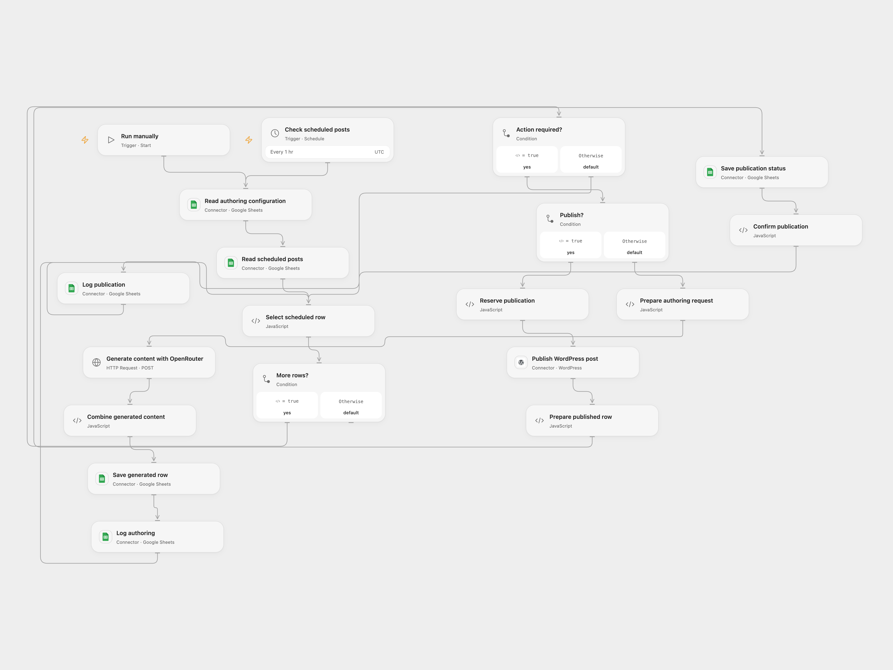

# Author and Publish Scheduled Blog Posts

Generate blog content from scheduled spreadsheet rows and publish due posts to WordPress.

<!-- template-actions:start -->
 
<!-- template-actions:end -->

<picture>
  <source media="(prefers-color-scheme: dark)" srcset="preview-dark.png">
  
</picture>

## Setup

Connect Google Sheets and WordPress, configure the spreadsheet IDs and bind OPENROUTER_API_KEY to the OpenRouter request. Use a Config sheet with Key and Value columns and a Schedule sheet with headers including Action, Status, Scheduled, Title and final. Supply prompt_ACTION and prompt_ACTION_model entries for each authoring stage. Scheduled timestamps use UTC in yyyy-MM-dd HH:mm:ss format. Create a Log sheet with Date, Type and Message headers. Enable persistent State and prevent overlapping runs.

## Behavior

Run manually or every hour; each changed Action is processed. Authoring actions substitute row and configuration values into their prompt and update that row. A publish action creates a published WordPress post once the scheduled time has arrived and marks the row published. Each post is marked pending before the create request. If the response or later row update is uncertain, runs stop before another publication. Inspect WordPress and the row. If already published, set its Status to publish; then enter its row number and retry as the resolution in Select scheduled row, run once and clear both fields. If absent, use the same resolution to retry.

In n8n

In n8n configure Google Sheets, OpenRouter and WordPress credentials and choose a Data Table with rowNumber and status columns in the pending checkpoints. Activate only one format. In n8n inspect WordPress, update the Schedule row if needed and mark its Data Table pending record resolved.

Inspiration &amp; credits

## Changes to the source

- Use WordPress connections instead of embedding application passwords in XML, add a persistent publication checkpoint, and use UTC for scheduled rows.

Adapted from [Author and Publish Blog Posts From Google Sheets](https://github.com/enescingoz/awesome-n8n-templates/blob/827110332c21cbe000ab13f6d292d5adb1f1f8db/Google_Drive_and_Google_Sheets/Author%20and%20Publish%20Blog%20Posts%20From%20Google%20Sheets.json) in [enescingoz/awesome-n8n-templates](https://github.com/enescingoz/awesome-n8n-templates).

Source collection notice: © 2024–2026 Enes Cingoz, [CC BY 4.0](https://github.com/enescingoz/awesome-n8n-templates/blob/827110332c21cbe000ab13f6d292d5adb1f1f8db/LICENSE). The source export does not identify a separate template author or license. See [repository licensing](../../README.md#licensing) for the scope of OOMOL contributions and third-party material.

