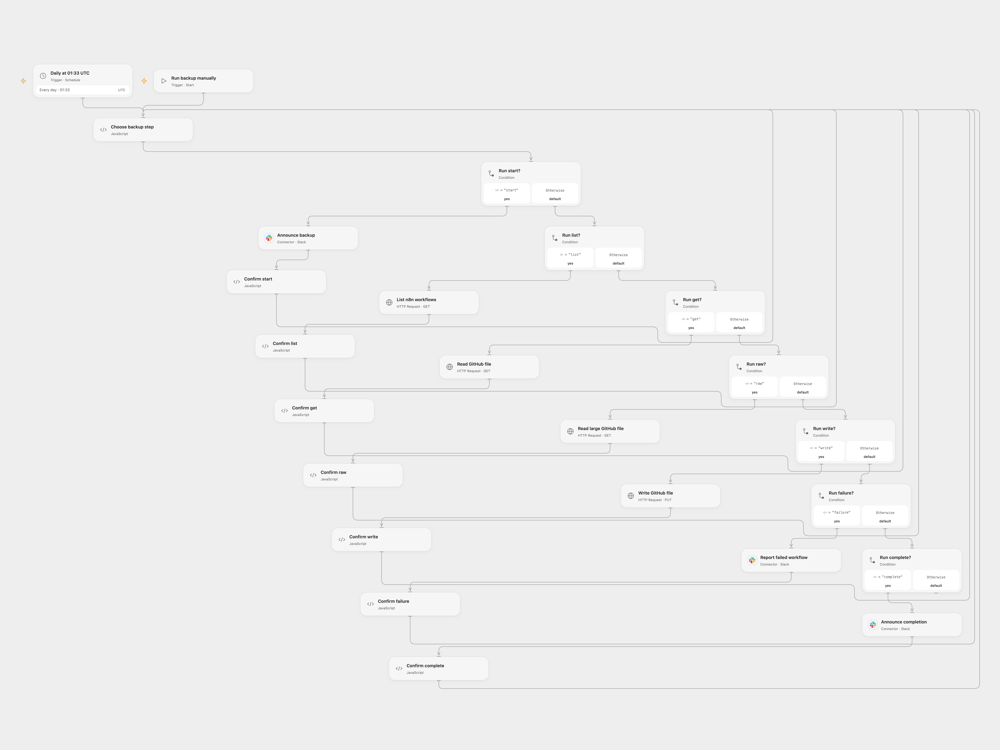

# Back Up n8n Workflows to GitHub

Back up n8n workflows into a GitHub repository and send progress notifications to Slack.

<picture>
  <source media="(prefers-color-scheme: dark)" srcset="preview-dark.png">
  
</picture>

[Open Flow JSON](templates/back-up-n8n-workflows-by-creation-date.openflow.json) · [n8n JSON](templates/back-up-n8n-workflows-by-creation-date.n8n.json)

## Setup

Store the n8n API key and GitHub token as Secret Variables `N8N_API_KEY` and `GITHUB_TOKEN`. In **Choose backup step**, enter the HTTPS n8n URL, GitHub owner and repository, folder path, and Slack channel ID. Connect Slack, enable persistent State, and prevent overlapping runs. Use a private repository if workflow definitions contain sensitive configuration.

In n8n, set the `repo_owner`, `repo_name`, and `repo_path` variables (end the path with /), connect n8n, GitHub and Slack, and choose the notification channel. Use one format.

## Behavior

Run manually or daily at 01:33 UTC. Each workflow is stored under `YYYY/MM/ID.json` using its creation date. Existing JSON is compared by top-level keys; changed files are updated and missing files created. Slack receives start, completion, and individual failure notices. Open Flow requests large files as raw content.

If a GitHub or Slack write has an unknown result, inspect the service and enter the pending key in **Choose backup step** only after resolving it; acknowledgement treats that write as completed.

Inspiration &amp; credits

## Changes to the source

- Use explicit UTC and user-provided repository and channel configuration.
- Open Flow paginates workflow reads, preserves unfinished pages, and pauses on uncertain writes.
- Correct n8n repository expressions, distinguish missing files from read failures, and read large files as text for comparison.

Adapted from [Backup n8n workflows to GitHub](https://github.com/Zie619/n8n-workflows/blob/ae8cf6dc5b873cbb4f74587aa9180ed3a9f70682/workflows/Code/0182_Code_GitHub_Create_Scheduled.json) in [Zie619/n8n-workflows](https://github.com/Zie619/n8n-workflows). The source export does not identify a separate template author or license.

The collection’s [MIT notice](https://github.com/Zie619/n8n-workflows/blob/94007c1445d9258a7da116646b79473e7c7c3282/LICENSE) is pinned at a later revision. This is the collection notice at that revision; it does not establish a separate original template author's license. Our changes are listed above; see [repository licensing](../../README.md#licensing).

> MIT License
>
> Copyright (c) 2025 Zie619
>
> Permission is hereby granted, free of charge, to any person obtaining a copy
> of this software and associated documentation files (the "Software"), to deal
> in the Software without restriction, including without limitation the rights
> to use, copy, modify, merge, publish, distribute, sublicense, and/or sell
> copies of the Software, and to permit persons to whom the Software is
> furnished to do so, subject to the following conditions:
>
> The above copyright notice and this permission notice shall be included in all
> copies or substantial portions of the Software.
>
> THE SOFTWARE IS PROVIDED "AS IS", WITHOUT WARRANTY OF ANY KIND, EXPRESS OR
> IMPLIED, INCLUDING BUT NOT LIMITED TO THE WARRANTIES OF MERCHANTABILITY,
> FITNESS FOR A PARTICULAR PURPOSE AND NONINFRINGEMENT. IN NO EVENT SHALL THE
> AUTHORS OR COPYRIGHT HOLDERS BE LIABLE FOR ANY CLAIM, DAMAGES OR OTHER
> LIABILITY, WHETHER IN AN ACTION OF CONTRACT, TORT OR OTHERWISE, ARISING FROM,
> OUT OF OR IN CONNECTION WITH THE SOFTWARE OR THE USE OR OTHER DEALINGS IN THE
> SOFTWARE.

