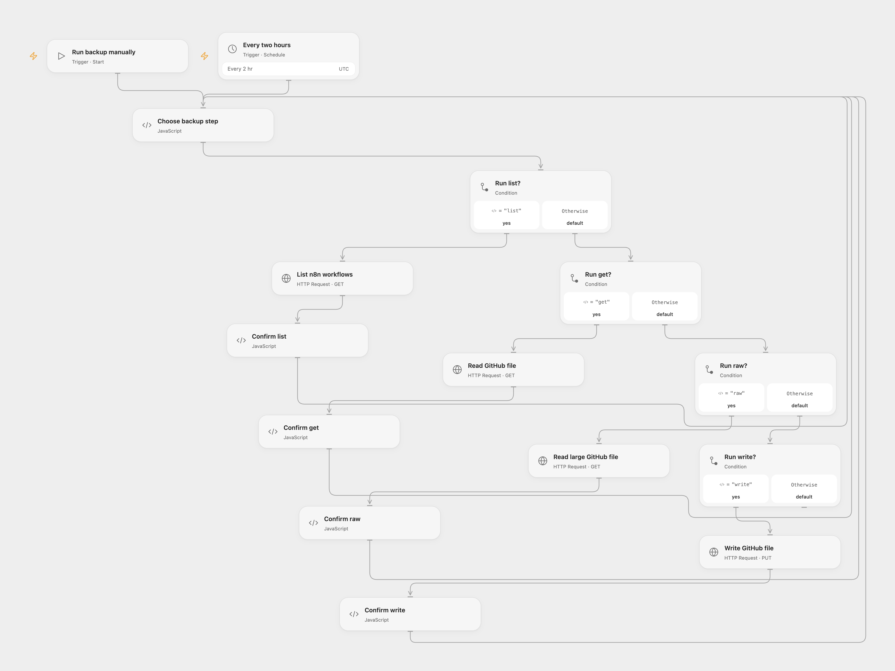

# Back Up n8n Workflows by ID to GitHub

Back up n8n workflows to GitHub by workflow ID, updating files only when their contents change.

<!-- template-actions:start -->
 
<!-- template-actions:end -->

<picture>
  <source media="(prefers-color-scheme: dark)" srcset="preview-dark.png">
  
</picture>

## Setup

Configure the n8n HTTPS URL, GitHub owner, repository and folder in **Choose backup step**; bind Secret Variables `N8N_API_KEY` and `GITHUB_TOKEN` and enable persistent State. In n8n configure the repository in **Globals**, connect n8n and GitHub, and select a Data Table with text columns `item_key` and `status` on the checkpoint nodes. Enable one format and prevent overlapping runs. Protect the repository and execution history since workflow definitions can contain sensitive configuration.

## Behavior

Run manually or every two hours (UTC). Workflows are saved as `<folder>/<ID>.json`. Existing content is compared with top-level keys ordered; unchanged files are skipped, missing files created, and changed files updated. Large GitHub files are read as raw text.

When a GitHub write has an unknown result, inspect the repository before acknowledging the pending key in Open Flow or resolving the pending Data Table row in n8n. Do not retry until the actual outcome is known.

Inspiration &amp; credits

## Changes to the source

- Use UTC, paginate workflow listing, distinguish failed reads from missing files, and checkpoint writes.

Adapted from [Back up n8n workflows to GitHub](https://github.com/Zie619/n8n-workflows/blob/ae8cf6dc5b873cbb4f74587aa9180ed3a9f70682/workflows/Code/0667_Code_GitHub_Create_Scheduled.json) in [Zie619/n8n-workflows](https://github.com/Zie619/n8n-workflows). The source export does not identify a separate template author or license.

The collection’s [MIT notice](https://github.com/Zie619/n8n-workflows/blob/94007c1445d9258a7da116646b79473e7c7c3282/LICENSE) is pinned at a later revision. This is the collection notice at that revision; it does not establish a separate original template author's license. Our changes are listed above; see [repository licensing](../../README.md#licensing).

> MIT License
>
> Copyright (c) 2025 Zie619
>
> Permission is hereby granted, free of charge, to any person obtaining a copy
> of this software and associated documentation files (the "Software"), to deal
> in the Software without restriction, including without limitation the rights
> to use, copy, modify, merge, publish, distribute, sublicense, and/or sell
> copies of the Software, and to permit persons to whom the Software is
> furnished to do so, subject to the following conditions:
>
> The above copyright notice and this permission notice shall be included in all
> copies or substantial portions of the Software.
>
> THE SOFTWARE IS PROVIDED "AS IS", WITHOUT WARRANTY OF ANY KIND, EXPRESS OR
> IMPLIED, INCLUDING BUT NOT LIMITED TO THE WARRANTIES OF MERCHANTABILITY,
> FITNESS FOR A PARTICULAR PURPOSE AND NONINFRINGEMENT. IN NO EVENT SHALL THE
> AUTHORS OR COPYRIGHT HOLDERS BE LIABLE FOR ANY CLAIM, DAMAGES OR OTHER
> LIABILITY, WHETHER IN AN ACTION OF CONTRACT, TORT OR OTHERWISE, ARISING FROM,
> OUT OF OR IN CONNECTION WITH THE SOFTWARE OR THE USE OR OTHER DEALINGS IN THE
> SOFTWARE.

