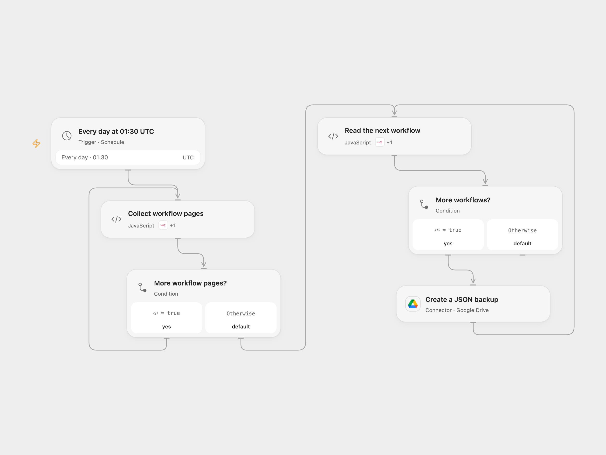

# Back Up n8n Workflows Daily to Google Drive

Save a JSON copy of each n8n workflow in Google Drive every day.

<picture>
  <source media="(prefers-color-scheme: dark)" srcset="preview-dark.png">
  
</picture>

[Open Flow JSON](templates/back-up-n8n-workflows-daily-to-google-drive.openflow.json) · [n8n JSON](templates/back-up-n8n-workflows-daily-to-google-drive.n8n.json)

## Setup

Connect n8n with permission to read workflows and Google Drive with permission to create files in the destination folder. Set its folder ID in **Read the next workflow**. In n8n, connect the n8n credential in both n8n nodes, select a Drive credential and folder in **Backup to Google Drive**. Activate one format.

## Behavior

At 01:30 UTC each day, read all accessible n8n workflows and create a JSON file for each in the selected folder. Files are named with the workflow name and ID. Every run creates new files, so arrange retention and access controls in Drive. Workflow definitions may contain sensitive configuration even when credential secrets are not included; inspect and restrict the destination. This does not back up n8n credentials, execution history, binary data, or other instance settings.

A failed read or upload stops the run; previous files remain. If an upload result is unknown, inspect Drive before rerunning because replay can duplicate backups. The workflow adds no automatic write retry. Large instances must fit execution and API limits.

Inspiration &amp; credits

## Changes to the source

- Read all pages and fetch each workflow's full definition; use a user-selected folder and UTC schedule.
- Include the workflow ID in the filename and remove automatic retries for uncertain writes.

Adapted from [Daily n8n workflow backup to Google Drive](https://github.com/Zie619/n8n-workflows/blob/ae8cf6dc5b873cbb4f74587aa9180ed3a9f70682/workflows/Code/0781_Code_Schedule_Export_Scheduled.json) in [Zie619/n8n-workflows](https://github.com/Zie619/n8n-workflows). The source export does not identify a separate template author or license.

The collection’s [MIT notice](https://github.com/Zie619/n8n-workflows/blob/94007c1445d9258a7da116646b79473e7c7c3282/LICENSE) is pinned at a later revision. This is the collection notice at that revision; it does not establish a separate original template author's license. Our changes are listed above; see [repository licensing](../../README.md#licensing).

> MIT License
>
> Copyright (c) 2025 Zie619
>
> Permission is hereby granted, free of charge, to any person obtaining a copy
> of this software and associated documentation files (the "Software"), to deal
> in the Software without restriction, including without limitation the rights
> to use, copy, modify, merge, publish, distribute, sublicense, and/or sell
> copies of the Software, and to permit persons to whom the Software is
> furnished to do so, subject to the following conditions:
>
> The above copyright notice and this permission notice shall be included in all
> copies or substantial portions of the Software.
>
> THE SOFTWARE IS PROVIDED "AS IS", WITHOUT WARRANTY OF ANY KIND, EXPRESS OR
> IMPLIED, INCLUDING BUT NOT LIMITED TO THE WARRANTIES OF MERCHANTABILITY,
> FITNESS FOR A PARTICULAR PURPOSE AND NONINFRINGEMENT. IN NO EVENT SHALL THE
> AUTHORS OR COPYRIGHT HOLDERS BE LIABLE FOR ANY CLAIM, DAMAGES OR OTHER
> LIABILITY, WHETHER IN AN ACTION OF CONTRACT, TORT OR OTHERWISE, ARISING FROM,
> OUT OF OR IN CONNECTION WITH THE SOFTWARE OR THE USE OR OTHER DEALINGS IN THE
> SOFTWARE.

