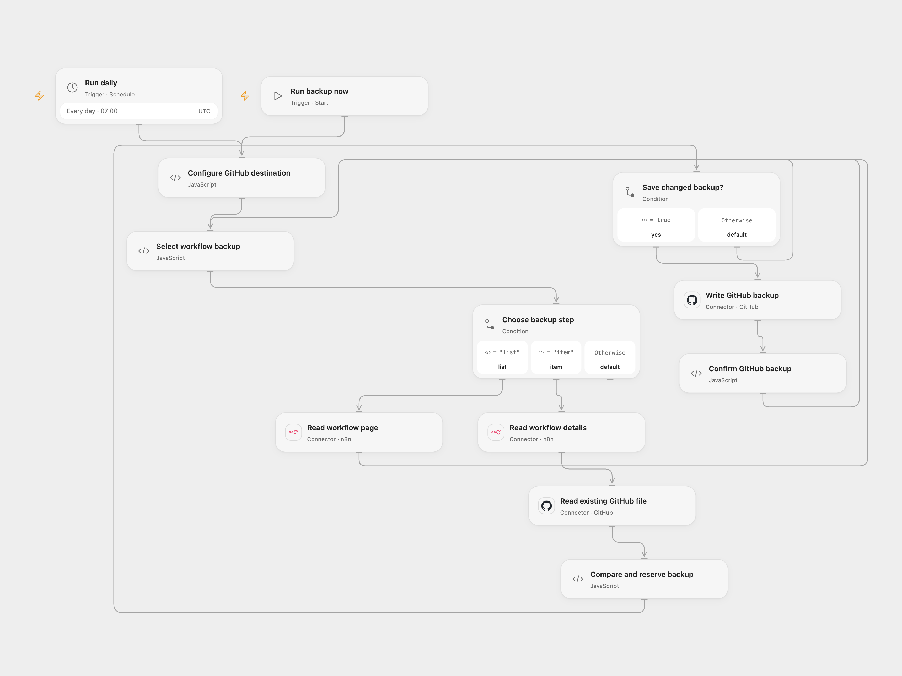

# Back Up n8n Workflows to GitHub by Tag

Back up new or changed n8n workflows to GitHub, grouped by their first tag.

<!-- template-actions:start -->
 
<!-- template-actions:end -->

<picture>
  <source media="(prefers-color-scheme: dark)" srcset="preview-dark.png">
  
</picture>

## Setup

Connect n8n and GitHub. Set the GitHub owner and repository in **Configure GitHub destination**, and a base directory in **Select workflow backup**. Enable persistent State and avoid overlapping runs. In n8n connect the n8n API credential to both n8n nodes and a GitHub API credential to both HTTP nodes. Set the owner, repository and base path in **Prepare backup path**, and select a Data Table with item_key and status text columns in all checkpoint nodes. Review workflow data before selecting a repository; backups can contain sensitive configuration.

## Behavior

Run manually or daily at 07:00 UTC. The workflow reads all n8n workflow pages and uses the first tag as a directory, with ID.json as the filename. Untagged workflows are saved directly under the base directory. A file is created or updated only when its JSON differs. Tags must be safe path segments. Existing files over the GitHub contents API inline limit stop for manual handling.

A pending marker is stored before writing. If the result is unknown, inspect GitHub and enter the pending key and confirmed or absent in **Compare and reserve backup**, then rerun and clear those fields. Confirmed requires matching destination content; absent requires unchanged destination SHA. In n8n inspect the pending Data Table row and the destination; delete the row only after reconciling the write. Earlier files may already have been committed.

Inspiration &amp; credits

Preserve per-workflow ID and tag paths, read all workflow pages and stop on uncertain writes.

Adapted from [Backup to GitHub](https://github.com/Zie619/n8n-workflows/blob/ae8cf6dc5b873cbb4f74587aa9180ed3a9f70682/workflows/Code/0718_Code_GitHub_Create_Scheduled.json) in [Zie619/n8n-workflows](https://github.com/Zie619/n8n-workflows). Attribution: Zie619 / n8n-workflows.

The collection’s [MIT notice](https://github.com/Zie619/n8n-workflows/blob/94007c1445d9258a7da116646b79473e7c7c3282/LICENSE) is pinned at a later revision. This is the collection notice at that revision; it does not establish a separate original template author's license. Our changes are listed above; see [repository licensing](../../README.md#licensing).

> MIT License
>
> Copyright (c) 2025 Zie619
>
> Permission is hereby granted, free of charge, to any person obtaining a copy
> of this software and associated documentation files (the "Software"), to deal
> in the Software without restriction, including without limitation the rights
> to use, copy, modify, merge, publish, distribute, sublicense, and/or sell
> copies of the Software, and to permit persons to whom the Software is
> furnished to do so, subject to the following conditions:
>
> The above copyright notice and this permission notice shall be included in all
> copies or substantial portions of the Software.
>
> THE SOFTWARE IS PROVIDED "AS IS", WITHOUT WARRANTY OF ANY KIND, EXPRESS OR
> IMPLIED, INCLUDING BUT NOT LIMITED TO THE WARRANTIES OF MERCHANTABILITY,
> FITNESS FOR A PARTICULAR PURPOSE AND NONINFRINGEMENT. IN NO EVENT SHALL THE
> AUTHORS OR COPYRIGHT HOLDERS BE LIABLE FOR ANY CLAIM, DAMAGES OR OTHER
> LIABILITY, WHETHER IN AN ACTION OF CONTRACT, TORT OR OTHERWISE, ARISING FROM,
> OUT OF OR IN CONNECTION WITH THE SOFTWARE OR THE USE OR OTHER DEALINGS IN THE
> SOFTWARE.

