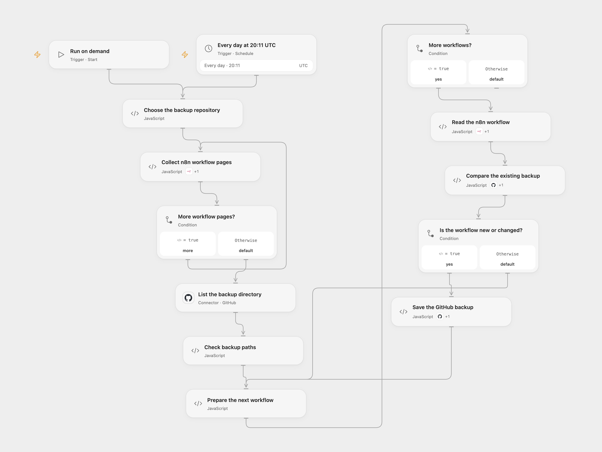

# Back Up n8n Workflows to GitHub

Save new or changed n8n workflow JSON files to a GitHub repository.

<picture>
  <source media="(prefers-color-scheme: dark)" srcset="preview-dark.png">
  
</picture>

[Open Flow JSON](templates/back-up-n8n-workflows-to-github.openflow.json) · [n8n JSON](templates/back-up-n8n-workflows-to-github.n8n.json)

## Setup

Connect n8n using an API key with access to the workflows and configure its instance URL in the connection. In **Choose the backup repository**, set the GitHub owner, repository, and an existing directory without a leading or trailing slash. Connect GitHub with repository contents read/write access in each GitHub step. In n8n connect n8n and GitHub and edit the three values in the **Choose the backup repository** code. The n8n credential Base URL must include `/api/v1`. Enable one format.

Workflow exports can contain private configuration, references and pinned data. Review your data and use a private repository with appropriate access controls.

## Behavior

Every day at 20:11 UTC, or on manual execution, the workflow lists n8n workflows and checks the backup directory. It reads each workflow and creates `<workflow name>.json` when absent, or updates it when its top-level sorted JSON differs. Unchanged files are left alone. GitHub commits use its default branch. n8n schedules a fixed second within the minute; Open Flow starts at the minute boundary.

The directory must exist and contain fewer than 1,000 entries, the GitHub directory API limit. Unsafe or duplicate workflow names stop before writes. Open Flow stops on a repeated n8n pagination cursor; n8n follows its native paginator. A workflow or directory error, existing non-JSON backup, or uncertain write stops the run; earlier commits remain. Check GitHub before retrying. Open Flow updates using the compared file SHA, so a concurrent edit causes a conflict. n8n fetches the SHA again immediately before editing; a concurrent edit after comparison can be overwritten. The selected n8n account controls which workflows are visible. Open Flow requires a publicly reachable HTTPS n8n instance and collected data must fit its run limits.

## Changes to the source

- Use the supported n8n public API instead of the source's localhost internal endpoint and configure the GitHub target. Replace source evaluation of GitHub content with JSON parsing.
- Check a directory listing before deciding a file is new, and fail on path collisions or an incomplete listing. Make the schedule timezone explicit; the source inherited its instance timezone.

Source and license

Adapted from [Back up n8n workflows to GitHub](https://github.com/Zie619/n8n-workflows/blob/ae8cf6dc5b873cbb4f74587aa9180ed3a9f70682/workflows/Github/1149_GitHub_Manual_Create_Scheduled.json) in [Zie619/n8n-workflows](https://github.com/Zie619/n8n-workflows). The source export does not identify a separate template author or license.

The collection’s [MIT notice](https://github.com/Zie619/n8n-workflows/blob/94007c1445d9258a7da116646b79473e7c7c3282/LICENSE) is pinned at a later revision. This is the collection notice at that revision; it does not establish a separate original template author's license. Our changes are listed above; see [repository licensing](../../README.md#licensing).

> MIT License
>
> Copyright (c) 2025 Zie619
>
> Permission is hereby granted, free of charge, to any person obtaining a copy
> of this software and associated documentation files (the "Software"), to deal
> in the Software without restriction, including without limitation the rights
> to use, copy, modify, merge, publish, distribute, sublicense, and/or sell
> copies of the Software, and to permit persons to whom the Software is
> furnished to do so, subject to the following conditions:
>
> The above copyright notice and this permission notice shall be included in all
> copies or substantial portions of the Software.
>
> THE SOFTWARE IS PROVIDED "AS IS", WITHOUT WARRANTY OF ANY KIND, EXPRESS OR
> IMPLIED, INCLUDING BUT NOT LIMITED TO THE WARRANTIES OF MERCHANTABILITY,
> FITNESS FOR A PARTICULAR PURPOSE AND NONINFRINGEMENT. IN NO EVENT SHALL THE
> AUTHORS OR COPYRIGHT HOLDERS BE LIABLE FOR ANY CLAIM, DAMAGES OR OTHER
> LIABILITY, WHETHER IN AN ACTION OF CONTRACT, TORT OR OTHERWISE, ARISING FROM,
> OUT OF OR IN CONNECTION WITH THE SOFTWARE OR THE USE OR OTHER DEALINGS IN THE
> SOFTWARE.

