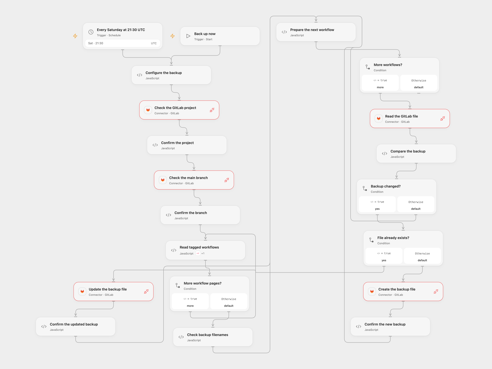

# Back Up n8n Workflows to GitLab

Back up tagged n8n workflows to GitLab on demand or weekly, writing only new or changed files.

<picture>
  <source media="(prefers-color-scheme: dark)" srcset="preview-dark.png">
  
</picture>

[Open Flow JSON](templates/back-up-n8n-workflows-to-gitlab.openflow.json) · [n8n JSON](templates/back-up-n8n-workflows-to-gitlab.n8n.json)

## Setup

Connect n8n with workflow read access and GitLab with repository API read/write permission. In **Configure the backup**, set the GitLab owner, project, existing directory path and one or more comma-separated n8n tags to match. A workflow must have all listed tags. The GitLab project must have a **main** branch. In n8n, configure the same values and connections. Run manually or activate the weekly schedule; activate one format. Both schedules use Saturday 21:30 UTC as a starting point. Open Flow runs on the minute boundary; n8n uses a fixed second within that minute.

## Behavior

The workflow lists matching n8n workflows, keeps ASCII letters and digits from each name to form a JSON filename, then creates or updates files under the directory on the main branch. Unchanged files are skipped. Empty or colliding filenames stop the run before any writes. Open Flow checks the GitLab project and branch and uses the last known commit ID when updating; a concurrent file edit causes the update to fail. The n8n GitLab node does not supply that precondition, so avoid concurrent edits when using n8n. Backups can contain sensitive workflow data; use a private repository with suitable access. Collected workflow data and each file response must fit the execution limits.

A failed or uncertain write may already have committed, and earlier writes are not rolled back. Inspect the repository before retrying. Concurrent runs can still race on new files; no automatic write retries are added.

Inspiration &amp; credits

## Changes to the source

- Replace repository defaults, use an explicit UTC schedule, follow all matching workflow pages and reject colliding filenames. The commit message is fixed rather than including run mode and time.
- Open Flow uses the GitLab Provider API Request for repository files because the formal catalog has no file Actions; it verifies the project and branch before treating a missing file as new and uses the last commit ID on updates.

Adapted from [Back Up n8n Workflows to GitLab](https://github.com/Zie619/n8n-workflows/blob/ae8cf6dc5b873cbb4f74587aa9180ed3a9f70682/workflows/Gitlab/0557_Gitlab_Filter_Create_Scheduled.json) in [Zie619/n8n-workflows](https://github.com/Zie619/n8n-workflows). The matching [n8n community listing](https://n8n.io/workflows/2376-backup-tag-selected-workflows-to-gitlab/) credits Hubschrauber. The original template does not state a separate license.

The collection’s [MIT notice](https://github.com/Zie619/n8n-workflows/blob/94007c1445d9258a7da116646b79473e7c7c3282/LICENSE) is pinned at a later revision. This is the collection notice at that revision; it does not establish a separate original template author's license. Our changes are listed above; see [repository licensing](../../README.md#licensing).

> MIT License
>
> Copyright (c) 2025 Zie619
>
> Permission is hereby granted, free of charge, to any person obtaining a copy
> of this software and associated documentation files (the "Software"), to deal
> in the Software without restriction, including without limitation the rights
> to use, copy, modify, merge, publish, distribute, sublicense, and/or sell
> copies of the Software, and to permit persons to whom the Software is
> furnished to do so, subject to the following conditions:
>
> The above copyright notice and this permission notice shall be included in all
> copies or substantial portions of the Software.
>
> THE SOFTWARE IS PROVIDED "AS IS", WITHOUT WARRANTY OF ANY KIND, EXPRESS OR
> IMPLIED, INCLUDING BUT NOT LIMITED TO THE WARRANTIES OF MERCHANTABILITY,
> FITNESS FOR A PARTICULAR PURPOSE AND NONINFRINGEMENT. IN NO EVENT SHALL THE
> AUTHORS OR COPYRIGHT HOLDERS BE LIABLE FOR ANY CLAIM, DAMAGES OR OTHER
> LIABILITY, WHETHER IN AN ACTION OF CONTRACT, TORT OR OTHERWISE, ARISING FROM,
> OUT OF OR IN CONNECTION WITH THE SOFTWARE OR THE USE OR OTHER DEALINGS IN THE
> SOFTWARE.

