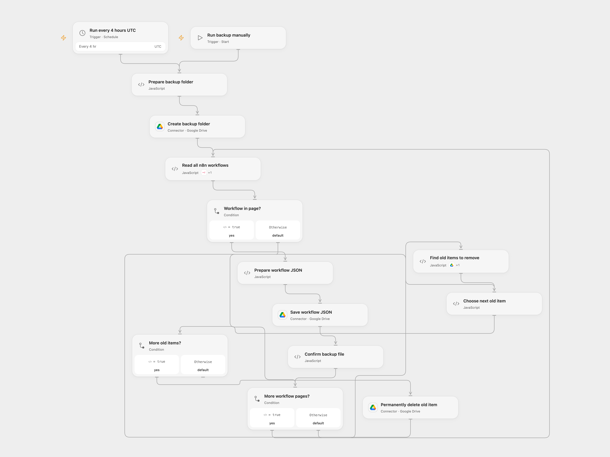

# Back Up n8n Workflows to Google Drive

Save n8n workflows as JSON in a fresh Drive folder and clean up older items in a dedicated parent folder.

<picture>
  <source media="(prefers-color-scheme: dark)" srcset="preview-dark.png">
  
</picture>

[Open Flow JSON](templates/back-up-n8n-workflows-to-google-drive.openflow.json) · [n8n JSON](templates/back-up-n8n-workflows-to-google-drive.n8n.json)

## Setup

Create a dedicated Google Drive parent folder used only for these backups. **Cleanup permanently deletes matching old backup folders.** Use a parent folder dedicated to these backups. Connect Google Drive and enter the parent folder ID in **Prepare backup folder**. Connect the n8n API with workflow read access. Configure the same dedicated parent folder and credentials in n8n. Enable one format and prevent overlapping runs.

## Behavior

Every four hours or on manual execution, the workflow creates a new backup folder and saves each n8n workflow as a JSON file. After every upload succeeds, it lists up to the first 50 folders named with the prefix `Workflow Backups ` in the parent folder and permanently deletes the returned old backup folders, keeping the new folder. More matching folders can remain outside that first page. Ordinary files and nonmatching folders are not deleted. If no workflows are returned, it leaves the new empty folder and does not delete anything. A later read or upload failure can leave a partial new folder; cleanup does not start. A later cleanup failure can leave some prior items already deleted.

A failed or uncertain create, upload or deletion may have succeeded. Inspect Drive before retrying. Open Flow reads and uploads one workflow at a time; a workflow that exceeds its per-node size limit fails before cleanup. Backup JSON can contain sensitive workflow data; restrict Drive access. Concurrent runs or external changes in the parent folder can cause data loss, so keep runs non-overlapping and the folder dedicated. Open Flow uses UTC minute boundaries; n8n uses a fixed second within the scheduled minute. n8n retains the source's automatic retry for reading workflows; Open Flow does not add a read retry.

Inspiration &amp; credits

## Changes to the source

- Replace the private Drive folder ID and set UTC and minute 00 explicitly; the source omitted its timezone and trigger minute. Keep the source search limit of 50 but restrict deletion to folders whose names begin with `Workflow Backups `; the source searched all item types and could delete ordinary files.
- Do not upload an empty placeholder or clean up if the workflow list is empty. Stop cleanup after unsuccessful uploads. n8n writes each workflow as an object instead of the source's single-item JSON array.

Adapted from [Back up n8n workflows to Google Drive](https://github.com/Zie619/n8n-workflows/blob/ae8cf6dc5b873cbb4f74587aa9180ed3a9f70682/workflows/Schedule/0720_Schedule_Filter_Create_Scheduled.json) in [Zie619/n8n-workflows](https://github.com/Zie619/n8n-workflows). The source export does not identify a separate template author or license.

The collection’s [MIT notice](https://github.com/Zie619/n8n-workflows/blob/94007c1445d9258a7da116646b79473e7c7c3282/LICENSE) is pinned at a later revision. This is the collection notice at that revision; it does not establish a separate original template author's license. Our changes are listed above; see [repository licensing](../../README.md#licensing).

> MIT License
>
> Copyright (c) 2025 Zie619
>
> Permission is hereby granted, free of charge, to any person obtaining a copy
> of this software and associated documentation files (the "Software"), to deal
> in the Software without restriction, including without limitation the rights
> to use, copy, modify, merge, publish, distribute, sublicense, and/or sell
> copies of the Software, and to permit persons to whom the Software is
> furnished to do so, subject to the following conditions:
>
> The above copyright notice and this permission notice shall be included in all
> copies or substantial portions of the Software.
>
> THE SOFTWARE IS PROVIDED "AS IS", WITHOUT WARRANTY OF ANY KIND, EXPRESS OR
> IMPLIED, INCLUDING BUT NOT LIMITED TO THE WARRANTIES OF MERCHANTABILITY,
> FITNESS FOR A PARTICULAR PURPOSE AND NONINFRINGEMENT. IN NO EVENT SHALL THE
> AUTHORS OR COPYRIGHT HOLDERS BE LIABLE FOR ANY CLAIM, DAMAGES OR OTHER
> LIABILITY, WHETHER IN AN ACTION OF CONTRACT, TORT OR OTHERWISE, ARISING FROM,
> OUT OF OR IN CONNECTION WITH THE SOFTWARE OR THE USE OR OTHER DEALINGS IN THE
> SOFTWARE.

