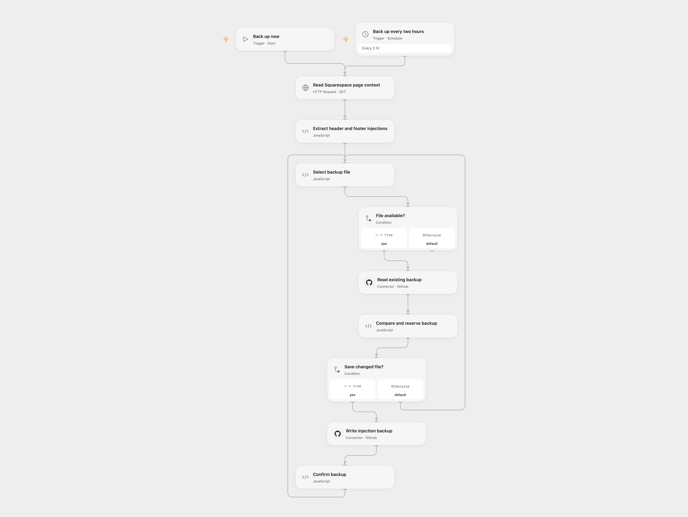

# Back Up Squarespace Code Injections to GitHub

Back up Squarespace header and footer injections as HTML files in GitHub.

<!-- template-actions:start -->
[](https://openflow.run/templates/backup-squarespace-code-injections-to-github/) [](templates/backup-squarespace-code-injections-to-github.n8n.json)
<!-- template-actions:end -->

<picture>
  <source media="(prefers-color-scheme: dark)" srcset="preview-dark.png">
  
</picture>

## Setup

Set your public Squarespace page-context URL in **Read Squarespace page context**, including the query string ?format=page-context. Connect GitHub with repository contents read/write access. Set the same repository owner and name in **Select backup file**, **Compare and reserve backup**, and **Write injection backup**. Enable persistent State. Avoid overlapping runs for the same site.

## Behavior

Run manually or every two hours. The workflow extracts and cleans the header and footer, then writes headers.html and footers.html under squarespace-backup/<site-domain>/ in GitHub. Existing identical content is left unchanged. Page-context data and backups can contain site code; use a repository with appropriate access.

When a GitHub write outcome is uncertain, inspect the destination file. In Open Flow enter the pending key and confirmed or absent in **Compare and reserve backup** and rerun, then clear the recovery fields. Confirmed requires matching file content; absent requires the destination SHA to remain unchanged.

<details>
<summary>In n8n</summary>

In n8n set the page-context URL, GitHub repository, and a Data Table with item_key and status text columns. In n8n inspect the checkpoint and repository, and delete the pending Data Table row only after reconciliation.

</details>

<details>
<summary>Inspiration &amp; credits</summary>

Embed the source cleanup parser, skip unchanged files, and add checkpoints for uncertain writes.

### parse5 6.0.1 (MIT)

```text
Copyright (c) 2013-2019 Ivan Nikulin (ifaaan@gmail.com, https://github.com/inikulin)

Permission is hereby granted, free of charge, to any person obtaining a copy
of this software and associated documentation files (the "Software"), to deal
in the Software without restriction, including without limitation the rights
to use, copy, modify, merge, publish, distribute, sublicense, and/or sell
copies of the Software, and to permit persons to whom the Software is
furnished to do so, subject to the following conditions:

The above copyright notice and this permission notice shall be included in
all copies or substantial portions of the Software.

THE SOFTWARE IS PROVIDED "AS IS", WITHOUT WARRANTY OF ANY KIND, EXPRESS OR
IMPLIED, INCLUDING BUT NOT LIMITED TO THE WARRANTIES OF MERCHANTABILITY,
FITNESS FOR A PARTICULAR PURPOSE AND NONINFRINGEMENT. IN NO EVENT SHALL THE
AUTHORS OR COPYRIGHT HOLDERS BE LIABLE FOR ANY CLAIM, DAMAGES OR OTHER
LIABILITY, WHETHER IN AN ACTION OF CONTRACT, TORT OR OTHERWISE, ARISING FROM,
OUT OF OR IN CONNECTION WITH THE SOFTWARE OR THE USE OR OTHER DEALINGS IN
THE SOFTWARE.
```


Adapted from [Backup Squarespace code Injections to Github](https://github.com/Zie619/n8n-workflows/blob/ae8cf6dc5b873cbb4f74587aa9180ed3a9f70682/workflows/Code/1844_Code_Schedule_Export_Webhook.json) in [Zie619/n8n-workflows](https://github.com/Zie619/n8n-workflows). Attribution: Zie619 / n8n-workflows.

The collection’s [MIT notice](https://github.com/Zie619/n8n-workflows/blob/94007c1445d9258a7da116646b79473e7c7c3282/LICENSE) is pinned at a later revision. This is the collection notice at that revision; it does not establish a separate original template author's license. Our changes are listed above; see [repository licensing](../../README.md#licensing).

> MIT License
>
> Copyright (c) 2025 Zie619
>
> Permission is hereby granted, free of charge, to any person obtaining a copy
> of this software and associated documentation files (the "Software"), to deal
> in the Software without restriction, including without limitation the rights
> to use, copy, modify, merge, publish, distribute, sublicense, and/or sell
> copies of the Software, and to permit persons to whom the Software is
> furnished to do so, subject to the following conditions:
>
> The above copyright notice and this permission notice shall be included in all
> copies or substantial portions of the Software.
>
> THE SOFTWARE IS PROVIDED "AS IS", WITHOUT WARRANTY OF ANY KIND, EXPRESS OR
> IMPLIED, INCLUDING BUT NOT LIMITED TO THE WARRANTIES OF MERCHANTABILITY,
> FITNESS FOR A PARTICULAR PURPOSE AND NONINFRINGEMENT. IN NO EVENT SHALL THE
> AUTHORS OR COPYRIGHT HOLDERS BE LIABLE FOR ANY CLAIM, DAMAGES OR OTHER
> LIABILITY, WHETHER IN AN ACTION OF CONTRACT, TORT OR OTHERWISE, ARISING FROM,
> OUT OF OR IN CONNECTION WITH THE SOFTWARE OR THE USE OR OTHER DEALINGS IN THE
> SOFTWARE.

</details>
