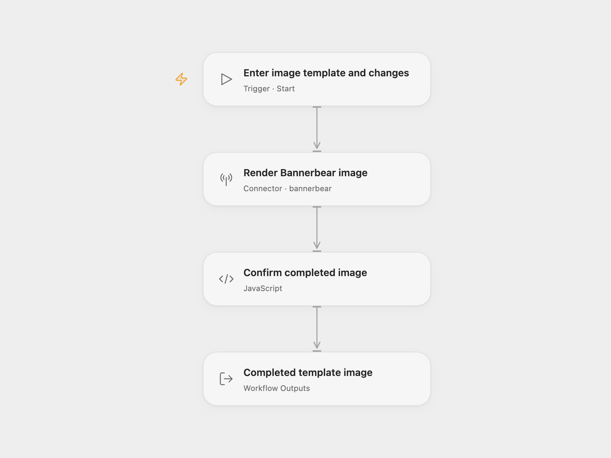

# Bannerbear Template Image

Render an existing Bannerbear template with new text or layer settings and return the completed image record and media URL.

<picture>
  <source media="(prefers-color-scheme: dark)" srcset="preview-dark.png">
  
</picture>

[Open Flow JSON](templates/bannerbear-template-image.openflow.json) · [n8n JSON](templates/bannerbear-template-image.n8n.json)

## Setup

Select a Bannerbear account in **Render Bannerbear image** and allow `bannerbear.create_image_sync`. Use a V2-compatible **project API key** for the project containing your template. V5-scoped keys are not interchangeable with V2 keys. Run with the **Template** UID and a **Modifications** array. Each modification names an existing layer. For a text layer, an example is `[ { "name": "message", "text": "Your announcement", "color": "#3097BC", "background": "#28A96F" } ]`. The template controls layout and text fitting.

In n8n, choose **HTTP Bearer Auth** credentials in **Render Bannerbear image** with the same project API key as the token. Edit the template UID and modifications in its JSON body. Both formats use Bannerbear’s V2 synchronous image endpoint.

Each run creates one image and waits for its result. A completed status, image UID and media URL are required. The full image record is retained, including optional fields and extra properties. The workflow does not download the media, save a local file or send a completion webhook. Repeating the same input creates another render.

The synchronous API waits up to 10 seconds and returns `408` on timeout. No workflow retry is configured. A timeout or failed request can leave a render on the account, so check Bannerbear before repeating an uncertain request. A queued or failed result is not treated as a completed image.

## Changes to the source

- Replace the example template with user configuration.
- Use synchronous generation in both formats. The source used an asynchronous creation request followed by at most three status checks, two seconds apart. The adapted workflow waits within the creation request for up to 10 seconds.
- Check the completed image UID and media URL before returning the complete record.

Source and license

Adapted from [Bannerbear template image workflow](https://github.com/Zie619/n8n-workflows/blob/ae8cf6dc5b873cbb4f74587aa9180ed3a9f70682/workflows/Manual/1012_Manual_Bannerbear_Automate_Triggered.json) in [Zie619/n8n-workflows](https://github.com/Zie619/n8n-workflows). The source export does not identify a separate template author or license.

The collection’s [MIT notice](https://github.com/Zie619/n8n-workflows/blob/94007c1445d9258a7da116646b79473e7c7c3282/LICENSE) is pinned at a later revision. This is the collection notice at that revision; it does not establish a separate original template author's license. Our changes are listed above; see [repository licensing](../../README.md#licensing).

> MIT License
>
> Copyright (c) 2025 Zie619
>
> Permission is hereby granted, free of charge, to any person obtaining a copy
> of this software and associated documentation files (the "Software"), to deal
> in the Software without restriction, including without limitation the rights
> to use, copy, modify, merge, publish, distribute, sublicense, and/or sell
> copies of the Software, and to permit persons to whom the Software is
> furnished to do so, subject to the following conditions:
>
> The above copyright notice and this permission notice shall be included in all
> copies or substantial portions of the Software.
>
> THE SOFTWARE IS PROVIDED "AS IS", WITHOUT WARRANTY OF ANY KIND, EXPRESS OR
> IMPLIED, INCLUDING BUT NOT LIMITED TO THE WARRANTIES OF MERCHANTABILITY,
> FITNESS FOR A PARTICULAR PURPOSE AND NONINFRINGEMENT. IN NO EVENT SHALL THE
> AUTHORS OR COPYRIGHT HOLDERS BE LIABLE FOR ANY CLAIM, DAMAGES OR OTHER
> LIABILITY, WHETHER IN AN ACTION OF CONTRACT, TORT OR OTHERWISE, ARISING FROM,
> OUT OF OR IN CONNECTION WITH THE SOFTWARE OR THE USE OR OTHER DEALINGS IN THE
> SOFTWARE.

