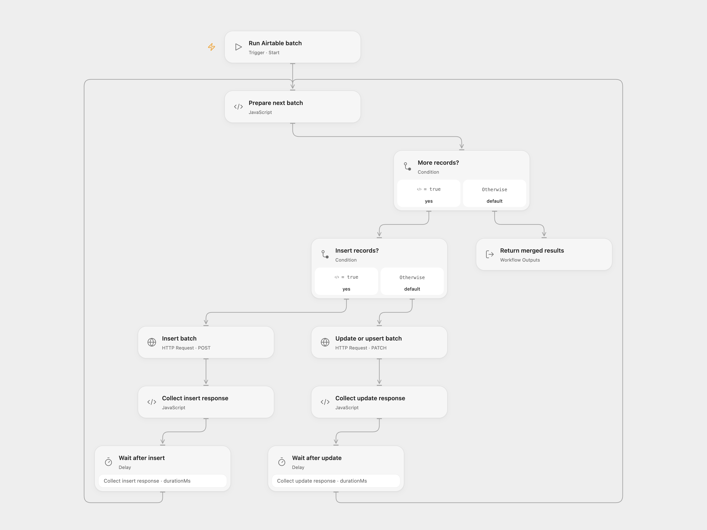

# Batch Airtable Record Operations

Insert, update or upsert Airtable records in batches of ten.

<picture>
  <source media="(prefers-color-scheme: dark)" srcset="preview-dark.png">
  
</picture>

[Open Flow JSON](templates/batch-airtable-record-operations.openflow.json) · [n8n JSON](templates/batch-airtable-record-operations.n8n.json)

## Setup and use

Bind secret Variable AIRTABLE_TOKEN with record write access. Run Open Flow with a base ID, table ID or name, mode (insert, update or upsert), mergeFields and records. Each record contains fields; update records put their Airtable record ID in fields.id. Upsert needs one to three merge field names. In n8n import the workflow, configure Airtable credentials and select the imported workflow in **Airtable Batch** before running its test path. Use one format.

## Behavior

Requests contain up to ten records. Inserts use POST, updates and upserts use PATCH. Upserts send fieldsToMergeOn. Results combine records and the created and updated record IDs. Open Flow waits 200 ms after a successful batch and retries a 429 after five seconds up to five attempts. Other failed requests stop; earlier batches may already have been written. If a write outcome is unknown, inspect Airtable before retrying to avoid duplicate inserts. In n8n, failed requests, including 429 responses, stop without automatic retry.

Inspiration &amp; credits

## Changes to the source

- Open Flow accepts inputs directly and retries only rate-limit responses; n8n disables automatic retries of uncertain writes. Placeholder base, table and token configuration replace source-specific settings.

Adapted from [Airtable batch processing](https://github.com/Zie619/n8n-workflows/blob/ae8cf6dc5b873cbb4f74587aa9180ed3a9f70682/workflows/Wait/0091_Wait_Splitout_Process_Webhook.json) in [Zie619/n8n-workflows](https://github.com/Zie619/n8n-workflows). The source export does not identify a separate template author or license.

The collection’s [MIT notice](https://github.com/Zie619/n8n-workflows/blob/94007c1445d9258a7da116646b79473e7c7c3282/LICENSE) is pinned at a later revision. This is the collection notice at that revision; it does not establish a separate original template author's license. Our changes are listed above; see [repository licensing](../../README.md#licensing).

> MIT License
>
> Copyright (c) 2025 Zie619
>
> Permission is hereby granted, free of charge, to any person obtaining a copy
> of this software and associated documentation files (the "Software"), to deal
> in the Software without restriction, including without limitation the rights
> to use, copy, modify, merge, publish, distribute, sublicense, and/or sell
> copies of the Software, and to permit persons to whom the Software is
> furnished to do so, subject to the following conditions:
>
> The above copyright notice and this permission notice shall be included in all
> copies or substantial portions of the Software.
>
> THE SOFTWARE IS PROVIDED "AS IS", WITHOUT WARRANTY OF ANY KIND, EXPRESS OR
> IMPLIED, INCLUDING BUT NOT LIMITED TO THE WARRANTIES OF MERCHANTABILITY,
> FITNESS FOR A PARTICULAR PURPOSE AND NONINFRINGEMENT. IN NO EVENT SHALL THE
> AUTHORS OR COPYRIGHT HOLDERS BE LIABLE FOR ANY CLAIM, DAMAGES OR OTHER
> LIABILITY, WHETHER IN AN ACTION OF CONTRACT, TORT OR OTHERWISE, ARISING FROM,
> OUT OF OR IN CONNECTION WITH THE SOFTWARE OR THE USE OR OTHER DEALINGS IN THE
> SOFTWARE.

