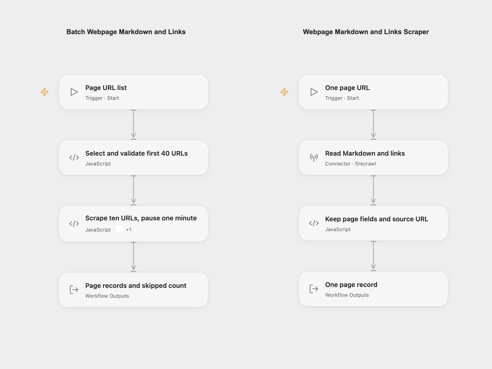

# Batch Webpage Markdown and Links

Convert the first 40 URLs in a list into Markdown, page metadata and link arrays. Process groups of ten with a one-minute pause between groups.

<picture>
  <source media="(prefers-color-scheme: dark)" srcset="preview-dark.png">
  
</picture>

[Open Flow JSON](templates/batch-webpage-markdown-links.openflow.json) · [n8n JSON](templates/batch-webpage-markdown-links.n8n.json)

## Setup

The Open Flow JSON imports **Batch Webpage Markdown and Links** and **Webpage Markdown and Links Scraper**. Select your Firecrawl account on the scraper’s **Read Markdown and links** Connector, publish that workflow, then refresh **Scrape ten URLs, pause one minute** in the main workflow to select its published interface. The shared worker revision stays unconfigured until you publish it.

Run the main workflow with `urlsJson`, a JSON array such as `["https://example.com/", "https://example.org/"]`. In n8n, edit the same JSON in **Set Page URLs** and select a Header Auth credential on **Retrieve Page Markdown and Links** with header `Authorization` and value `Bearer <your Firecrawl API key>`.

The workflow uses the first 40 entries in input order. It reports the number omitted by this cap; it does not automatically continue with the remaining URLs. Repeated URLs are processed again. An invalid selected URL stops the batch before any scrape. An empty list returns no pages; n8n produces no items for that empty list.

## Results and limits

Each page record includes `url`, `title`, `description`, Markdown `content`, an ordered `links` array and nullable `pageStatus`. Missing optional title or description becomes an empty string. A missing requested Markdown value or link array fails the workflow. A successful Firecrawl response can contain a target error page; `pageStatus` exposes the reported target status rather than treating API success as proof of HTTP 200.

Pages run sequentially in groups of ten, with a one-minute pause before another group. There is no pause after the last group. This limits the normal processing cadence; retries and overlapping runs can make additional API requests. Check your account’s rate and credit limits. The main Open Flow mapping step has a two-hour execution budget and the scraper’s **Read Markdown and links** step has a 150-second budget for its configured retry handling. n8n’s HTTP request timeout is 45 seconds per attempt. Cancel the run if you no longer need it.

Each page’s read step allows two additional attempts five seconds apart. Open Flow retries only failures its platform marks safe to retry; n8n’s HTTP retry setting applies to node errors more broadly. A failed page stops later URLs and does not replay earlier successful pages. Already completed scrapes may have consumed credits, and results can change before a manual rerun. The workflow has no deduplication, resume checkpoint or rollback. It returns records for you to inspect or connect to a destination; no database writes are configured.

The scrape sends each selected URL to Firecrawl. It requests fresh main content with `maxAge: 0`, `onlyMainContent: true`, `formats: ["markdown", "links"]` and a 30-second scrape timeout. Fresh scraping can consume more credits than cached results. Review the [current Firecrawl limits](https://docs.firecrawl.dev/rate-limits) and your allowance before a full batch.

## Changes to the source

- Move to Firecrawl v2 because v1 [shuts down December 10, 2026](https://docs.firecrawl.dev/migrate-to-v2). Keep v1’s fresh-scrape behavior explicitly instead of v2’s two-day cache default.
- Correct the source’s omitted wait unit, which defaulted to 45 hours. Make the pause one minute between groups of ten and remove the final unnecessary wait.
- Keep the first-40 cap and return skipped counts, source URL associations and a complete list of page records.
- Keep the source’s three-attempt retry count, with one page per worker or native loop iteration. The original HTTP node received ten items at once, so retrying that node could repeat earlier page requests. A later failure now retries only the current page.
- Return links as an array instead of coercing them to text. Remove the unconfigured database placeholders and document the returned records as the handoff point.

## Source and license

Adapted from [Convert URL HTML to Markdown Format and Get Page Links](https://github.com/enescingoz/awesome-n8n-templates/blob/827110332c21cbe000ab13f6d292d5adb1f1f8db/PDF_and_Document_Processing/Convert%20URL%20HTML%20to%20Markdown%20Format%20and%20Get%20Page%20Links.json) in [enescingoz/awesome-n8n-templates](https://github.com/enescingoz/awesome-n8n-templates). The export credits **Simon at [automake.io](https://automake.io/)**; it states no separate template license.

Source collection notice: ©2024–2026 Enes Cingoz, [CC BY4.0](https://github.com/enescingoz/awesome-n8n-templates/blob/827110332c21cbe000ab13f6d292d5adb1f1f8db/LICENSE). See [repository licensing](../../README.md#licensing) for the scope of OOMOL contributions and third-party material.
