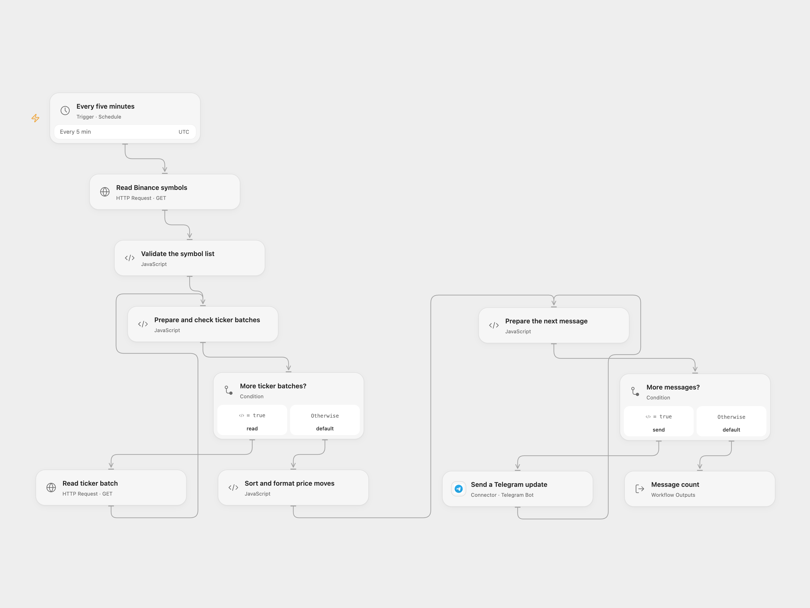

# Binance Price Moves to Telegram

Send Telegram updates for Binance spot pairs whose 24-hour price change reaches 15%.

<picture>
  <source media="(prefers-color-scheme: dark)" srcset="preview-dark.png">
  
</picture>

[Open Flow JSON](templates/binance-price-moves-to-telegram.openflow.json) · [n8n JSON](templates/binance-price-moves-to-telegram.n8n.json)

## Setup

Connect a Telegram bot and set the destination chat ID in **Send a Telegram update**. The bot must be able to post there. In n8n, set the chat ID and connect Telegram credentials on **Send Telegram Message**. Activate one format.

## Behavior

Every five minutes the workflow reads the current Binance spot symbol list, fetches 24-hour ticker data in batches of up to 20, and selects pairs whose absolute percentage change is at least 15%. After all batches succeed, it sorts by signed change descending and sends one or more messages of up to 1,000 characters. No matching pairs means no Telegram message. The threshold comes from the original code, although a source node is named 10%. Results cover trading pairs, not necessarily distinct coins; this is not a trade signal.

The batched readings occur at different times and may differ from a single snapshot. A new symbol after the initial list is not included until the next run; if a listed symbol disappears or a batch is incomplete, duplicated or unexpected, the run stops before sending. Each run repeats alerts for matching pairs. The initial list and accumulated matches must fit the runtime's Code input limit.

Binance applies IP-based request weights. The symbol list uses weight 4 and each batch uses weight 2, so large lists consume more weight than a single all-symbol request. Adjust the schedule if other integrations share the IP and obey rate-limit responses. Access can vary by region. The source used the n8n instance timezone; this template uses UTC. n8n chooses a stable second within each scheduled minute, while Open Flow uses the minute boundary.

HTTP or batch validation errors stop before any Telegram message. Telegram messages are sent sequentially; earlier messages may already have arrived when a later send fails, and an unknown send may also have arrived. Check the chat before retrying. Open Flow limits each HTTP response to 4 MiB and 30 seconds. Telegram uses legacy Markdown.

## Changes to the source

- Replace the private chat ID, use documented public-data endpoints, and set UTC explicitly.
- Fetch the initial symbol list and full ticker data in bounded batches, verify complete batches before sending, and send message chunks sequentially.

Source and license

Adapted from [Binance 24-hour price changes to Telegram](https://github.com/Zie619/n8n-workflows/blob/ae8cf6dc5b873cbb4f74587aa9180ed3a9f70682/workflows/Telegram/0381_Telegram_Code_Update_Webhook.json) in [Zie619/n8n-workflows](https://github.com/Zie619/n8n-workflows). The matching [n8n listing](https://n8n.io/workflows/2043-crypto-market-alert-system-with-binance-and-telegram-integration/) credits Nskha. The original template does not state a separate license.

The collection’s [MIT notice](https://github.com/Zie619/n8n-workflows/blob/94007c1445d9258a7da116646b79473e7c7c3282/LICENSE) is pinned at a later revision. This is the collection notice at that revision; it does not establish a separate original template author's license. Our changes are listed above; see [repository licensing](../../README.md#licensing).

> MIT License
>
> Copyright (c) 2025 Zie619
>
> Permission is hereby granted, free of charge, to any person obtaining a copy
> of this software and associated documentation files (the "Software"), to deal
> in the Software without restriction, including without limitation the rights
> to use, copy, modify, merge, publish, distribute, sublicense, and/or sell
> copies of the Software, and to permit persons to whom the Software is
> furnished to do so, subject to the following conditions:
>
> The above copyright notice and this permission notice shall be included in all
> copies or substantial portions of the Software.
>
> THE SOFTWARE IS PROVIDED "AS IS", WITHOUT WARRANTY OF ANY KIND, EXPRESS OR
> IMPLIED, INCLUDING BUT NOT LIMITED TO THE WARRANTIES OF MERCHANTABILITY,
> FITNESS FOR A PARTICULAR PURPOSE AND NONINFRINGEMENT. IN NO EVENT SHALL THE
> AUTHORS OR COPYRIGHT HOLDERS BE LIABLE FOR ANY CLAIM, DAMAGES OR OTHER
> LIABILITY, WHETHER IN AN ACTION OF CONTRACT, TORT OR OTHERWISE, ARISING FROM,
> OUT OF OR IN CONNECTION WITH THE SOFTWARE OR THE USE OR OTHER DEALINGS IN THE
> SOFTWARE.

