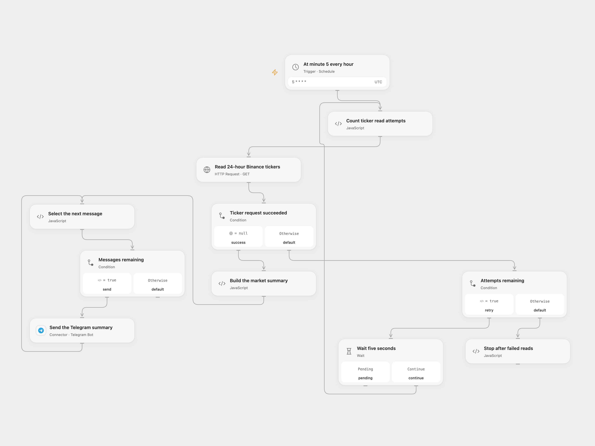

# Binance USDC Market Summary to Telegram

Send an hourly summary of BTC, ETH and SOL against USDC to a Telegram chat.

<picture>
  <source media="(prefers-color-scheme: dark)" srcset="preview-dark.png">
  
</picture>

[Open Flow JSON](templates/binance-usdc-market-summary-to-telegram.openflow.json) · [n8n JSON](templates/binance-usdc-market-summary-to-telegram.n8n.json)

## Setup

Connect a Telegram bot and set the destination chat ID in **Send the Telegram summary**. In n8n, configure the Telegram credential and destination chat ID. Activate one format. The schedule runs at minute 5 of each hour in UTC; the source used the n8n instance timezone. The host must be able to reach Binance’s public spot API.

## Behavior

The report uses Binance’s rolling 24-hour BTCUSDC, ETHUSDC and SOLUSDC tickers. It includes the three-pair average price change, combined quote volume in USDC, highest high/low volatility, narrowest bid/ask spread, volume ranking, and per-pair gainers and losers with price, volume, spread, momentum against weighted average price and trade count. The average is an unweighted average of these three pairs; it is not the whole cryptocurrency market. A zero-change pair is included in the overview and volume ranking but has no gainer or loser section.

The workflow requests the three pairs in one public call, retries the read up to four times after failure at five-second intervals, and sends HTML report chunks in order. Missing, malformed or unavailable ticker data stops before Telegram. A Telegram failure stops later chunks; an uncertain send may already have arrived, so check the chat before rerunning. The prices are Binance spot snapshots quoted in USDC.

Inspiration &amp; credits

## Changes to the source

- Request the three selected symbols directly, validate all fields and make the schedule timezone explicit.
- Replace the private chat ID and label quote amounts in USDC.
- Preserve ordered report chunks and stop on invalid denominators instead of publishing invalid percentages.

Adapted from [Daily Crypto Market Summary Bot](https://github.com/Zie619/n8n-workflows/blob/ae8cf6dc5b873cbb4f74587aa9180ed3a9f70682/workflows/Http/0870_HTTP_Schedule_Update_Webhook.json) in [Zie619/n8n-workflows](https://github.com/Zie619/n8n-workflows). The source export does not identify a separate template author or license.

The collection’s [MIT notice](https://github.com/Zie619/n8n-workflows/blob/94007c1445d9258a7da116646b79473e7c7c3282/LICENSE) is pinned at a later revision. This is the collection notice at that revision; it does not establish a separate original template author's license. Our changes are listed above; see [repository licensing](../../README.md#licensing).

> MIT License
>
> Copyright (c) 2025 Zie619
>
> Permission is hereby granted, free of charge, to any person obtaining a copy
> of this software and associated documentation files (the "Software"), to deal
> in the Software without restriction, including without limitation the rights
> to use, copy, modify, merge, publish, distribute, sublicense, and/or sell
> copies of the Software, and to permit persons to whom the Software is
> furnished to do so, subject to the following conditions:
>
> The above copyright notice and this permission notice shall be included in all
> copies or substantial portions of the Software.
>
> THE SOFTWARE IS PROVIDED "AS IS", WITHOUT WARRANTY OF ANY KIND, EXPRESS OR
> IMPLIED, INCLUDING BUT NOT LIMITED TO THE WARRANTIES OF MERCHANTABILITY,
> FITNESS FOR A PARTICULAR PURPOSE AND NONINFRINGEMENT. IN NO EVENT SHALL THE
> AUTHORS OR COPYRIGHT HOLDERS BE LIABLE FOR ANY CLAIM, DAMAGES OR OTHER
> LIABILITY, WHETHER IN AN ACTION OF CONTRACT, TORT OR OTHERWISE, ARISING FROM,
> OUT OF OR IN CONNECTION WITH THE SOFTWARE OR THE USE OR OTHER DEALINGS IN THE
> SOFTWARE.

A matching [n8n community listing](https://n8n.io/workflows/3621-send-hourly-crypto-market-analysis-from-binance-to-telegram/) credits Aurélien P. The source export refers to template 2043, whose current listing describes a different workflow; that identifier does not establish the author or license of this export.

