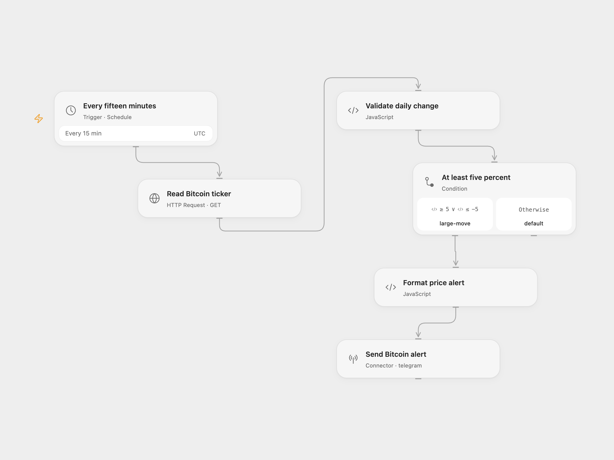

# Bitcoin Price Alert

Check Bitcoin’s USD ticker every 15 minutes. Send one Telegram message when its 24-hour change is at least +5% or at most −5%. The message also includes the current USD price and seven-day change.

<picture>
  <source media="(prefers-color-scheme: dark)" srcset="preview-dark.png">
  
</picture>

[Open Flow JSON](templates/bitcoin-price-alert.openflow.json) · [n8n JSON](templates/bitcoin-price-alert.n8n.json)

## Setup

For Open Flow, import the JSON, connect your Telegram bot in **Send Bitcoin alert**, and replace `@YOUR_TELEGRAM_CHANNEL` with your chat ID or channel username. Confirm the UTC schedule or choose your preferred timezone. The CoinPaprika request uses its fixed public BTC ticker endpoint and needs no API key.

For n8n, connect Telegram in **Send Telegram alert**, set the chat ID, and confirm the workflow timezone before enabling it. Both formats use the same 15-minute cron and inclusive +5%/−5% thresholds.

The alert is evaluated on every poll. While a large 24-hour move continues, another message is sent every 15 minutes; there is no threshold-crossing detection or deduplication. An ordinary move sends nothing. Failed HTTP requests or missing required metrics stop without sending an alert. The workflow does not place trades.

Inspiration &amp; credits

## Changes to the source

- Validate the 24-hour metric before evaluating the condition, and validate price and seven-day change when formatting an alert.
- Send the price message without an added platform signature and use an explicit UTC schedule.
- Keep invalid data from being formatted as a successful price message.

Adapted from [Bitcoin price alert to Telegram with CoinPaprika](https://github.com/enescingoz/awesome-n8n-templates/blob/827110332c21cbe000ab13f6d292d5adb1f1f8db/Telegram/Bitcoin%20price%20alert%20to%20Telegram%20with%20CoinPaprika.json) in [enescingoz/awesome-n8n-templates](https://github.com/enescingoz/awesome-n8n-templates).

Source collection notice: © 2024–2026 Enes Cingoz, [CC BY 4.0](https://github.com/enescingoz/awesome-n8n-templates/blob/827110332c21cbe000ab13f6d292d5adb1f1f8db/LICENSE). The source export does not identify a separate template author or license. See [repository licensing](../../README.md#licensing) for the scope of OOMOL contributions and third-party material.

