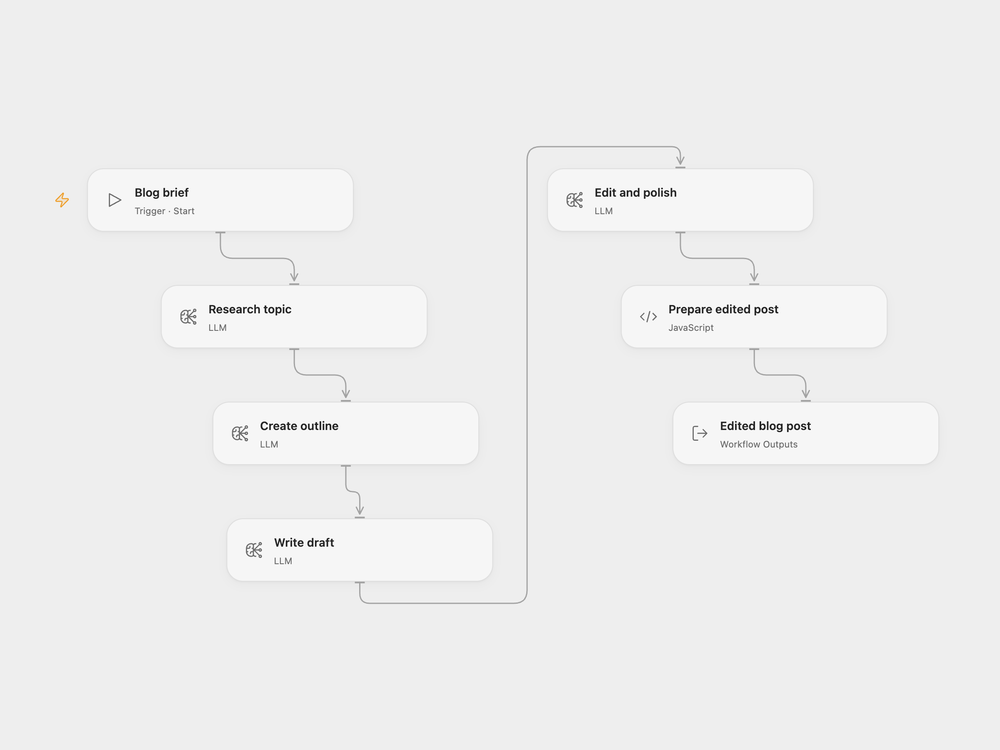

# Blog Writing Pipeline

Produce a Markdown blog post through separate research, outline, drafting, and editing steps. The workflow returns the edited post, topic, and generation time.

<picture>
  <source media="(prefers-color-scheme: dark)" srcset="preview-dark.png">
  
</picture>

[Open Flow JSON](templates/blog-writing-pipeline.openflow.json) · [n8n JSON](templates/blog-writing-pipeline.n8n.json)

## Setup

For Open Flow, select a configured `llama3:8b` model in every model step. For n8n, connect the model steps to an OpenAI-compatible Ollama credential, using the `/v1` base URL of an Ollama service reachable from n8n. Confirm that it serves `llama3:8b`. You can choose another available model in both formats; its wording and quality may differ.

In Open Flow, use Run and supply `topic`, `tone`, and integer `word_count`. For example, use “How our support team handles recurring questions”, “professional but conversational”, and `1500`. In n8n, edit those values in **Set Blog Parameters** and use Execute Workflow.

Four model calls run in order. A failure stops later steps. The workflow does not browse sources, verify citations, or publish the post. Treat research notes as model output and check facts before publication. Word count is a prompt target, not an enforced count.

## Changes to the source

- Use configured model accounts instead of a machine-local Ollama URL.
- Fix the source requests that omitted POST, and read message output through the model node contract instead of parsing a nonexistent `data` string.
- Use real paragraph breaks in prompts and stop if editing returns an empty post.

## Source and license

Adapted from [AI Blog Writer Pipeline with Ollama](https://github.com/enescingoz/awesome-n8n-templates/blob/827110332c21cbe000ab13f6d292d5adb1f1f8db/OpenAI_and_LLMs/AI%20Blog%20Writer%20Pipeline%20with%20Ollama.json) in [enescingoz/awesome-n8n-templates](https://github.com/enescingoz/awesome-n8n-templates).

Source collection notice: © 2024–2026 Enes Cingoz, [CC BY 4.0](https://github.com/enescingoz/awesome-n8n-templates/blob/827110332c21cbe000ab13f6d292d5adb1f1f8db/LICENSE). The source export does not identify a separate template author or license. See [repository licensing](../../README.md#licensing) for the scope of OOMOL contributions and third-party material.
