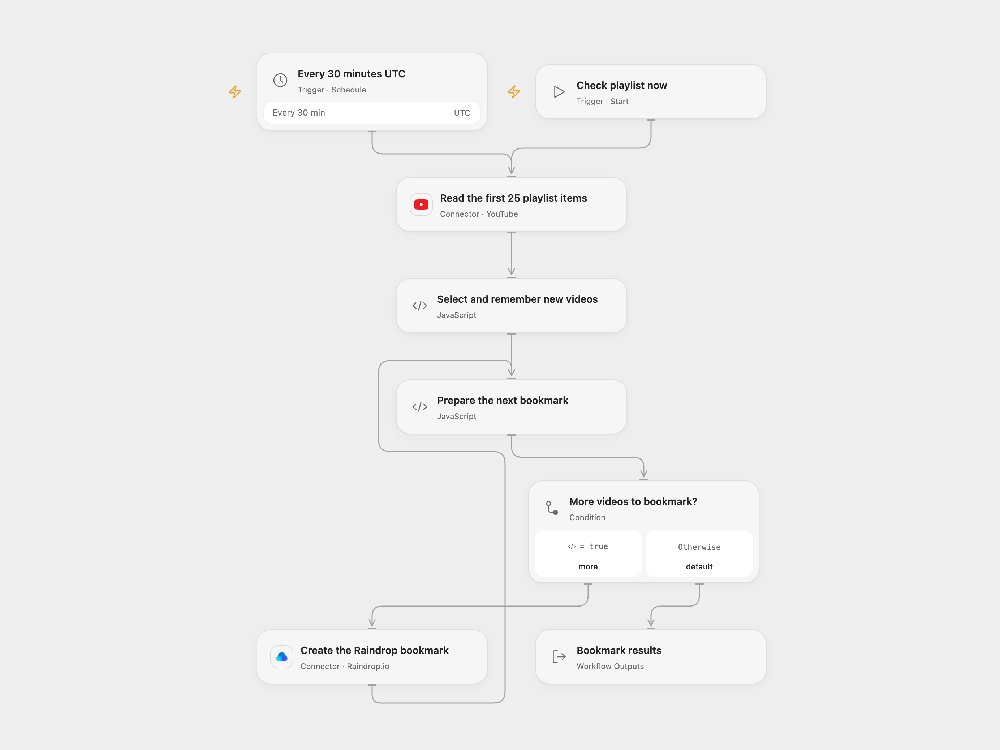

# Bookmark New YouTube Playlist Videos

Check a YouTube playlist and save newly seen videos to Raindrop.

<picture>
  <source media="(prefers-color-scheme: dark)" srcset="preview-dark.png">
  
</picture>

[Open Flow JSON](templates/bookmark-new-youtube-playlist-videos.openflow.json) · [n8n JSON](templates/bookmark-new-youtube-playlist-videos.n8n.json)

## Setup

Connect YouTube in **Read the first 25 playlist items** and enter the playlist ID. Connect Raindrop in **Create the Raindrop bookmark** using a test token from your Raindrop integration. The collection defaults to Unsorted (ID `-1`); enter another writable collection ID if needed. Keep workflow State persistent and prevent overlapping runs. One workflow tracks one playlist; reset its saved video IDs when changing playlists.

In n8n, select YouTube OAuth2 and Raindrop OAuth2 credentials, enter the same playlist and collection IDs, and activate the workflow. Open Flow manual runs update the same persistent State as scheduled runs. n8n saves workflow static data for active trigger executions; manual tests do not persist it. Enable one format to avoid duplicate bookmarks.

## Behavior

Run manually or on the 30-minute schedule. Each run requests the first 25 playlist items in the order returned by YouTube. This is the original limit, not a full playlist scan: videos beyond that window can be missed. On the first non-empty run, every returned video is bookmarked; later runs bookmark IDs absent from the saved history. Each bookmark links to the video, is titled `channel | video title`, and has the `youtube` tag. An empty list creates nothing.

As in the source, the workflow saves all selected IDs before creating bookmarks. If a later bookmark fails, some saved IDs may never have been bookmarked and the next run will skip them. An uncertain creation may already exist. Check Raindrop and repair or reset the saved history before replaying. There is no automatic retry or rollback. The history grows and must fit execution state limits; overlapping runs can create duplicates or overwrite state.

The schedule starts in UTC. n8n Cron V1 chooses a fixed randomized second within each scheduled minute while Open Flow uses minute boundaries. Invalid video IDs, missing titles or channel names, or titles over 1000 characters stop before State changes.

Inspiration &amp; credits

## Changes to the source

- Configure a real playlist and Raindrop collection; use Unsorted instead of the source's `0` collection placeholder.
- Make the original first-25 limit and pre-write ID history explicit, and validate the complete returned batch before saving history.

Adapted from [YouTube to Raindrop](https://github.com/Zie619/n8n-workflows/blob/ae8cf6dc5b873cbb4f74587aa9180ed3a9f70682/workflows/Functionitem/1140_Functionitem_Raindrop_Automation_Scheduled.json) in [Zie619/n8n-workflows](https://github.com/Zie619/n8n-workflows). The source export does not identify a separate template author or license.

The collection’s [MIT notice](https://github.com/Zie619/n8n-workflows/blob/94007c1445d9258a7da116646b79473e7c7c3282/LICENSE) is pinned at a later revision. This is the collection notice at that revision; it does not establish a separate original template author's license. Our changes are listed above; see [repository licensing](../../README.md#licensing).

> MIT License
>
> Copyright (c) 2025 Zie619
>
> Permission is hereby granted, free of charge, to any person obtaining a copy
> of this software and associated documentation files (the "Software"), to deal
> in the Software without restriction, including without limitation the rights
> to use, copy, modify, merge, publish, distribute, sublicense, and/or sell
> copies of the Software, and to permit persons to whom the Software is
> furnished to do so, subject to the following conditions:
>
> The above copyright notice and this permission notice shall be included in all
> copies or substantial portions of the Software.
>
> THE SOFTWARE IS PROVIDED "AS IS", WITHOUT WARRANTY OF ANY KIND, EXPRESS OR
> IMPLIED, INCLUDING BUT NOT LIMITED TO THE WARRANTIES OF MERCHANTABILITY,
> FITNESS FOR A PARTICULAR PURPOSE AND NONINFRINGEMENT. IN NO EVENT SHALL THE
> AUTHORS OR COPYRIGHT HOLDERS BE LIABLE FOR ANY CLAIM, DAMAGES OR OTHER
> LIABILITY, WHETHER IN AN ACTION OF CONTRACT, TORT OR OTHERWISE, ARISING FROM,
> OUT OF OR IN CONNECTION WITH THE SOFTWARE OR THE USE OR OTHER DEALINGS IN THE
> SOFTWARE.

