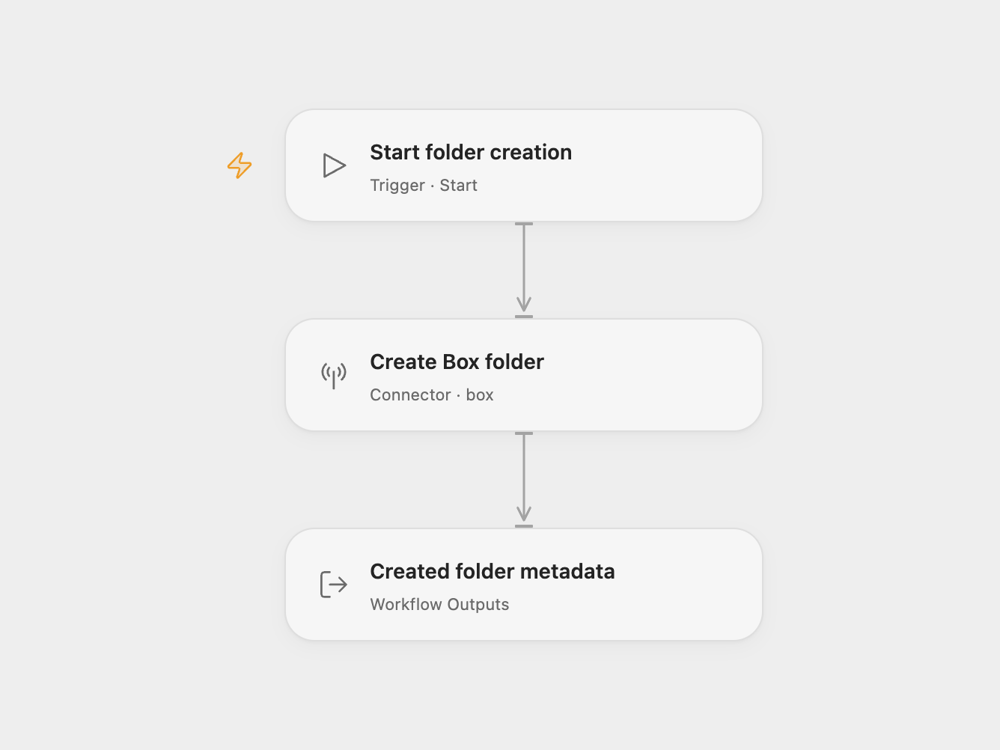

# Box Folder Creator

Create one named folder in Box and return its metadata.

<picture>
  <source media="(prefers-color-scheme: dark)" srcset="preview-dark.png">
  
</picture>

[Open Flow JSON](templates/box-folder-creator.openflow.json) · [n8n JSON](templates/box-folder-creator.n8n.json)

## Setup

Select your Box account in **Create Box folder**. Edit the folder name and parent folder ID. The defaults preserve the source example: `n8n-rocks` in root folder `0`. The connected account must be allowed to create a folder in that destination. In n8n, configure the same name, parent and account in **Box**. Run manually after setup.

Each run makes one creation request. Open Flow returns the folder metadata with the Action’s additional normalized fields; n8n returns Box’s folder record. No files are uploaded and no local folders are created.

Box can reject a name that already exists in the parent, typically with HTTP 409. The workflow does not reuse, rename, update or search for an existing folder. Errors stop the run without a retry or rollback. Check Box before rerunning an uncertain request.

Inspiration &amp; credits

## Changes to the source

- Make Box’s root parent ID `0` explicit.
- Expose the created folder metadata in Open Flow.

Adapted from [Box folder workflow](https://github.com/Zie619/n8n-workflows/blob/ae8cf6dc5b873cbb4f74587aa9180ed3a9f70682/workflows/Manual/1027_Manual_Box_Automate_Triggered.json) in [Zie619/n8n-workflows](https://github.com/Zie619/n8n-workflows). The source export does not identify a separate template author or license.

The collection’s [MIT notice](https://github.com/Zie619/n8n-workflows/blob/94007c1445d9258a7da116646b79473e7c7c3282/LICENSE) is pinned at a later revision. This is the collection notice at that revision; it does not establish a separate original template author's license. Our changes are listed above; see [repository licensing](../../README.md#licensing).

> MIT License
>
> Copyright (c) 2025 Zie619
>
> Permission is hereby granted, free of charge, to any person obtaining a copy
> of this software and associated documentation files (the "Software"), to deal
> in the Software without restriction, including without limitation the rights
> to use, copy, modify, merge, publish, distribute, sublicense, and/or sell
> copies of the Software, and to permit persons to whom the Software is
> furnished to do so, subject to the following conditions:
>
> The above copyright notice and this permission notice shall be included in all
> copies or substantial portions of the Software.
>
> THE SOFTWARE IS PROVIDED "AS IS", WITHOUT WARRANTY OF ANY KIND, EXPRESS OR
> IMPLIED, INCLUDING BUT NOT LIMITED TO THE WARRANTIES OF MERCHANTABILITY,
> FITNESS FOR A PARTICULAR PURPOSE AND NONINFRINGEMENT. IN NO EVENT SHALL THE
> AUTHORS OR COPYRIGHT HOLDERS BE LIABLE FOR ANY CLAIM, DAMAGES OR OTHER
> LIABILITY, WHETHER IN AN ACTION OF CONTRACT, TORT OR OTHERWISE, ARISING FROM,
> OUT OF OR IN CONNECTION WITH THE SOFTWARE OR THE USE OR OTHER DEALINGS IN THE
> SOFTWARE.

