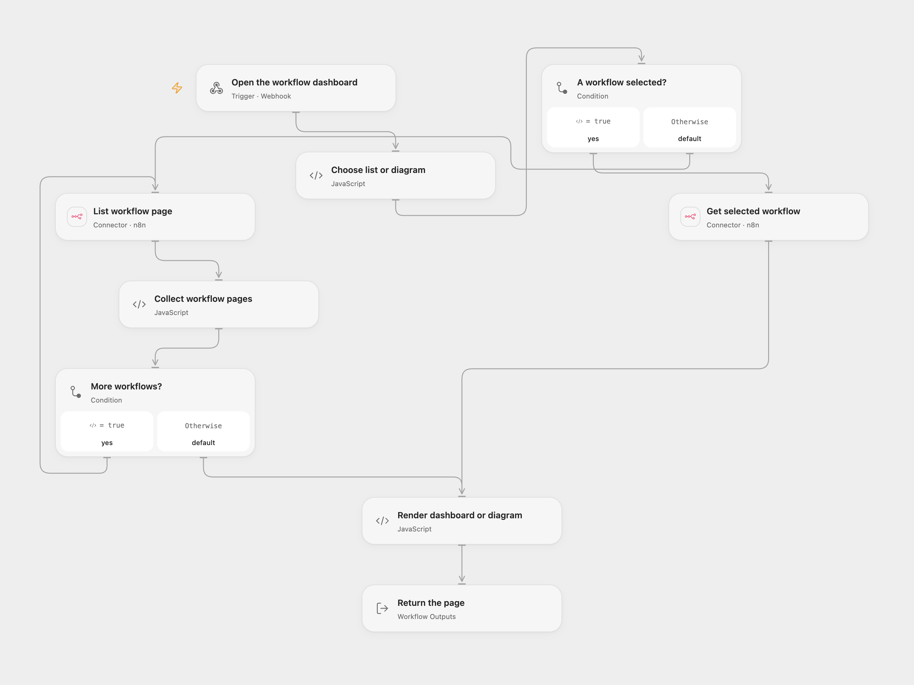

# Browse n8n Workflows with Mermaid

Browse an n8n instance’s workflows and render their node connections as Mermaid diagrams.

<picture>
  <source media="(prefers-color-scheme: dark)" srcset="preview-dark.png">
  
</picture>

[Open Flow JSON](templates/browse-n8n-workflows-with-mermaid.openflow.json) · [n8n JSON](templates/browse-n8n-workflows-with-mermaid.n8n.json)

## Setup

Connect an n8n API account with permission to read workflows on a publicly reachable HTTPS instance, set the n8n instance URL in **Render dashboard or diagram**, and deploy the Open Flow GET webhook. In the bundled n8n workflow set **Fetch Open Flow response** to the deployed Open Flow webhook URL, enable **Open Flow dashboard webhook**, and open its production URL. Restrict both webhook URLs to intended dashboard users. The relay serves the HTML and Mermaid text responses; the direct Open Flow endpoint returns text/plain. The n8n sandbox gives the page an opaque origin, so its diagram requests use Origin null; allow that origin and use access restrictions that do not require browser cookies. For the direct n8n format set the instance URL in **Render dashboard**, connect its API credential to **List workflows** and **Single workflow**, activate its separate webhook, and restrict access. Use one format.

## Use

Open the webhook URL to see workflow names. Select **Show workflow** to fetch the selected graph and render it with Mermaid. The page loads Mermaid from jsDelivr. The list follows all available pages; Open Flow stops above 10,000 workflows instead of truncating. Sticky notes are omitted from diagrams. The dashboard shares workflow names and node connections with anyone who can access the webhook; node credentials and parameters are not included in its output. Workflow execution histories can contain the retrieved configuration.

Inspiration &amp; credits

Replace the original page with a compact dashboard, escape workflow names, and follow all workflow list pages.

Adapted from [Workflow dashboard with mermaid.js](https://github.com/Zie619/n8n-workflows/blob/ae8cf6dc5b873cbb4f74587aa9180ed3a9f70682/workflows/Code/1713_Code_Webhook_Automate_Webhook.json) in [Zie619/n8n-workflows](https://github.com/Zie619/n8n-workflows). The source export does not identify a separate template author or license.

The collection’s [MIT notice](https://github.com/Zie619/n8n-workflows/blob/94007c1445d9258a7da116646b79473e7c7c3282/LICENSE) is pinned at a later revision. This is the collection notice at that revision; it does not establish a separate original template author's license. Our changes are listed above; see [repository licensing](../../README.md#licensing).

> MIT License
>
> Copyright (c) 2025 Zie619
>
> Permission is hereby granted, free of charge, to any person obtaining a copy
> of this software and associated documentation files (the "Software"), to deal
> in the Software without restriction, including without limitation the rights
> to use, copy, modify, merge, publish, distribute, sublicense, and/or sell
> copies of the Software, and to permit persons to whom the Software is
> furnished to do so, subject to the following conditions:
>
> The above copyright notice and this permission notice shall be included in all
> copies or substantial portions of the Software.
>
> THE SOFTWARE IS PROVIDED "AS IS", WITHOUT WARRANTY OF ANY KIND, EXPRESS OR
> IMPLIED, INCLUDING BUT NOT LIMITED TO THE WARRANTIES OF MERCHANTABILITY,
> FITNESS FOR A PARTICULAR PURPOSE AND NONINFRINGEMENT. IN NO EVENT SHALL THE
> AUTHORS OR COPYRIGHT HOLDERS BE LIABLE FOR ANY CLAIM, DAMAGES OR OTHER
> LIABILITY, WHETHER IN AN ACTION OF CONTRACT, TORT OR OTHERWISE, ARISING FROM,
> OUT OF OR IN CONNECTION WITH THE SOFTWARE OR THE USE OR OTHER DEALINGS IN THE
> SOFTWARE.

