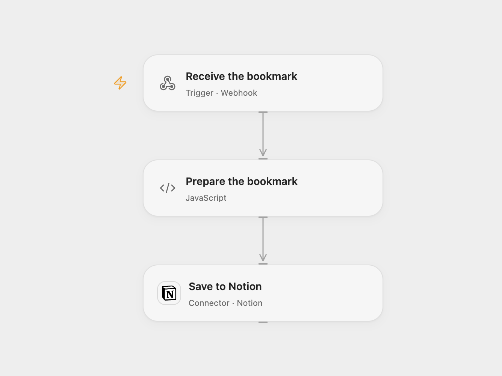

# Save a Browser Bookmark to Notion

Send the current browser page URL to a webhook and save it as a Notion database page.

<picture>
  <source media="(prefers-color-scheme: dark)" srcset="preview-dark.png">
  
</picture>

[Open Flow JSON](templates/browser-bookmark-to-notion.openflow.json) · [n8n JSON](templates/browser-bookmark-to-notion.n8n.json)

## Setup

Create a Notion bookmarks database with a title property named **Name**, share it with your Notion connection and set its data source ID in **Prepare the bookmark**. In n8n, select the Notion credential and destination database in **Notion**. Deploy the selected workflow and copy its public HTTPS webhook URL.

Create a browser bookmark and replace its URL with the following single line, substituting your webhook URL inside the quotes:

```javascript
javascript:(()=>{fetch("YOUR_WEBHOOK_URL",{method:"POST",headers:{"Content-Type":"application/json"},body:JSON.stringify({url:location.href})})})()
```

Both formats permit browser requests from any origin for this bookmarklet. Any reverse proxy must forward OPTIONS and POST requests and preserve CORS response headers. The webhook has no authentication, so anyone who knows its URL can create pages; protect the URL and the destination database. The source n8n webhook also accepts unauthenticated requests. Browser security policies on some pages can prevent the bookmarklet from sending; use another sender with a POST JSON body such as `{"url":"https://example.com"}` when needed.

## Behavior

Click the bookmarklet while viewing a page. The workflow creates a Notion page whose title is the submitted URL. Duplicate clicks or deliveries create duplicate pages. Inspect Notion before retrying an uncertain write. Open Flow rejects a missing or blank URL before creating a page; n8n uses the submitted field directly.

## Changes to the source

- Replace the webhook path and database with setup; use the current Notion data source parent in Open Flow.
- Permit cross-origin browser requests in both formats; Open Flow also validates the URL field.

Original n8n community template: [Bookmarking urls in your browser and save them to Notion](https://n8n.io/workflows/2038-bookmarking-urls-in-your-browser-and-save-them-to-notion/), by Zacharia Kimotho.


<details>
<summary>Source and license</summary>

Adapted from [Bookmarking urls in your browser and save them to Notion](https://github.com/Zie619/n8n-workflows/blob/ae8cf6dc5b873cbb4f74587aa9180ed3a9f70682/workflows/Stickynote/0378_Stickynote_Notion_Automate_Webhook.json) in [Zie619/n8n-workflows](https://github.com/Zie619/n8n-workflows). The source export does not identify a separate template author or license.

The collection’s [MIT notice](https://github.com/Zie619/n8n-workflows/blob/94007c1445d9258a7da116646b79473e7c7c3282/LICENSE) is pinned at a later revision. This is the collection notice at that revision; it does not establish a separate original template author's license. Our changes are listed above; see [repository licensing](../../README.md#licensing).

> MIT License
>
> Copyright (c) 2025 Zie619
>
> Permission is hereby granted, free of charge, to any person obtaining a copy
> of this software and associated documentation files (the "Software"), to deal
> in the Software without restriction, including without limitation the rights
> to use, copy, modify, merge, publish, distribute, sublicense, and/or sell
> copies of the Software, and to permit persons to whom the Software is
> furnished to do so, subject to the following conditions:
>
> The above copyright notice and this permission notice shall be included in all
> copies or substantial portions of the Software.
>
> THE SOFTWARE IS PROVIDED "AS IS", WITHOUT WARRANTY OF ANY KIND, EXPRESS OR
> IMPLIED, INCLUDING BUT NOT LIMITED TO THE WARRANTIES OF MERCHANTABILITY,
> FITNESS FOR A PARTICULAR PURPOSE AND NONINFRINGEMENT. IN NO EVENT SHALL THE
> AUTHORS OR COPYRIGHT HOLDERS BE LIABLE FOR ANY CLAIM, DAMAGES OR OTHER
> LIABILITY, WHETHER IN AN ACTION OF CONTRACT, TORT OR OTHERWISE, ARISING FROM,
> OUT OF OR IN CONNECTION WITH THE SOFTWARE OR THE USE OR OTHER DEALINGS IN THE
> SOFTWARE.

</details>
