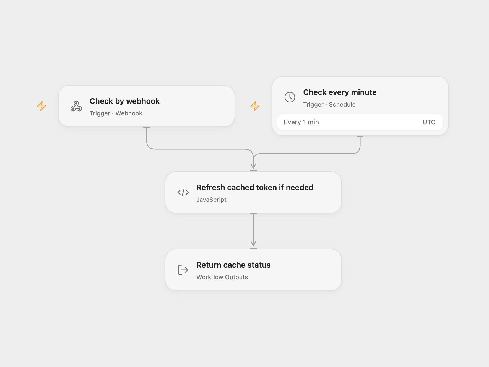

# Cache an Access Token for One Minute

Demonstrate how workflow state can retain a short-lived access token.

<!-- template-actions:start -->
 
<!-- template-actions:end -->

<picture>
  <source media="(prefers-color-scheme: dark)" srcset="preview-dark.png">
  
</picture>

## Setup

Enable persistent State. Set the HTTPS token endpoint in **Refresh cached token if needed** and add its host to that node's HTTP allowlist. The example expects a GET response with a nonempty JSON string field named `AccessToken`. Adjust the request and response mapping to match your issuer. In n8n set the endpoint and any required authentication on **get new accessToken**, activate the workflow, and use the production webhook or schedule.

## Behavior

The schedule checks every minute and the GET webhook can trigger an additional check. A missing or at least one-minute-old token is fetched and stored with its timestamp; a fresh token is reused. Open Flow returns only the cache status. This example ends after caching; adapt the workflow to use the stored token for your own operation. Prevent overlapping runs if your issuer requires a single refresh.

State and n8n execution data can contain the token. Restrict access and retention. The source webhook has no authentication; restrict its exposure to trusted callers. The webhook acknowledges before the cache operation finishes.

Inspiration &amp; credits

## Changes to the source

- Refresh immediately when there is no token, read the response body consistently, configure the endpoint, and use a one-minute UTC schedule.

Adapted from [StaticData Demo](https://github.com/Zie619/n8n-workflows/blob/ae8cf6dc5b873cbb4f74587aa9180ed3a9f70682/workflows/Code/0630_Code_Webhook_Create_Scheduled.json) in [Zie619/n8n-workflows](https://github.com/Zie619/n8n-workflows). The source export does not identify a separate template author or license.

The collection’s [MIT notice](https://github.com/Zie619/n8n-workflows/blob/94007c1445d9258a7da116646b79473e7c7c3282/LICENSE) is pinned at a later revision. This is the collection notice at that revision; it does not establish a separate original template author's license. Our changes are listed above; see [repository licensing](../../README.md#licensing).

> MIT License
>
> Copyright (c) 2025 Zie619
>
> Permission is hereby granted, free of charge, to any person obtaining a copy
> of this software and associated documentation files (the "Software"), to deal
> in the Software without restriction, including without limitation the rights
> to use, copy, modify, merge, publish, distribute, sublicense, and/or sell
> copies of the Software, and to permit persons to whom the Software is
> furnished to do so, subject to the following conditions:
>
> The above copyright notice and this permission notice shall be included in all
> copies or substantial portions of the Software.
>
> THE SOFTWARE IS PROVIDED "AS IS", WITHOUT WARRANTY OF ANY KIND, EXPRESS OR
> IMPLIED, INCLUDING BUT NOT LIMITED TO THE WARRANTIES OF MERCHANTABILITY,
> FITNESS FOR A PARTICULAR PURPOSE AND NONINFRINGEMENT. IN NO EVENT SHALL THE
> AUTHORS OR COPYRIGHT HOLDERS BE LIABLE FOR ANY CLAIM, DAMAGES OR OTHER
> LIABILITY, WHETHER IN AN ACTION OF CONTRACT, TORT OR OTHERWISE, ARISING FROM,
> OUT OF OR IN CONNECTION WITH THE SOFTWARE OR THE USE OR OTHER DEALINGS IN THE
> SOFTWARE.

