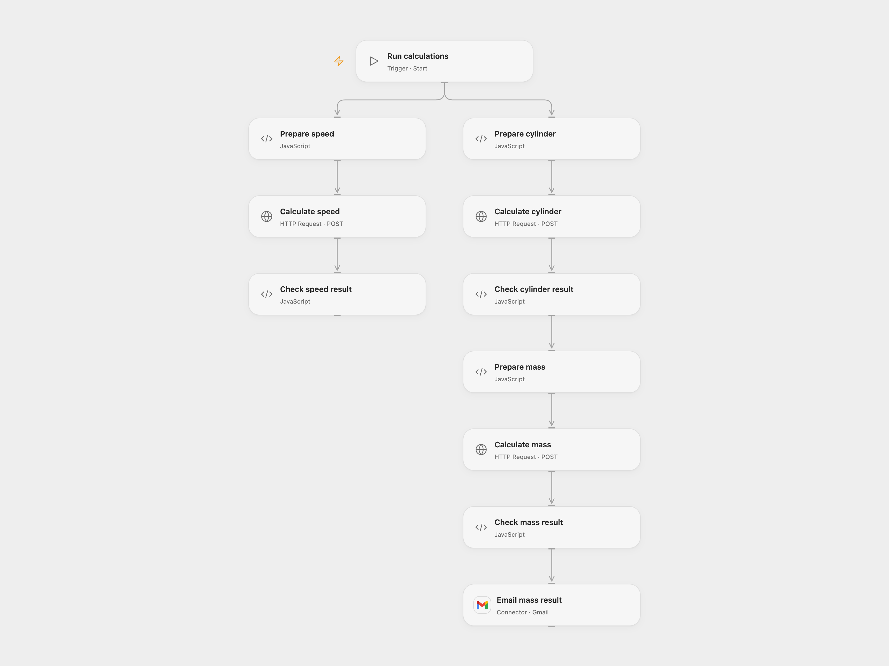

# Calculate Cylinder Mass and Speed

Run cylinder, mass and speed calculations with CalcsLive and email the mass result.

<picture>
  <source media="(prefers-color-scheme: dark)" srcset="preview-dark.png">
  
</picture>

[Open Flow JSON](templates/calculate-cylinder-mass-and-speed.openflow.json) · [n8n JSON](templates/calculate-cylinder-mass-and-speed.n8n.json)

## Setup

Create three CalcsLive articles with matching input and output symbols: cylinder (D, h → A, V), mass (ρ, V → m), and speed (d, t). Enter their IDs in the matching **Prepare** nodes, bind the secret Variable CALCSLIVE_API_KEY to each HTTP request, and connect Gmail. Set the recipient in **Prepare mass**. Run manually.

For n8n, install the CalcsLive community node package, connect its API credential and Gmail, set the three article IDs and the recipient, then run manually. Use one format.

## Behavior

The cylinder uses D = 200 mm and h = 20 cm. Its volume and unit feed the mass calculation with density 1,000 kg/m³; the result is emailed. The separate speed calculation uses 360 km and 10 h and remains available in its node result. The source's unused 2 h Set field did not change the speed node; this template exposes the actual 10 h input. Edit the preparation nodes to change these example values. An uncertain email send may have succeeded; check sent mail before rerunning.

Inspiration &amp; credits

## Changes to the source

- Make article IDs, the API secret and recipient configuration explicit; use the API directly in Open Flow.

Adapted from [CalcsLive engineering calculations](https://github.com/Zie619/n8n-workflows/blob/ae8cf6dc5b873cbb4f74587aa9180ed3a9f70682/workflows/Calcslive/2058_Calcslive_Engineering_Calculations_Manual.json) in [Zie619/n8n-workflows](https://github.com/Zie619/n8n-workflows). The source export does not identify a separate template author or license.

The collection’s [MIT notice](https://github.com/Zie619/n8n-workflows/blob/94007c1445d9258a7da116646b79473e7c7c3282/LICENSE) is pinned at a later revision. This is the collection notice at that revision; it does not establish a separate original template author's license. Our changes are listed above; see [repository licensing](../../README.md#licensing).

> MIT License
>
> Copyright (c) 2025 Zie619
>
> Permission is hereby granted, free of charge, to any person obtaining a copy
> of this software and associated documentation files (the "Software"), to deal
> in the Software without restriction, including without limitation the rights
> to use, copy, modify, merge, publish, distribute, sublicense, and/or sell
> copies of the Software, and to permit persons to whom the Software is
> furnished to do so, subject to the following conditions:
>
> The above copyright notice and this permission notice shall be included in all
> copies or substantial portions of the Software.
>
> THE SOFTWARE IS PROVIDED "AS IS", WITHOUT WARRANTY OF ANY KIND, EXPRESS OR
> IMPLIED, INCLUDING BUT NOT LIMITED TO THE WARRANTIES OF MERCHANTABILITY,
> FITNESS FOR A PARTICULAR PURPOSE AND NONINFRINGEMENT. IN NO EVENT SHALL THE
> AUTHORS OR COPYRIGHT HOLDERS BE LIABLE FOR ANY CLAIM, DAMAGES OR OTHER
> LIABILITY, WHETHER IN AN ACTION OF CONTRACT, TORT OR OTHERWISE, ARISING FROM,
> OUT OF OR IN CONNECTION WITH THE SOFTWARE OR THE USE OR OTHER DEALINGS IN THE
> SOFTWARE.

