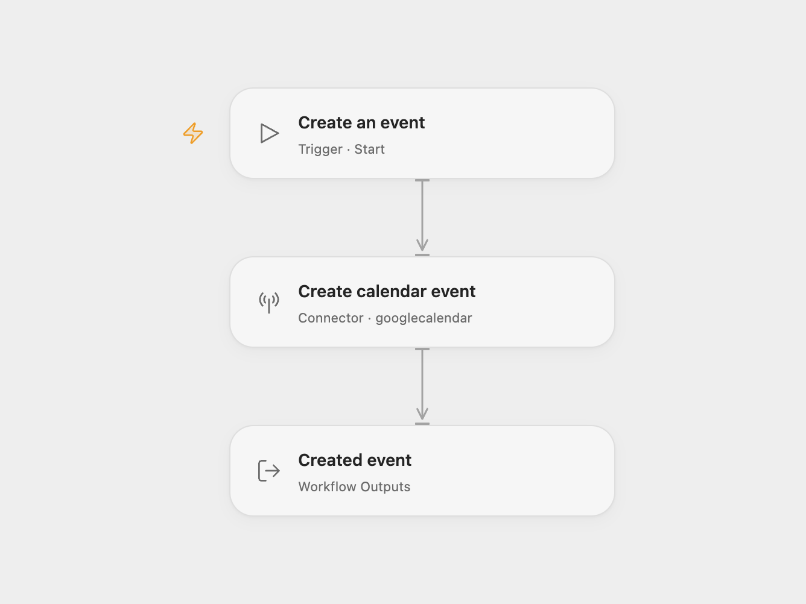

# Calendar Event Creator

Create one event in a Google Calendar you can edit. Run the workflow manually after setting the event details.

<picture>
  <source media="(prefers-color-scheme: dark)" srcset="preview-dark.png">
  
</picture>

[Open Flow JSON](templates/calendar-event-creator.openflow.json) · [n8n JSON](templates/calendar-event-creator.n8n.json)

## Setup

For Open Flow, import the JSON, connect Google Calendar in **Create calendar event**, and replace `YOUR_CALENDAR_ID`. Edit the event object’s `summary`, `start`, and `end`. Use timestamps with explicit UTC offsets; the example event is January 1, 2030, 09:00–10:00 UTC.

For n8n, connect Google Calendar in **Google Calendar**, select the calendar, and edit Start, End, and Summary. The workflow timezone is UTC.

Run once to create the event. Open Flow returns its ID and a web link when Google supplies one; n8n shows the created event in the final node output. Each run creates a new event with the configured details. There are no attendees, recurrence rules, or extra notifications configured. Existing calendar reminder defaults apply.

## Changes to the source

- Replace the source’s personal calendar ID with a setup placeholder.
- Replace the old example dates with a clearly stated UTC example and an editable title.
- Expose the created event’s ID and link in Open Flow.

Source and license

Adapted from [Add an event to Calendar](https://github.com/Zie619/n8n-workflows/blob/ae8cf6dc5b873cbb4f74587aa9180ed3a9f70682/workflows/Manual/0342_Manual_GoogleCalendar_Create_Triggered.json) in [Zie619/n8n-workflows](https://github.com/Zie619/n8n-workflows). The source export does not identify a separate template author or license.

The collection’s [MIT notice](https://github.com/Zie619/n8n-workflows/blob/94007c1445d9258a7da116646b79473e7c7c3282/LICENSE) is pinned at a later revision. This is the collection notice at that revision; it does not establish a separate original template author's license. Our changes are listed above; see [repository licensing](../../README.md#licensing).

> MIT License
>
> Copyright (c) 2025 Zie619
>
> Permission is hereby granted, free of charge, to any person obtaining a copy
> of this software and associated documentation files (the "Software"), to deal
> in the Software without restriction, including without limitation the rights
> to use, copy, modify, merge, publish, distribute, sublicense, and/or sell
> copies of the Software, and to permit persons to whom the Software is
> furnished to do so, subject to the following conditions:
>
> The above copyright notice and this permission notice shall be included in all
> copies or substantial portions of the Software.
>
> THE SOFTWARE IS PROVIDED "AS IS", WITHOUT WARRANTY OF ANY KIND, EXPRESS OR
> IMPLIED, INCLUDING BUT NOT LIMITED TO THE WARRANTIES OF MERCHANTABILITY,
> FITNESS FOR A PARTICULAR PURPOSE AND NONINFRINGEMENT. IN NO EVENT SHALL THE
> AUTHORS OR COPYRIGHT HOLDERS BE LIABLE FOR ANY CLAIM, DAMAGES OR OTHER
> LIABILITY, WHETHER IN AN ACTION OF CONTRACT, TORT OR OTHERWISE, ARISING FROM,
> OUT OF OR IN CONNECTION WITH THE SOFTWARE OR THE USE OR OTHER DEALINGS IN THE
> SOFTWARE.

