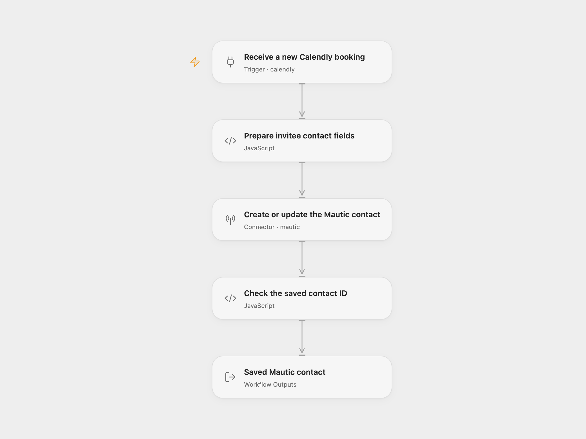

# Calendly Booking to Mautic Contact

Create a contact in Mautic, or update the matching contact’s first-name field, when an invitee books a Calendly meeting.

<picture>
  <source media="(prefers-color-scheme: dark)" srcset="preview-dark.png">
  
</picture>

[Open Flow JSON](templates/calendly-booking-to-mautic-contact.openflow.json) · [n8n JSON](templates/calendly-booking-to-mautic-contact.n8n.json)

## Setup

In Open Flow, connect a Calendly **Personal Access Token** in **Receive a new Calendly booking**, and a Mautic account in **Create or update the Mautic contact**. The Calendly account needs access to manage webhooks for its own user. Keep **Scope** set to `user` and **Event Types** set to `invitee.created`. OAuth application signing keys are not supported by this Open Flow trigger.

In n8n, choose **Personal Access Token** credentials in **On new event** and **Mautic API** credentials in **Create/update contact**. Use the Mautic instance’s HTTPS base URL, username and password. Enable REST API and Basic authentication, and grant that account contact-create/edit permission. Configure email as a unique Mautic field so the server matches existing contacts by email. No contact search or separate update request is added.

Deploy with a public HTTPS callback and activate the workflow to register its signed Calendly subscription. Use a fresh signed subscription; remove an older unsigned subscription for the same n8n callback before activation. Both formats manage their own subscription. Activate one format for this business process to avoid two separate updates from the same booking.

## Behavior

A new `invitee.created` delivery supplies the invitee’s email and name. The workflow validates both values, makes one Mautic contact request, checks the returned contact ID and returns the complete saved contact. It subscribes to this user’s new bookings, including the created event from a reschedule. It does not process cancellations, fetch old bookings, add contacts to segments or send marketing messages.

As in the source, the full Calendly `name` is written to Mautic’s `firstname` field. It does not split a full name or infer a family name. The source’s other standard name/company fields are sent as blank values; Mautic’s default behavior skips blanks on an existing contact. Keep `overwriteWithBlank` unset. Existing-contact matching depends on your instance’s unique-field configuration.

Open Flow returns **Contact**; n8n returns that contact as one item. Email/name validation failure prevents the write. API errors or a missing saved ID stop the run. No workflow retry or exactly-once guarantee is added: a repeated booking delivery can update the contact again and may trigger server-side Mautic automations. Check Mautic before replaying a write with an unknown result.

Both newly registered subscriptions verify Calendly signatures. Open Flow accepts signature timestamps within three minutes; the native n8n trigger uses a five-minute window. Keep the execution server’s clock accurate. A successful webhook acknowledgment does not prove that the later CRM write succeeded.

Inspiration &amp; credits

## Changes to the source

- Make the source’s Personal Access Token, user scope, booking-created event, Basic authentication and raw-contact output explicit.
- Reject missing invitee name/email before contacting Mautic, and confirm a saved ID afterward.
- Preserve the email/name mapping, single contact request and server-side matching behavior without adding searches or notifications.

Adapted from [Create or update Mautic contact on a new Calendly event](https://github.com/Zie619/n8n-workflows/blob/ae8cf6dc5b873cbb4f74587aa9180ed3a9f70682/workflows/Calendly/0277_Calendly_Mautic_Create_Triggered.json) in [Zie619/n8n-workflows](https://github.com/Zie619/n8n-workflows). The source export does not identify a separate template author or license.

The collection’s [MIT notice](https://github.com/Zie619/n8n-workflows/blob/94007c1445d9258a7da116646b79473e7c7c3282/LICENSE) is pinned at a later revision. This is the collection notice at that revision; it does not establish a separate original template author's license. Our changes are listed above; see [repository licensing](../../README.md#licensing).

> MIT License
>
> Copyright (c) 2025 Zie619
>
> Permission is hereby granted, free of charge, to any person obtaining a copy
> of this software and associated documentation files (the "Software"), to deal
> in the Software without restriction, including without limitation the rights
> to use, copy, modify, merge, publish, distribute, sublicense, and/or sell
> copies of the Software, and to permit persons to whom the Software is
> furnished to do so, subject to the following conditions:
>
> The above copyright notice and this permission notice shall be included in all
> copies or substantial portions of the Software.
>
> THE SOFTWARE IS PROVIDED "AS IS", WITHOUT WARRANTY OF ANY KIND, EXPRESS OR
> IMPLIED, INCLUDING BUT NOT LIMITED TO THE WARRANTIES OF MERCHANTABILITY,
> FITNESS FOR A PARTICULAR PURPOSE AND NONINFRINGEMENT. IN NO EVENT SHALL THE
> AUTHORS OR COPYRIGHT HOLDERS BE LIABLE FOR ANY CLAIM, DAMAGES OR OTHER
> LIABILITY, WHETHER IN AN ACTION OF CONTRACT, TORT OR OTHERWISE, ARISING FROM,
> OUT OF OR IN CONNECTION WITH THE SOFTWARE OR THE USE OR OTHER DEALINGS IN THE
> SOFTWARE.

