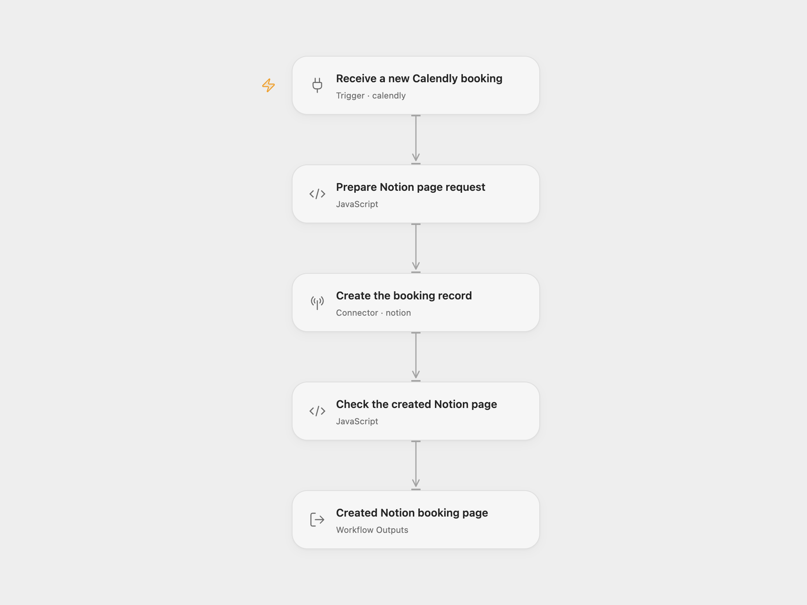

# Calendly Booking to Notion

Create a Notion record for each new Calendly booking, storing the invitee’s name, email and one configured status.

<picture>
  <source media="(prefers-color-scheme: dark)" srcset="preview-dark.png">
  
</picture>

[Open Flow JSON](templates/calendly-booking-to-notion.openflow.json) · [n8n JSON](templates/calendly-booking-to-notion.n8n.json)

## Setup

Prepare a Notion data source with **Name** as its title property, **Email** as an email property, and **Status** as a select property. Share it with a Notion internal integration that can insert content. Obtain the destination **data source ID** and the ID of an existing Status option. The source export does not identify that option’s display name; choose your own existing option. The workflow uses its ID and does not create a new select option.

In Open Flow, connect a Calendly **Personal Access Token** in **Receive a new Calendly booking** and your Notion account in **Create the booking record**. In **Prepare Notion page request**, configure `dataSourceId` and `statusOptionId`. Use a data source ID rather than the enclosing database ID; Notion provides **Copy data source ID** in the database’s data-source settings.

In n8n, connect **Calendly Personal Access Token API** in the trigger and **Notion API** credentials in **Create the booking record**. Set the two configuration constants at the start of **Prepare Notion page request**. The native HTTP step preserves the supplied `Notion-Version: 2026-03-11` while Notion API credentials manage the integration secret. Keep that header and the current page request format together.

Keep Calendly scope `user` and event `invitee.created`. Deploy a public HTTPS callback and activate to register a fresh signed subscription. Remove an older unsigned subscription for the same n8n callback before activation. Use one format for this process; activating both registers two subscriptions and can create two records. Open Flow’s Calendly trigger requires a Personal Access Token connection.

## Behavior

Each accepted booking validates its name, email and configured IDs, then creates one Notion page and returns the complete page after checking its ID. The workflow creates a new record, so repeated delivery can create another page. It does not search for duplicates, update an earlier booking, process cancellations, add page-body content or send a message. The created event from a reschedule also creates a new record. No additional schema lookup or select-option creation is performed.

Invalid configuration or missing invitee data stops before the write. Notion permission, property or API errors stop the run. No workflow retry or exactly-once write guarantee is added. Check Notion before replaying a write with an unknown result.

New subscriptions verify signatures. Open Flow uses a three-minute signature timestamp window; native n8n uses five minutes. Keep the server clock accurate. Webhook acknowledgment does not confirm the later Notion write.

Inspiration &amp; credits

## Changes to the source

- Read name and email from the current Calendly v2 invitee payload instead of obsolete nested `payload.invitee` paths.
- Replace the source’s private database and Status option IDs with destination configuration, using a data-source parent for Notion’s current API.
- Validate required values before creating a page and verify the returned page ID while preserving the complete response.

Adapted from [Calendly booking to Notion database workflow](https://github.com/Zie619/n8n-workflows/blob/ae8cf6dc5b873cbb4f74587aa9180ed3a9f70682/workflows/Calendly/0039_Calendly_Notion_Automate_Triggered.json) in [Zie619/n8n-workflows](https://github.com/Zie619/n8n-workflows). The source export does not identify a separate template author or license.

The collection’s [MIT notice](https://github.com/Zie619/n8n-workflows/blob/94007c1445d9258a7da116646b79473e7c7c3282/LICENSE) is pinned at a later revision. This is the collection notice at that revision; it does not establish a separate original template author's license. Our changes are listed above; see [repository licensing](../../README.md#licensing).

> MIT License
>
> Copyright (c) 2025 Zie619
>
> Permission is hereby granted, free of charge, to any person obtaining a copy
> of this software and associated documentation files (the "Software"), to deal
> in the Software without restriction, including without limitation the rights
> to use, copy, modify, merge, publish, distribute, sublicense, and/or sell
> copies of the Software, and to permit persons to whom the Software is
> furnished to do so, subject to the following conditions:
>
> The above copyright notice and this permission notice shall be included in all
> copies or substantial portions of the Software.
>
> THE SOFTWARE IS PROVIDED "AS IS", WITHOUT WARRANTY OF ANY KIND, EXPRESS OR
> IMPLIED, INCLUDING BUT NOT LIMITED TO THE WARRANTIES OF MERCHANTABILITY,
> FITNESS FOR A PARTICULAR PURPOSE AND NONINFRINGEMENT. IN NO EVENT SHALL THE
> AUTHORS OR COPYRIGHT HOLDERS BE LIABLE FOR ANY CLAIM, DAMAGES OR OTHER
> LIABILITY, WHETHER IN AN ACTION OF CONTRACT, TORT OR OTHERWISE, ARISING FROM,
> OUT OF OR IN CONNECTION WITH THE SOFTWARE OR THE USE OR OTHER DEALINGS IN THE
> SOFTWARE.

