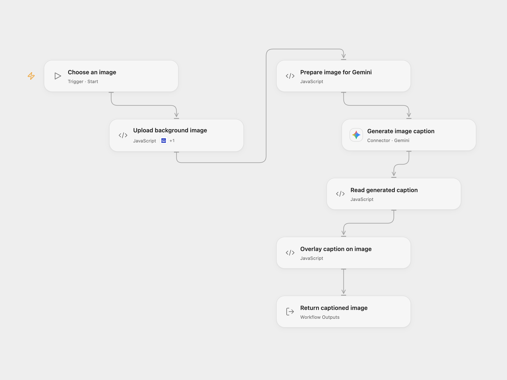

# Caption an Image with Gemini

Generate a caption for an image and overlay it on the picture.

<!-- template-actions:start -->
 
<!-- template-actions:end -->

<picture>
  <source media="(prefers-color-scheme: dark)" srcset="preview-dark.png">
  
</picture>

## Setup

Provide a publicly accessible HTTPS image URL. Connect Cloudinary and Gemini, and enable Provider API access for Gemini. Enable persistent State. In n8n set the image URL in **Get Image**, connect Gemini and make Arial available to the Edit Image node. Use one format.

## Behavior

The image is resized for Gemini, which generates a title and caption. They are drawn near the bottom of the original image over a translucent dark background. Open Flow returns a JPEG and the caption; n8n returns the edited image. Text layout can differ between the two rendering services. Review AI-generated captions before publishing.

Open Flow uploads the background to Cloudinary and retains the asset. The same URL reuses the saved upload; use a new URL if its content changes. If an upload is uncertain, inspect the Cloudinary account and enter the pending key in **Upload background image** with resolution absent to retry, or confirmed and the verified Cloudinary image URL to continue. Clear the recovery fields afterward. Gemini receives a resized image. Cloudinary text rendering does not support all Unicode characters; an unsupported caption can fail.

Inspiration &amp; credits

Use a current Gemini model, a configurable image and Cloudinary rendering with upload recovery in Open Flow.

Adapted from [Generate an image caption with Gemini](https://github.com/Zie619/n8n-workflows/blob/ae8cf6dc5b873cbb4f74587aa9180ed3a9f70682/workflows/Code/0577_Code_Editimage_Update_Webhook.json) in [Zie619/n8n-workflows](https://github.com/Zie619/n8n-workflows). The source export does not identify a separate template author or license.

The collection’s [MIT notice](https://github.com/Zie619/n8n-workflows/blob/94007c1445d9258a7da116646b79473e7c7c3282/LICENSE) is pinned at a later revision. This is the collection notice at that revision; it does not establish a separate original template author's license. Our changes are listed above; see [repository licensing](../../README.md#licensing).

> MIT License
>
> Copyright (c) 2025 Zie619
>
> Permission is hereby granted, free of charge, to any person obtaining a copy
> of this software and associated documentation files (the "Software"), to deal
> in the Software without restriction, including without limitation the rights
> to use, copy, modify, merge, publish, distribute, sublicense, and/or sell
> copies of the Software, and to permit persons to whom the Software is
> furnished to do so, subject to the following conditions:
>
> The above copyright notice and this permission notice shall be included in all
> copies or substantial portions of the Software.
>
> THE SOFTWARE IS PROVIDED "AS IS", WITHOUT WARRANTY OF ANY KIND, EXPRESS OR
> IMPLIED, INCLUDING BUT NOT LIMITED TO THE WARRANTIES OF MERCHANTABILITY,
> FITNESS FOR A PARTICULAR PURPOSE AND NONINFRINGEMENT. IN NO EVENT SHALL THE
> AUTHORS OR COPYRIGHT HOLDERS BE LIABLE FOR ANY CLAIM, DAMAGES OR OTHER
> LIABILITY, WHETHER IN AN ACTION OF CONTRACT, TORT OR OTHERWISE, ARISING FROM,
> OUT OF OR IN CONNECTION WITH THE SOFTWARE OR THE USE OR OTHER DEALINGS IN THE
> SOFTWARE.

