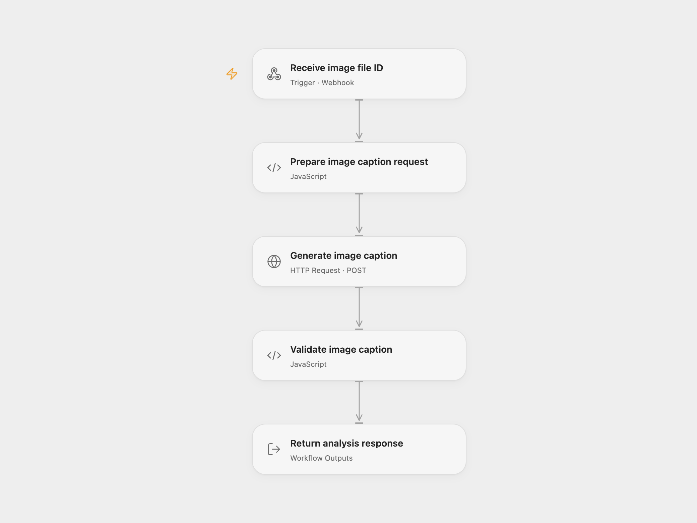

# Caption and Overlay a Remote Image

Generate a caption for a remote image and overlay it on the original.

<!-- template-actions:start -->
 
<!-- template-actions:end -->

<picture>
  <source media="(prefers-color-scheme: dark)" srcset="preview-dark.png">
  
</picture>

## Setup

Configure OpenAI credentials with access to gpt-5.4-mini; the free API tier is not supported.

## Behavior

The workflow downloads an image, resizes a copy to 512 × 512 for vision, and generates a title and caption. It calculates placement from the original image dimensions and draws the caption over the original. The model sees the image and may make incorrect claims; review the result. Uploaded files remain in the OpenAI account according to its retention settings. If an upload outcome is uncertain, inspect the account before retrying.

In n8n

Configure the image URL and a supported font in n8n Edit Image nodes; install its GraphicsMagick prerequisite. For Open Flow mode, deploy its webhook and set OPENAI_API_KEY and the n8n relay URL; use the same OpenAI account for the resized image upload. Open Flow uses the n8n frontend for image transfer and rendering.

Inspiration &amp; credits

Adapted from [Easy Image Captioning with Gemini 1.5 Pro](https://github.com/enescingoz/awesome-n8n-templates/blob/827110332c21cbe000ab13f6d292d5adb1f1f8db/OpenAI_and_LLMs/Easy%20Image%20Captioning%20with%20Gemini%201.5%20Pro.json) in [enescingoz/awesome-n8n-templates](https://github.com/enescingoz/awesome-n8n-templates).

Source collection notice: © 2024–2026 Enes Cingoz, [CC BY 4.0](https://github.com/enescingoz/awesome-n8n-templates/blob/827110332c21cbe000ab13f6d292d5adb1f1f8db/LICENSE). The source export does not identify a separate template author or license. See [repository licensing](../../README.md#licensing) for the scope of OOMOL contributions and third-party material.

