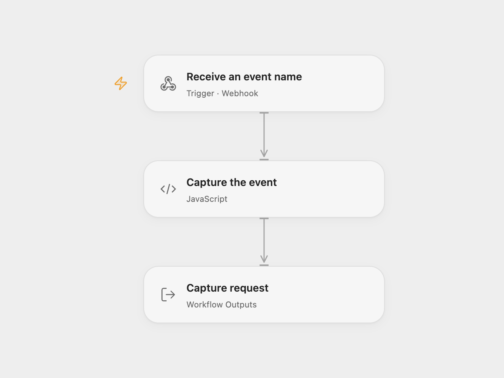

# Capture a PostHog Event from a Webhook

Capture a named PostHog event when a webhook is requested.

<picture>
  <source media="(prefers-color-scheme: dark)" srcset="preview-dark.png">
  
</picture>

[Open Flow JSON](templates/capture-posthog-event-from-webhook.openflow.json) · [n8n JSON](templates/capture-posthog-event-from-webhook.n8n.json)

## Setup and use

In Open Flow bind your PostHog project token to the secret Variable **POSTHOG_PROJECT_TOKEN** in **Capture the event**. Set the capture URL and the node’s HTTP host allowlist to your PostHog region or self-hosted instance. The example uses the US ingestion host. In n8n configure your PostHog credential and host. Publish or activate one format, then request the webhook URL with an `event` query parameter.

## Behavior

Each GET sends one event with the requested name and the fixed distinct ID `n8n`. The webhook acknowledges receipt immediately, before the capture result is known. A successful capture HTTP response is an acceptance rather than confirmation that the event was processed. A failed or uncertain request may already have been accepted; check PostHog before retrying. The webhook is unauthenticated, so anyone who can reach it can submit events; protect the URL or add access controls.

Inspiration &amp; credits

## Changes to the source

- Open Flow uses the PostHog capture HTTP endpoint with the project token supplied as a Variable. The n8n format retains its PostHog node.

Adapted from [Webhook PostHog event](https://github.com/Zie619/n8n-workflows/blob/ae8cf6dc5b873cbb4f74587aa9180ed3a9f70682/workflows/Posthog/1217_Posthog_Webhook_Automate_Webhook.json) in [Zie619/n8n-workflows](https://github.com/Zie619/n8n-workflows). The source export does not identify a separate template author or license.

The collection’s [MIT notice](https://github.com/Zie619/n8n-workflows/blob/94007c1445d9258a7da116646b79473e7c7c3282/LICENSE) is pinned at a later revision. This is the collection notice at that revision; it does not establish a separate original template author's license. Our changes are listed above; see [repository licensing](../../README.md#licensing).

> MIT License
>
> Copyright (c) 2025 Zie619
>
> Permission is hereby granted, free of charge, to any person obtaining a copy
> of this software and associated documentation files (the "Software"), to deal
> in the Software without restriction, including without limitation the rights
> to use, copy, modify, merge, publish, distribute, sublicense, and/or sell
> copies of the Software, and to permit persons to whom the Software is
> furnished to do so, subject to the following conditions:
>
> The above copyright notice and this permission notice shall be included in all
> copies or substantial portions of the Software.
>
> THE SOFTWARE IS PROVIDED "AS IS", WITHOUT WARRANTY OF ANY KIND, EXPRESS OR
> IMPLIED, INCLUDING BUT NOT LIMITED TO THE WARRANTIES OF MERCHANTABILITY,
> FITNESS FOR A PARTICULAR PURPOSE AND NONINFRINGEMENT. IN NO EVENT SHALL THE
> AUTHORS OR COPYRIGHT HOLDERS BE LIABLE FOR ANY CLAIM, DAMAGES OR OTHER
> LIABILITY, WHETHER IN AN ACTION OF CONTRACT, TORT OR OTHERWISE, ARISING FROM,
> OUT OF OR IN CONNECTION WITH THE SOFTWARE OR THE USE OR OTHER DEALINGS IN THE
> SOFTWARE.

