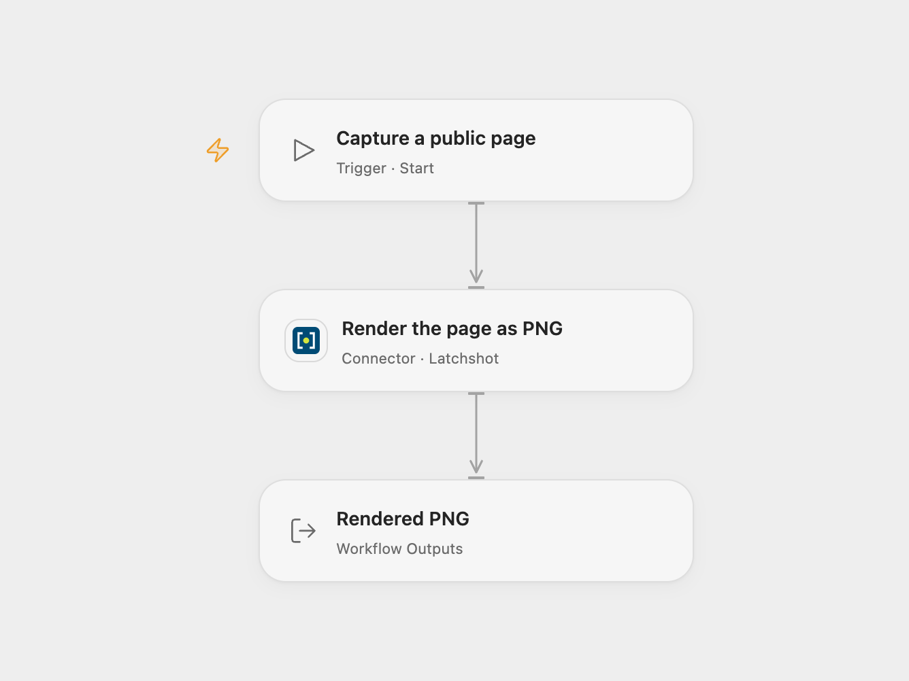

# Capture a Public Page with Latchshot

Render a public web page as a PNG using a chosen viewport.

<picture>
  <source media="(prefers-color-scheme: dark)" srcset="preview-dark.png">
  
</picture>

[Open Flow JSON](templates/capture-public-page-with-latchshot.openflow.json) · [n8n JSON](templates/capture-public-page-with-latchshot.n8n.json)

## Setup

Connect a Latchshot API key to **Render the page as PNG**. Set the public page URL, viewport width and height, full-page option and delay. The sample uses a 1440 × 900 viewport and waits 250 ms after navigation. The Connector deployment must have file transit configured.

In n8n, select an HTTP Bearer Auth credential on **Capture public page** and configure the same inputs in **Set capture input**. Use one format for each capture.

## Behavior

Run manually to request one screenshot. Latchshot accepts public HTTP or HTTPS targets subject to its URL and render limits. Open Flow returns a PNG file reference in Connector transit storage, including its MIME type and size, plus render diagnostics when provided. The transit link is publicly readable. The Connector tags the object for expiry, but deletion depends on the storage deployment’s lifecycle configuration. Treat the link as shareable and copy the artifact to durable storage if needed. The n8n output is the binary field **capture**. The Connector requires transit storage and limits the uploaded artifact to 512 MiB.

A failed render or transit upload stops the workflow. A render can succeed before an upload fails; inspect the service before retrying. The workflow adds no automatic replay.

## Changes to the source

- Use the Connector action and its file-transit result in Open Flow; n8n retains its binary output.
- Send the configured delay using the service's delay field in both formats.

Source and license

Adapted from [Latchshot — capture a public webpage](https://github.com/enescingoz/awesome-n8n-templates/blob/827110332c21cbe000ab13f6d292d5adb1f1f8db/Other_Integrations_and_Use_Cases/Latchshot%20%E2%80%94%20capture%20a%20public%20webpage.json) in [enescingoz/awesome-n8n-templates](https://github.com/enescingoz/awesome-n8n-templates).

Source collection notice: © 2024–2026 Enes Cingoz, [CC BY 4.0](https://github.com/enescingoz/awesome-n8n-templates/blob/827110332c21cbe000ab13f6d292d5adb1f1f8db/LICENSE). The source export does not identify a separate template author or license. See [repository licensing](../../README.md#licensing) for the scope of OOMOL contributions and third-party material.

