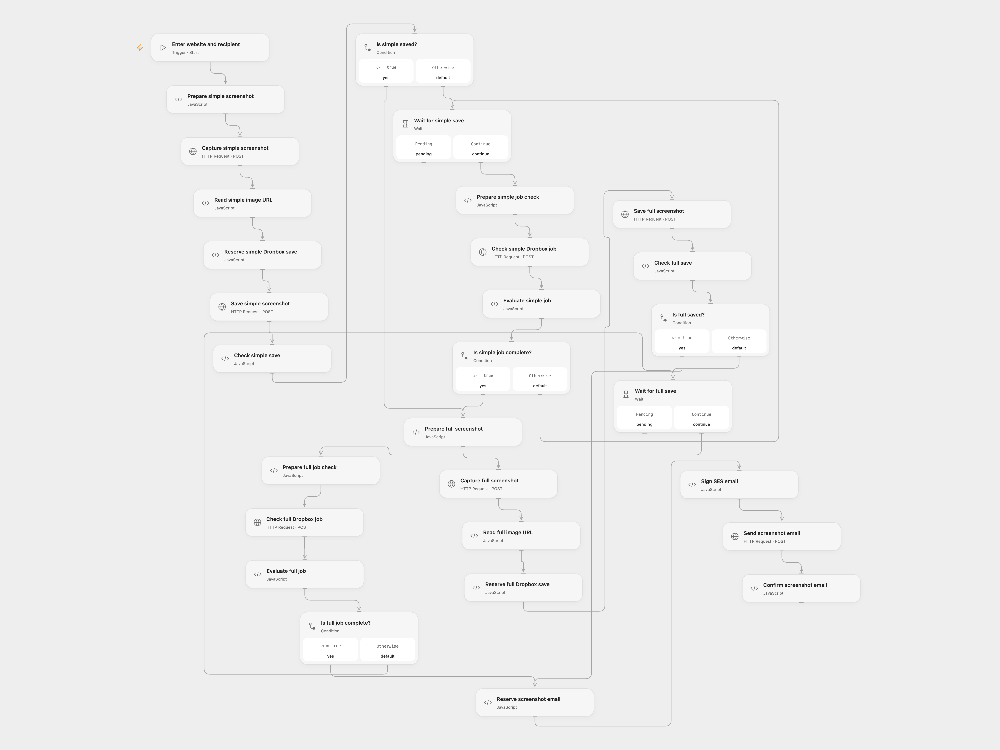

# Capture Webpage Screenshots to Dropbox and Email

Capture standard and full-page screenshots, save them to Dropbox, and email the images.

<picture>
  <source media="(prefers-color-scheme: dark)" srcset="preview-dark.png">
  
</picture>

[Open Flow JSON](templates/capture-webpage-screenshots-to-dropbox-and-email.openflow.json) · [n8n JSON](templates/capture-webpage-screenshots-to-dropbox-and-email.n8n.json)

## Setup

Provide a public website URL, recipient email and a unique submission ID. Configure a Dropbox folder. Bind UPROC_EMAIL and UPROC_API_KEY for the legacy Uproc v2 API and DROPBOX_ACCESS_TOKEN. Configure a verified SES sender and region, bind AWS_ACCESS_KEY_ID and AWS_SECRET_ACCESS_KEY, and enable persistent State. For temporary AWS credentials bind the same session token to the signing node and SES header.

In n8n configure Uproc, Dropbox and AWS SES credentials, website and recipient in **Create Web + Email Item**, and the verified sender in **Send Email**. Select a Data Table with item_key and status text columns. Use one format per run. Restrict access to execution history because it contains signed requests and addresses.

## Behavior

Uproc generates a 640-pixel standard and full-page screenshot. Each is saved in Dropbox; the email embeds both original screenshot URLs. Open Flow uses Dropbox's save_url, which may rename files on collision, so use unique submission IDs and inspect the actual saved paths. n8n downloads and uploads the original binary. URLs and images may contain sensitive content.

If either Dropbox save or the email result is uncertain, inspect Dropbox or SES before retrying. Open Flow keeps per-operation pending keys; enter the key and confirmed or absent in the relevant reserve node, replay and clear fields. Confirmed results stop for manual completion; do not replay the completed write. In n8n inspect Data Table rows, complete missing work manually, mark done after confirmation or delete only if no write occurred. Errors can leave earlier saves completed.

[Dropbox save_url](https://opensource.dropbox.com/SwiftyDropbox/api-docs/latest/Classes/FilesRoutes.html) may run asynchronously and names conflicts automatically.

Inspiration &amp; credits

Use unique Dropbox paths and checkpoints; Open Flow imports screenshot URLs through Dropbox rather than passing image bytes through Code.

Adapted from [screenshot](https://github.com/Zie619/n8n-workflows/blob/ae8cf6dc5b873cbb4f74587aa9180ed3a9f70682/workflows/Functionitem/0031_Functionitem_Dropbox_Automation_Webhook.json) in [Zie619/n8n-workflows](https://github.com/Zie619/n8n-workflows). The source export does not identify a separate template author or license.

The collection’s [MIT notice](https://github.com/Zie619/n8n-workflows/blob/94007c1445d9258a7da116646b79473e7c7c3282/LICENSE) is pinned at a later revision. This is the collection notice at that revision; it does not establish a separate original template author's license. Our changes are listed above; see [repository licensing](../../README.md#licensing).

> MIT License
>
> Copyright (c) 2025 Zie619
>
> Permission is hereby granted, free of charge, to any person obtaining a copy
> of this software and associated documentation files (the "Software"), to deal
> in the Software without restriction, including without limitation the rights
> to use, copy, modify, merge, publish, distribute, sublicense, and/or sell
> copies of the Software, and to permit persons to whom the Software is
> furnished to do so, subject to the following conditions:
>
> The above copyright notice and this permission notice shall be included in all
> copies or substantial portions of the Software.
>
> THE SOFTWARE IS PROVIDED "AS IS", WITHOUT WARRANTY OF ANY KIND, EXPRESS OR
> IMPLIED, INCLUDING BUT NOT LIMITED TO THE WARRANTIES OF MERCHANTABILITY,
> FITNESS FOR A PARTICULAR PURPOSE AND NONINFRINGEMENT. IN NO EVENT SHALL THE
> AUTHORS OR COPYRIGHT HOLDERS BE LIABLE FOR ANY CLAIM, DAMAGES OR OTHER
> LIABILITY, WHETHER IN AN ACTION OF CONTRACT, TORT OR OTHERWISE, ARISING FROM,
> OUT OF OR IN CONNECTION WITH THE SOFTWARE OR THE USE OR OTHER DEALINGS IN THE
> SOFTWARE.

