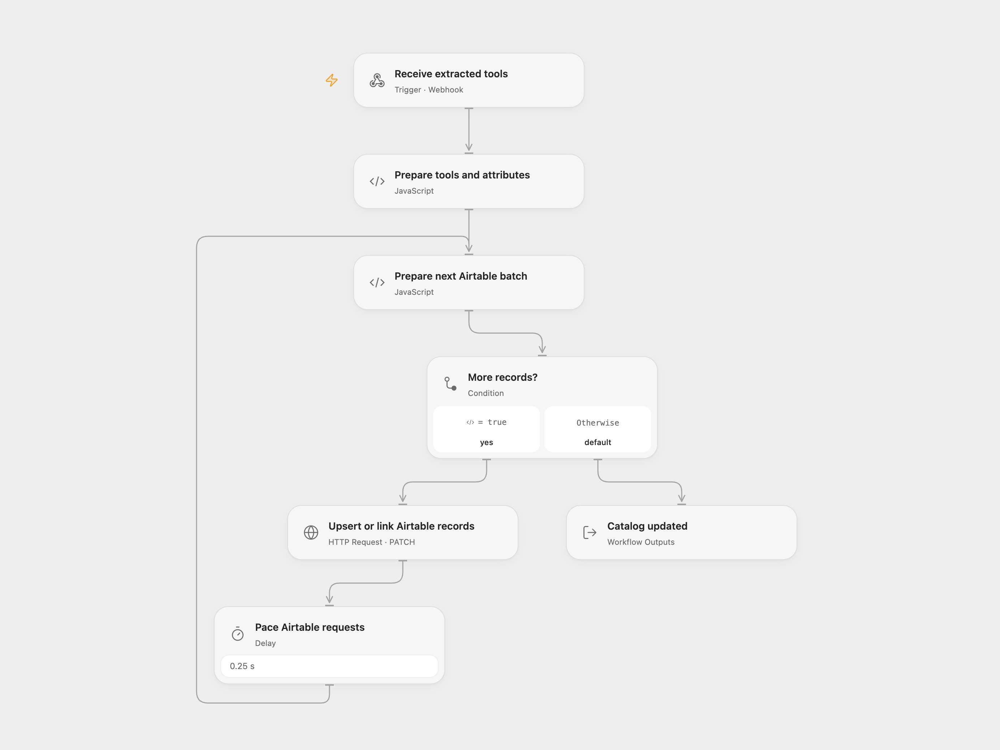

# Catalog Tools from Logo Sheets

Extract tools and relationships from a logo sheet and update linked Airtable records.

<!-- template-actions:start -->
 
<!-- template-actions:end -->

<picture>
  <source media="(prefers-color-scheme: dark)" srcset="preview-dark.png">
  
</picture>

## Setup and use

Create an Airtable base with an Attributes table containing Name and a linked Tools field, and a Tools table containing Name, Hash, linked Attributes and self-linked Similar fields. Configure base and table names in Prepare tools and attributes. Bind AIRTABLE_TOKEN to a personal access token with data read/write access to the base.

Import the n8n workflow and configure its OpenAI credentials and Airtable nodes. The source vision model gpt-4o is scheduled to shut down on January 14, 2027; choose an available vision model before then. For n8n mode enable On form submission and disable Form for Open Flow. For Open Flow mode reverse those settings, set the Open Flow webhook URL in Forward extracted tools and activate n8n. The Open Flow webhook does not authenticate callers; restrict access to trusted senders. Submit a logo sheet image and optional context through the selected form.

## Behavior

The vision model extracts product names, attributes and similar products. Open Flow upserts attributes by Name and tools by the MD5 hash of normalized names, then merges new record links with existing Attributes and Similar links. Requests contain up to ten records each and are spaced by 250 milliseconds. Large extractions must fit workflow input and execution limits. The form and model may not identify every logo correctly; review the extracted catalog.

If an Airtable response is lost, inspect the records before retrying. An interrupted run may already have changed some records. Use one form mode at a time and prevent overlapping runs against the same records.

Inspiration &amp; credits

## Changes to the source

- Keep image intake and vision extraction in n8n; Open Flow handles batched Airtable upserts and linked-record updates. Replace private Airtable IDs and repair the form's optional prompt mapping and preserve attribute updates when no similar tool is found.

Adapted from [Extract Information from a Logo Sheet using forms, AI, Google Sheet and Airtable](https://github.com/enescingoz/awesome-n8n-templates/blob/827110332c21cbe000ab13f6d292d5adb1f1f8db/Google_Drive_and_Google_Sheets/Extract%20Information%20from%20a%20Logo%20Sheet%20using%20forms%2C%20AI%2C%20Google%20Sheet%20and%20Airtable.json) in [enescingoz/awesome-n8n-templates](https://github.com/enescingoz/awesome-n8n-templates).

Source collection notice: © 2024–2026 Enes Cingoz, [CC BY 4.0](https://github.com/enescingoz/awesome-n8n-templates/blob/827110332c21cbe000ab13f6d292d5adb1f1f8db/LICENSE). The source export does not identify a separate template author or license. See [repository licensing](../../README.md#licensing) for the scope of OOMOL contributions and third-party material.

