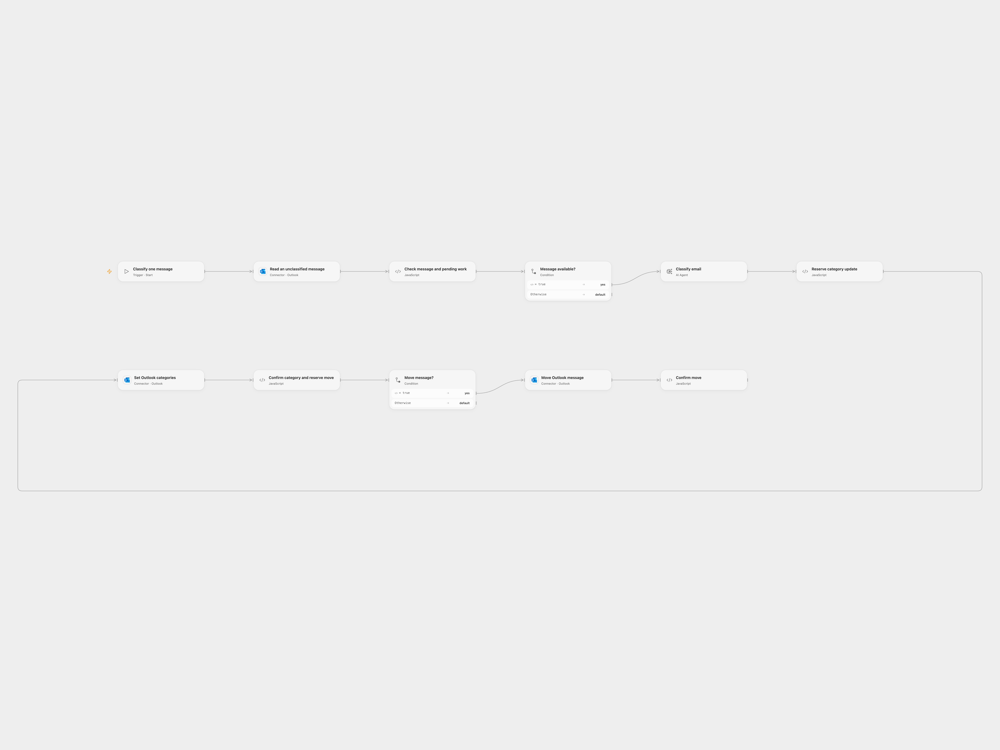

# Categorize Outlook Email with AI

Classify an unflagged Outlook message and move it to a matching folder.

<picture>
  <source media="(prefers-color-scheme: dark)" srcset="preview-dark.png">
  
</picture>

[Open Flow JSON](templates/categorize-outlook-email-with-ai.openflow.json) · [n8n JSON](templates/categorize-outlook-email-with-ai.n8n.json)

## Setup

Connect Outlook with Mail.ReadWrite access and configure a model. Set the source folder in **Read an unclassified message** and folder IDs in **Reserve category update**. Enable persistent State and avoid overlapping runs. In n8n connect Outlook and Ollama, set the input and destination folder IDs, and select a Data Table with item_key and status text columns. Use one format.

## Behavior

A manual run selects up to one message that is unflagged and has no categories. The model chooses action, junk, receipt, SaaS, community, business or other, with an optional subcategory. It updates the message categories. Junk, receipt, SaaS and community move to corresponding folders; action and business move to Actioned only if already read. Other stays in place. Review classifications; email content is sent to the model and may appear in execution history.

If an update or move has an unknown outcome, inspect the message and folders in Outlook and manually finish any missing action. In Open Flow enter the original message ID in **Check message and pending work** to acknowledge reconciliation, run again and clear the field. In n8n inspect the pending Data Table row, complete any missing action manually, then mark the row done. Moves can change message IDs.

Inspiration &amp; credits

Original workflow by [Wayne Simpson](https://www.linkedin.com/in/simpsonwayne/) at [nocodecreative.io](https://nocodecreative.io).

Adapted from [Auto Categorise Outlook Emails with AI](https://github.com/enescingoz/awesome-n8n-templates/blob/827110332c21cbe000ab13f6d292d5adb1f1f8db/Gmail_and_Email_Automation/Auto%20Categorise%20Outlook%20Emails%20with%20AI.json) in [enescingoz/awesome-n8n-templates](https://github.com/enescingoz/awesome-n8n-templates).

Source collection notice: © 2024–2026 Enes Cingoz, [CC BY 4.0](https://github.com/enescingoz/awesome-n8n-templates/blob/827110332c21cbe000ab13f6d292d5adb1f1f8db/LICENSE). The source export does not identify a separate template author or license. See [repository licensing](../../README.md#licensing) for the scope of OOMOL contributions and third-party material.

