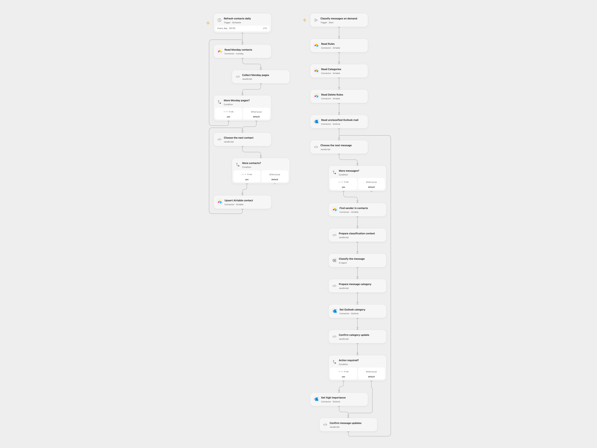

# Categorize Outlook with Contact Context

Classify unflagged Outlook messages using Airtable categories and contacts, and refresh contacts from Monday.

<!-- template-actions:start -->
 
<!-- template-actions:end -->

<picture>
  <source media="(prefers-color-scheme: dark)" srcset="preview-dark.png">
  
</picture>

## Setup and use

Connect Outlook, Monday and Airtable, configure the folder, board and group IDs, Airtable base/table names, and model. Categories need a Name field. Monday contact name and the second and seventh column values are mapped to Airtable First Name, Last Name, Type and Email; adapt those column positions to your board. In n8n configure the corresponding credentials, tables, Outlook folder and Monday board/group. Run mail classification manually; contact sync runs daily at 00:00 UTC in Open Flow. n8n uses its workflow timezone and source schedule.

## Behavior

Each manual run reads up to 10 unflagged, uncategorized messages and uses matching contact, categories and delete rules as model context. It applies one allowed category and sets importance high for Action. The model can be wrong; review changes. The source reads Rules but does not include it in the model prompt. Contact sync reads all available Monday pages for the selected group and upserts by Email. Duplicate Email matches or write errors stop the run. Message and contact data are sent to the model.

An update with an unknown outcome may already have succeeded; check Outlook or Airtable before rerunning. A scheduled contact sync can retry a previously uncertain upsert on its next run.

Inspiration &amp; credits

## Changes to the source

- Replace account-specific IDs, retain manual mail entry and daily contact refresh, and validate model categories against the configured list. Use Outlook and Airtable API requests for the source update and upsert operations.

Adapted from [Microsoft Outlook AI Email Assistant with contact support from Monday and Airtable](https://github.com/enescingoz/awesome-n8n-templates/blob/827110332c21cbe000ab13f6d292d5adb1f1f8db/Gmail_and_Email_Automation/Microsoft%20Outlook%20AI%20Email%20Assistant%20with%20contact%20support%20from%20Monday%20and%20Airtable.json) in [enescingoz/awesome-n8n-templates](https://github.com/enescingoz/awesome-n8n-templates).

Source collection notice: © 2024–2026 Enes Cingoz, [CC BY 4.0](https://github.com/enescingoz/awesome-n8n-templates/blob/827110332c21cbe000ab13f6d292d5adb1f1f8db/LICENSE). The source export does not identify a separate template author or license. See [repository licensing](../../README.md#licensing) for the scope of OOMOL contributions and third-party material.

