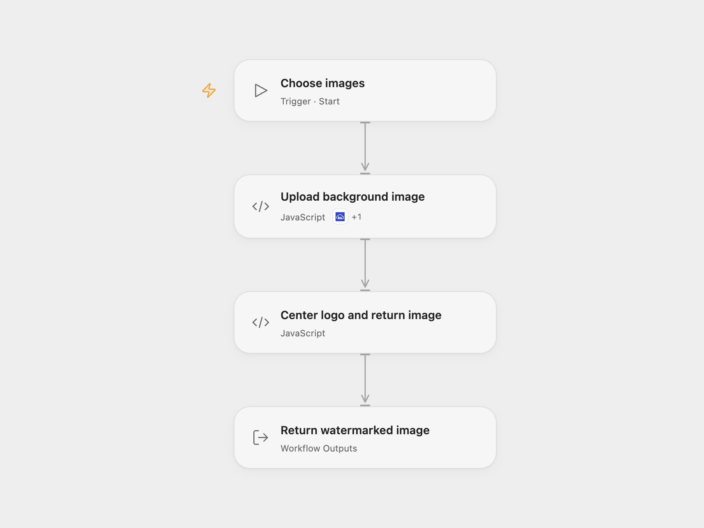

# Center a Logo on an Image

Center a transparent logo over a background image.

<!-- template-actions:start -->
 
<!-- template-actions:end -->

<picture>
  <source media="(prefers-color-scheme: dark)" srcset="preview-dark.png">
  
</picture>

## Setup

Provide two publicly accessible HTTPS image URLs. The overlay must be no larger than the background. Connect Cloudinary in Open Flow.

## Behavior

The logo is centered without scaling. Open Flow uploads the background to Cloudinary, then retrieves a JPEG with the remote overlay. The uploaded background remains in your Cloudinary account. Enable persistent State. A repeated background URL reuses the saved upload; use a new URL if the source image changes. If an upload is uncertain, inspect the account and enter the pending key in **Upload background image**, with resolution absent to retry or confirmed and the verified Cloudinary image URL to continue. Clear the recovery fields afterward.

In n8n

In n8n configure the two image URL nodes and run manually. n8n composites the downloaded images directly.

Inspiration &amp; credits

Open Flow uses Cloudinary to store the background and compose the logo; it checkpoints uploads for recovery. Both formats name the JPEG output with a matching extension.

Adapted from [Center a logo on a background image](https://github.com/Zie619/n8n-workflows/blob/ae8cf6dc5b873cbb4f74587aa9180ed3a9f70682/workflows/Code/0598_Code_Editimage_Update_Webhook.json) in [Zie619/n8n-workflows](https://github.com/Zie619/n8n-workflows). The source export does not identify a separate template author or license.

The collection’s [MIT notice](https://github.com/Zie619/n8n-workflows/blob/94007c1445d9258a7da116646b79473e7c7c3282/LICENSE) is pinned at a later revision. This is the collection notice at that revision; it does not establish a separate original template author's license. Our changes are listed above; see [repository licensing](../../README.md#licensing).

> MIT License
>
> Copyright (c) 2025 Zie619
>
> Permission is hereby granted, free of charge, to any person obtaining a copy
> of this software and associated documentation files (the "Software"), to deal
> in the Software without restriction, including without limitation the rights
> to use, copy, modify, merge, publish, distribute, sublicense, and/or sell
> copies of the Software, and to permit persons to whom the Software is
> furnished to do so, subject to the following conditions:
>
> The above copyright notice and this permission notice shall be included in all
> copies or substantial portions of the Software.
>
> THE SOFTWARE IS PROVIDED "AS IS", WITHOUT WARRANTY OF ANY KIND, EXPRESS OR
> IMPLIED, INCLUDING BUT NOT LIMITED TO THE WARRANTIES OF MERCHANTABILITY,
> FITNESS FOR A PARTICULAR PURPOSE AND NONINFRINGEMENT. IN NO EVENT SHALL THE
> AUTHORS OR COPYRIGHT HOLDERS BE LIABLE FOR ANY CLAIM, DAMAGES OR OTHER
> LIABILITY, WHETHER IN AN ACTION OF CONTRACT, TORT OR OTHERWISE, ARISING FROM,
> OUT OF OR IN CONNECTION WITH THE SOFTWARE OR THE USE OR OTHER DEALINGS IN THE
> SOFTWARE.

