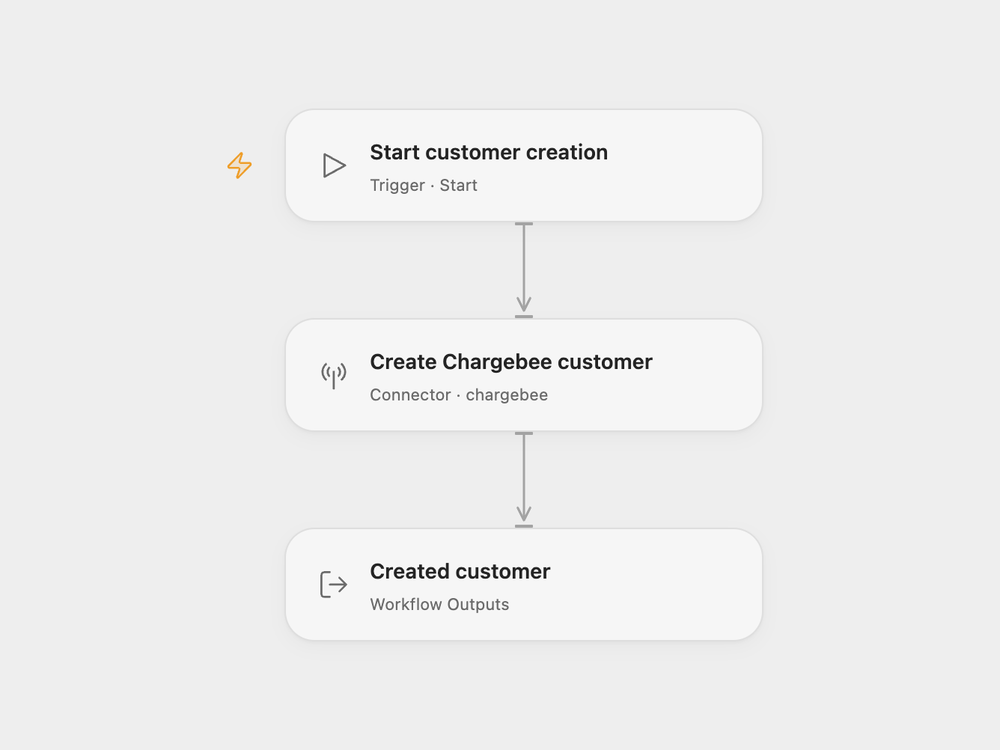

# Chargebee Customer Creator

Create a Chargebee customer with a configured first and last name.

<picture>
  <source media="(prefers-color-scheme: dark)" srcset="preview-dark.png">
  
</picture>

[Open Flow JSON](templates/chargebee-customer-creator.openflow.json) · [n8n JSON](templates/chargebee-customer-creator.n8n.json)

## Setup

Select your Chargebee account in **Create Chargebee customer** and replace the first and last name. The connection manages the site and API key. Run manually after setup.

In n8n, replace the site in **Create Chargebee customer**’s URL and edit the `first_name` and `last_name` body fields. Select a **Basic Auth** credential with your Chargebee API key as the username and an empty password. Keep the API key in the credential.

Each run makes one customer creation request. Chargebee generates the customer ID. The Open Flow result contains normalized customer fields and the full API record under `raw`; n8n returns the API response with its `customer` object. Your site’s automations and connected CRM integrations may also run when the customer is created.

There is no search, upsert, duplicate detection or automatic retry. If creation fails, the workflow stops. If a request times out, check Chargebee before running it again.

Inspiration &amp; credits

## Changes to the source

- Replace the empty name fields with setup placeholders.
- In n8n, send the customer fields as a documented URL-encoded POST body using managed Basic Auth.
- Expose the created customer result.

Adapted from [Create a new customer in Chargebee](https://github.com/Zie619/n8n-workflows/blob/ae8cf6dc5b873cbb4f74587aa9180ed3a9f70682/workflows/Manual/0018_Manual_Chargebee_Create_Triggered.json) in [Zie619/n8n-workflows](https://github.com/Zie619/n8n-workflows). The source export does not identify a separate template author or license.

The collection’s [MIT notice](https://github.com/Zie619/n8n-workflows/blob/94007c1445d9258a7da116646b79473e7c7c3282/LICENSE) is pinned at a later revision. This is the collection notice at that revision; it does not establish a separate original template author's license. Our changes are listed above; see [repository licensing](../../README.md#licensing).

> MIT License
>
> Copyright (c) 2025 Zie619
>
> Permission is hereby granted, free of charge, to any person obtaining a copy
> of this software and associated documentation files (the "Software"), to deal
> in the Software without restriction, including without limitation the rights
> to use, copy, modify, merge, publish, distribute, sublicense, and/or sell
> copies of the Software, and to permit persons to whom the Software is
> furnished to do so, subject to the following conditions:
>
> The above copyright notice and this permission notice shall be included in all
> copies or substantial portions of the Software.
>
> THE SOFTWARE IS PROVIDED "AS IS", WITHOUT WARRANTY OF ANY KIND, EXPRESS OR
> IMPLIED, INCLUDING BUT NOT LIMITED TO THE WARRANTIES OF MERCHANTABILITY,
> FITNESS FOR A PARTICULAR PURPOSE AND NONINFRINGEMENT. IN NO EVENT SHALL THE
> AUTHORS OR COPYRIGHT HOLDERS BE LIABLE FOR ANY CLAIM, DAMAGES OR OTHER
> LIABILITY, WHETHER IN AN ACTION OF CONTRACT, TORT OR OTHERWISE, ARISING FROM,
> OUT OF OR IN CONNECTION WITH THE SOFTWARE OR THE USE OR OTHER DEALINGS IN THE
> SOFTWARE.

