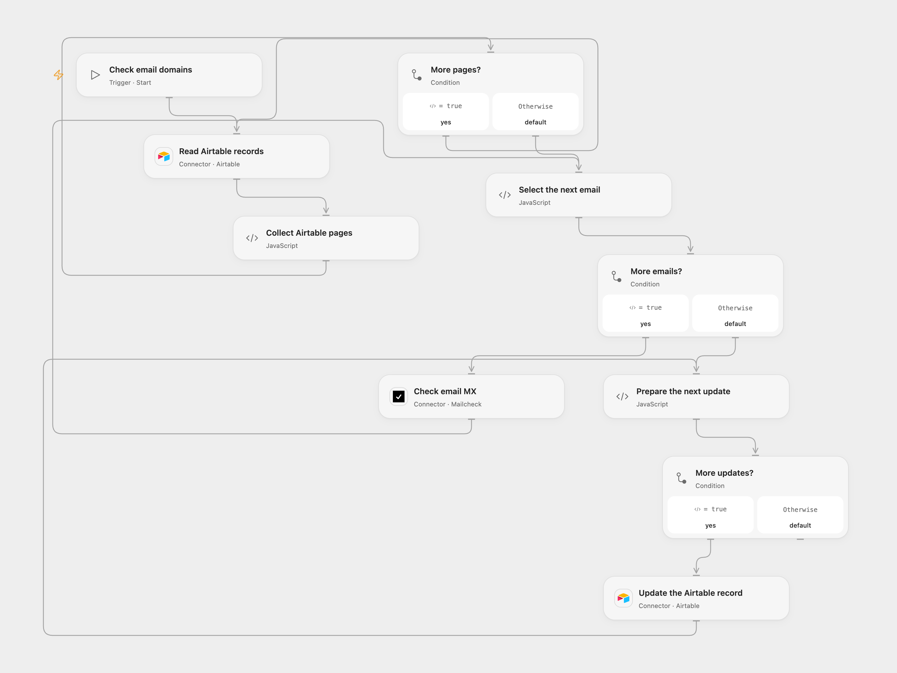

# Check Airtable Email MX Records

Check whether Airtable email domains have MX records and update each record.

<picture>
  <source media="(prefers-color-scheme: dark)" srcset="preview-dark.png">
  
</picture>

[Open Flow JSON](templates/check-airtable-email-mx-records.openflow.json) · [n8n JSON](templates/check-airtable-email-mx-records.n8n.json)

## Setup

Connect Airtable to both Airtable nodes, and set the same base and table IDs. Create a text field `Email` and a checkbox field `Valid`. Connect a UserCheck account to **Check email MX**. In n8n configure the same Airtable table with personal access token credentials on both Airtable nodes and a Header Auth credential named `Authorization` with value `Bearer YOUR_USERCHECK_API_KEY` on **Check email MX**. Run one format manually.

## Behavior

The workflow reads all records, checks each email's domain for MX records, then writes the resulting boolean to that record's `Valid` field. MX records indicate domain mail routing; they do not prove that a mailbox exists or accepts mail. Empty tables cause no writes. A failed or incomplete lookup stops before updates. If an update fails or its result is uncertain, earlier records may already have changed; inspect the table before retrying. The complete record list and results must fit Open Flow's Code input limit.

Inspiration &amp; credits

## Changes to the source

- Add a manual start and configure the table. Use the current UserCheck email endpoint for its MX signal instead of the legacy Mailcheck endpoint. Both formats use the same service.

Adapted from [Check Airtable email domains with Mailcheck](https://github.com/Zie619/n8n-workflows/blob/ae8cf6dc5b873cbb4f74587aa9180ed3a9f70682/workflows/Mailcheck/0026_Mailcheck_Airtable_Monitor.json) in [Zie619/n8n-workflows](https://github.com/Zie619/n8n-workflows). The matching [n8n listing](https://n8n.io/workflows/1055-validate-emails-in-a-table-using-mailcheck/) credits Harshil Agrawal. The original template does not state a separate license.

The collection’s [MIT notice](https://github.com/Zie619/n8n-workflows/blob/94007c1445d9258a7da116646b79473e7c7c3282/LICENSE) is pinned at a later revision. This is the collection notice at that revision; it does not establish a separate original template author's license. Our changes are listed above; see [repository licensing](../../README.md#licensing).

> MIT License
>
> Copyright (c) 2025 Zie619
>
> Permission is hereby granted, free of charge, to any person obtaining a copy
> of this software and associated documentation files (the "Software"), to deal
> in the Software without restriction, including without limitation the rights
> to use, copy, modify, merge, publish, distribute, sublicense, and/or sell
> copies of the Software, and to permit persons to whom the Software is
> furnished to do so, subject to the following conditions:
>
> The above copyright notice and this permission notice shall be included in all
> copies or substantial portions of the Software.
>
> THE SOFTWARE IS PROVIDED "AS IS", WITHOUT WARRANTY OF ANY KIND, EXPRESS OR
> IMPLIED, INCLUDING BUT NOT LIMITED TO THE WARRANTIES OF MERCHANTABILITY,
> FITNESS FOR A PARTICULAR PURPOSE AND NONINFRINGEMENT. IN NO EVENT SHALL THE
> AUTHORS OR COPYRIGHT HOLDERS BE LIABLE FOR ANY CLAIM, DAMAGES OR OTHER
> LIABILITY, WHETHER IN AN ACTION OF CONTRACT, TORT OR OTHERWISE, ARISING FROM,
> OUT OF OR IN CONNECTION WITH THE SOFTWARE OR THE USE OR OTHER DEALINGS IN THE
> SOFTWARE.

