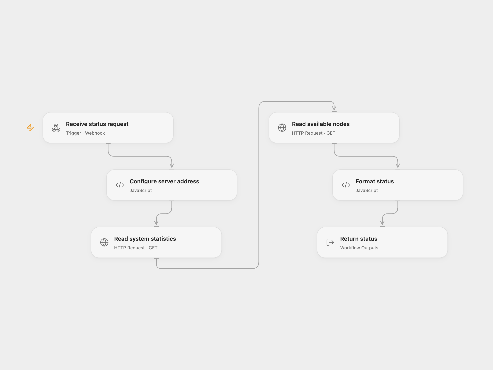

# Check ComfyUI Service Status

Return ComfyUI system statistics and the number of available node types.

<picture>
  <source media="(prefers-color-scheme: dark)" srcset="preview-dark.png">
  
</picture>

[Open Flow JSON](templates/check-comfyui-service-status.openflow.json) · [n8n JSON](templates/check-comfyui-service-status.n8n.json)

## Setup

Set the base URL of your ComfyUI server in **Configure server address**. In n8n set the base URL in **Configure server address**. The source uses the local Docker Compose hostname; the execution platform must be able to reach your configured server. Protect access to both the ComfyUI server and the deployed webhook because the response exposes system information. The template itself does not authenticate requests.

## Behavior

A GET request reads system statistics, then available node definitions, and returns the full statistics object, the number of top-level node types, and example API endpoint URLs. Either failed request stops the run. No automatic retry is configured. The webhook waits up to 60 seconds for the response.

Inspiration &amp; credits

## Changes to the source

- Read the two endpoints in sequence and produce one response, avoiding the original parallel branches both invoking the formatter.
- Replace the local example host with configuration.

Adapted from [ComfyUI Simple Test](https://github.com/Zie619/n8n-workflows/blob/94007c1445d9258a7da116646b79473e7c7c3282/ai-stack/workflows/comfyui-simple-test.json) in [Zie619/n8n-workflows](https://github.com/Zie619/n8n-workflows). The source export does not identify a separate template author or license.

The collection’s [MIT notice](https://github.com/Zie619/n8n-workflows/blob/94007c1445d9258a7da116646b79473e7c7c3282/LICENSE) is pinned at the same revision. This is the collection notice at that revision; it does not establish a separate original template author's license. Our changes are listed above; see [repository licensing](../../README.md#licensing).

> MIT License
>
> Copyright (c) 2025 Zie619
>
> Permission is hereby granted, free of charge, to any person obtaining a copy
> of this software and associated documentation files (the "Software"), to deal
> in the Software without restriction, including without limitation the rights
> to use, copy, modify, merge, publish, distribute, sublicense, and/or sell
> copies of the Software, and to permit persons to whom the Software is
> furnished to do so, subject to the following conditions:
>
> The above copyright notice and this permission notice shall be included in all
> copies or substantial portions of the Software.
>
> THE SOFTWARE IS PROVIDED "AS IS", WITHOUT WARRANTY OF ANY KIND, EXPRESS OR
> IMPLIED, INCLUDING BUT NOT LIMITED TO THE WARRANTIES OF MERCHANTABILITY,
> FITNESS FOR A PARTICULAR PURPOSE AND NONINFRINGEMENT. IN NO EVENT SHALL THE
> AUTHORS OR COPYRIGHT HOLDERS BE LIABLE FOR ANY CLAIM, DAMAGES OR OTHER
> LIABILITY, WHETHER IN AN ACTION OF CONTRACT, TORT OR OTHERWISE, ARISING FROM,
> OUT OF OR IN CONNECTION WITH THE SOFTWARE OR THE USE OR OTHER DEALINGS IN THE
> SOFTWARE.

