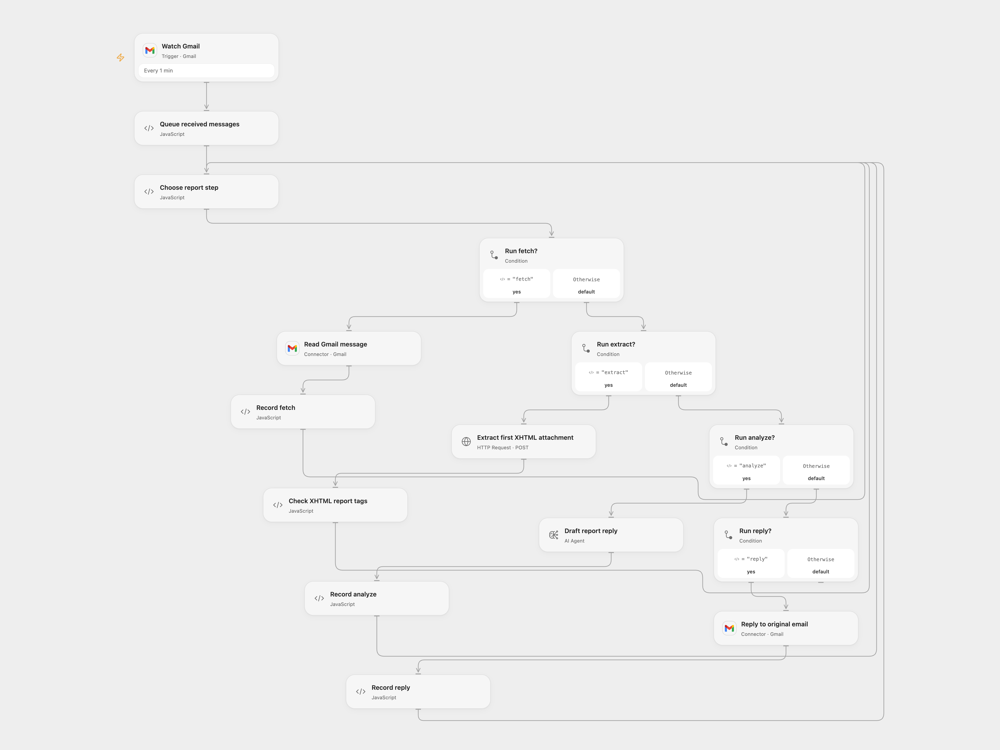

# Check CSRD XHTML Reports by Email

Check selected XHTML report tags and draft an email reply with the findings.

<picture>
  <source media="(prefers-color-scheme: dark)" srcset="preview-dark.png">
  
</picture>

[Open Flow JSON](templates/check-csrd-xhtml-reports-by-email.openflow.json) · [n8n JSON](templates/check-csrd-xhtml-reports-by-email.n8n.json)

## Setup

Connect Gmail and configure an AI model. Import the bundled n8n workflow, connect Gmail to the attachment relay, enable **XHTML attachment webhook**, and set its production HTTPS URL in **Choose report step**. Configure its Header Auth credential as Authorization: Bearer followed by a secret, and bind the same secret as the Open Flow variable N8N_RELAY_TOKEN. Disable the direct n8n email trigger when using Open Flow. Enable persistent State and prevent overlapping executions.

For direct n8n use, leave the relay disabled, connect Gmail and OpenAI, and select one Data Table with text columns item_key and status in the checkpoint nodes. Use only one format.

## Behavior

For each incoming message whose subject contains the case-sensitive text CSRD Reporting, the workflow extracts the first Gmail attachment as text, counts selected XHTML tags and duplicates, asks the model to summarize the findings, and replies to the original message. Attach an XHTML report as the first attachment. These pattern checks are a limited heuristic, not a CSRD or XBRL compliance audit. Review the generated reply. Report contents and findings are processed by n8n and the model provider; protect execution history.

If a reply outcome is unknown, inspect Gmail Sent before retrying. In **Choose report step**, enter the pending key and set resolution to confirmed if sent or absent if not, run another poll, and clear the fields. In n8n inspect the pending Data Table row, mark it done if sent or delete it only after confirming no reply was sent.

Inspiration &amp; credits

Reconnected the missing attachment path and corrected the reply reference. Added an authenticated extraction relay and reply checkpoint.

Adapted from [CSRD XHTML report email checks](https://github.com/Zie619/n8n-workflows/blob/ae8cf6dc5b873cbb4f74587aa9180ed3a9f70682/workflows/Extractfromfile/0828_Extractfromfile_Gmail_Send_Triggered.json) in [Zie619/n8n-workflows](https://github.com/Zie619/n8n-workflows). The source export does not identify a separate template author or license.

The collection’s [MIT notice](https://github.com/Zie619/n8n-workflows/blob/94007c1445d9258a7da116646b79473e7c7c3282/LICENSE) is pinned at a later revision. This is the collection notice at that revision; it does not establish a separate original template author's license. Our changes are listed above; see [repository licensing](../../README.md#licensing).

> MIT License
>
> Copyright (c) 2025 Zie619
>
> Permission is hereby granted, free of charge, to any person obtaining a copy
> of this software and associated documentation files (the "Software"), to deal
> in the Software without restriction, including without limitation the rights
> to use, copy, modify, merge, publish, distribute, sublicense, and/or sell
> copies of the Software, and to permit persons to whom the Software is
> furnished to do so, subject to the following conditions:
>
> The above copyright notice and this permission notice shall be included in all
> copies or substantial portions of the Software.
>
> THE SOFTWARE IS PROVIDED "AS IS", WITHOUT WARRANTY OF ANY KIND, EXPRESS OR
> IMPLIED, INCLUDING BUT NOT LIMITED TO THE WARRANTIES OF MERCHANTABILITY,
> FITNESS FOR A PARTICULAR PURPOSE AND NONINFRINGEMENT. IN NO EVENT SHALL THE
> AUTHORS OR COPYRIGHT HOLDERS BE LIABLE FOR ANY CLAIM, DAMAGES OR OTHER
> LIABILITY, WHETHER IN AN ACTION OF CONTRACT, TORT OR OTHERWISE, ARISING FROM,
> OUT OF OR IN CONNECTION WITH THE SOFTWARE OR THE USE OR OTHER DEALINGS IN THE
> SOFTWARE.

